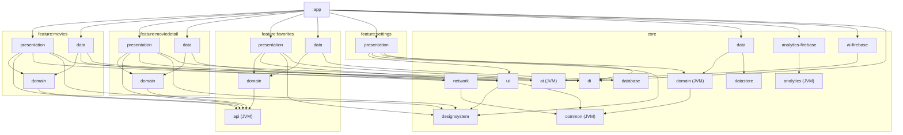
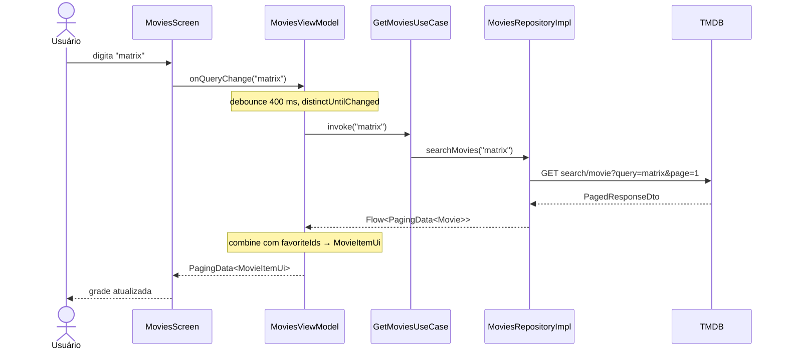
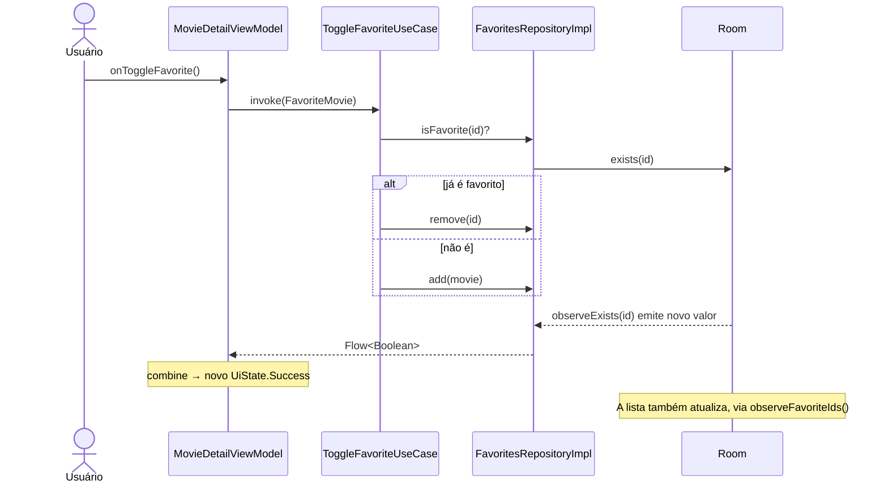

# Movies App — Documento de Arquitetura

> Versão 1.11 · 01/11/2026 · projeto **MyFavoriteFilms** (`com.faas.myfavoritefilms`)
> App Android de filmes (API TMDB) em Jetpack Compose, monorepo multi-módulo, Clean Architecture sobre o guia oficial de arquitetura do Google, DI com **Dagger 2 puro**.

Este documento descreve **como o projeto é estruturado e por quê**. Traz os contratos, as regras e os trechos de código representativos.

**Mapa da documentação:** [`AGENTS.md`](AGENTS.md) (regras em uma página, lido por agentes de IA) · [`docs/`](docs/README.md) (onboarding, guias passo a passo, referência, diagramas) · [`docs/decisions/`](docs/decisions/README.md) (uma ADR por arquivo) · [`.agents/skills/`](.agents/skills) (procedimentos para agentes). Este documento continua sendo a referência completa com código.

**Estado atual (v1.11):** documentação para pessoas e agentes de IA em padrões abertos: `AGENTS.md` aninhados, skills em `.agents/skills/` (Agent Skills), ADRs em `docs/decisions/` (MADR), guias em `docs/` (Diátaxis), scripts de verificação e hook de segredos em `scripts/`. Antes disso, repositórios falam com data sources local/remoto, nunca direto com DAO ou Retrofit (ADR-18); favoritos como feature com módulo `api` público + `domain`/`data`/`presentation` (ADR-17), no mesmo padrão das outras features, e tracking assíncrono numa fila serializada (seção 7.11); antes disso, busca em linguagem natural com IA (Gemini via Firebase AI Logic, seção 7.13) e app funcional com 4 features (`movies`, `moviedetail` com SDUI incluindo elenco e trailers, `favorites`, `settings`), bottom bar, **preferências de tema e idioma com DataStore** (seção 7.12), estratégia de testes completa (seção 13) e **tracking com Firebase Analytics + Crashlytics** (seção 7.11). Quando código e documento divergirem, **o código é a fonte da verdade** e este documento deve ser atualizado.

---

## Sumário

1. [Escopo do app](#1-escopo-do-app)
2. [Decisões de arquitetura](#2-decisões-de-arquitetura)
3. [Stack](#3-stack)
4. [Estrutura do monorepo](#4-estrutura-do-monorepo)
5. [Grafo e regras de dependência](#5-grafo-e-regras-de-dependência)
6. [Integração com a TMDB](#6-integração-com-a-tmdb)
7. [Módulos core](#7-módulos-core) (inclui SDUI 7.10, tracking 7.11 e preferências 7.12)
8. [Feature: movies (lista + busca)](#8-feature-movies-lista--busca)
9. [Feature: moviedetail (detalhe + favoritar)](#9-feature-moviedetail-detalhe--favoritar)
10. [Navegação, DI e módulo app](#10-navegação-di-e-módulo-app)
11. [Tratamento de erros](#11-tratamento-de-erros)
12. [Build: Gradle, build-logic e convention plugins](#12-build-gradle-build-logic-e-convention-plugins)
13. [Testes](#13-testes)
14. [Convenções de código](#14-convenções-de-código)
15. [Passo a passo e estado do projeto](#15-passo-a-passo-e-estado-do-projeto)
16. [Evoluções futuras](#16-evoluções-futuras)

---

## 1. Escopo do app

| Funcionalidade | Descrição | Onde vive |
|---|---|---|
| Lista de filmes | Filmes populares com rolagem infinita (paginação) | `feature:movies` |
| Busca por título | Campo de busca na própria tela da lista. Com busca vazia, mostra populares. Com texto, mostra o resultado da busca | `feature:movies` |
| Busca com IA | Modo "Buscar com IA": o usuário descreve o filme ("suspense dos anos 90 bem avaliado"), o Gemini converte em filtros e o app busca no `discover/movie`. Filtros viram chips removíveis; se a IA falhar, cai na busca por título | `feature:movies` + `core:ai` + `core:ai-firebase` |
| Detalhe do filme | Pôster, backdrop, título, tagline, ano, duração, nota, gêneros e sinopse | `feature:moviedetail` |
| Favoritar | Botão de favorito no detalhe e indicador/atalho na lista. Persistido localmente | `feature:favorites:api` (contrato) + `feature:favorites:domain`/`data` + `core:database` |
| Tela de favoritos | Grade com todos os favoritos, mesmo card da lista principal; desfavoritar remove com animação | `feature:favorites:presentation` |
| Informações server-driven | Bloco do detalhe montado a partir de um payload de SDUI (ficha técnica, elenco, trailers, produtoras, países, links) | `core:common/sdui` + `core:network/sdui` + `core:ui/sdui` |
| Ajustes | Tema (sistema/claro/escuro), cor dinâmica (Android 12+) e idioma do app (sistema/pt-BR/en), persistidos com DataStore | `feature:settings:presentation` + `core:domain` + `core:data` + `core:datastore` |

Fora do escopo desta versão: login TMDB, cache offline dos filmes, backend real de SDUI (hoje simulado, seção 7.10).

---

## 2. Decisões de arquitetura

Resumo das decisões. Quando alguém do time perguntar "por que é assim?", a resposta está aqui; o registro completo de cada uma (contexto, opções, consequências e como é confirmada) está em [`docs/decisions/`](docs/decisions/README.md), no formato MADR, com a numeração de quatro dígitos (ADR-17 = `0017`).

| # | Decisão | Motivo | Alternativa descartada |
|---|---|---|---|
| ADR-01 | Camadas do guia do Google (UI, Domain, Data) com nomenclatura `presentation` / `domain` / `data` | Alinhamento com a documentação oficial: UDF, StateFlow, repositórios e use cases | — |
| ADR-02 | **Domain obrigatório e Kotlin puro (módulo JVM)**, definindo as interfaces de repositório. O data implementa (inversão de dependência) | Clean Architecture: regra de negócio não conhece Android, Retrofit ou Room. Testes de domínio rodam na JVM, em milissegundos | Modelo do Google em que o domain depende do data (domain opcional) |
| ADR-03 | **Cada feature tem 3 módulos Gradle** (`domain`, `data`, `presentation`) | O compilador garante as fronteiras. Uma feature não consegue importar o que não declarou | Modelo Now in Android (feature só UI e camadas em `core`). É mais simples, mas isola menos |
| ADR-04 | **ViewModel só conversa com use cases**, nunca com repositório | Regra única, sem exceções, fácil de revisar em PR | Permissão do guia do Google para acesso direto ao repositório |
| ADR-05 | **Feature nunca depende de outra feature.** O que é compartilhado sobe para `core` | Evita acoplamento lateral e ciclos | — |
| ADR-06 | ~~Favoritos em `core:domain` + `core:data`~~ **Substituída pela ADR-17** | Era a única forma de duas features usarem a mesma regra sem depender uma da outra | — |
| ADR-07 | **Paging 3** para lista e busca, com `paging-common` (JVM) no domain | A API da TMDB é paginada. Paging é a solução oficial do Google para listas paginadas | Paginação manual no ViewModel |
| ADR-08 | **Navigation Compose com rotas type-safe** (`@Serializable`). Só o módulo `app` conhece todas as rotas | Recomendação atual do Google. As features expõem extensões de `NavGraphBuilder` | Navigation 3 (válido, ver seção 16) |
| ADR-09 | **Dagger 2 puro** (sem Hilt) para DI, com KSP | Controle explícito do grafo: `AppComponent` raiz + `ViewModelComponent` (subcomponente por ViewModel com `SavedStateHandle`). Nada de mágica de geração agregada | Hilt (menos código, porém esconde o grafo); Koin |
| ADR-10 | Filmes **online** (sem cache). Favoritos **offline** em Room | Escopo da v1. O cache dos filmes entra depois com `RemoteMediator` sem quebrar contratos | Offline-first completo desde o início |
| ADR-11 | Token TMDB em `local.properties` → `BuildConfig` do `core:network` | Fora do controle de versão e simples para desenvolvimento | Hardcode no código |
| ADR-12 | **Módulo `core:di`** com `ViewModelKey`, `DaggerViewModelFactory` e `daggerViewModel()` | É o equivalente ao que o Hilt daria pronto. Fica no core para todas as `presentation` usarem sem conhecer o `:app` | Factory por feature (duplicação) |
| ADR-14 | **Server-Driven UI genérico no core**: modelo em `core:common`, parser em `core:network`, renderer em `core:ui`. Cada feature só produz/consome `List<SduiComponent>` | Qualquer tela pode ter blocos dirigidos pelo servidor sem duplicar parser/renderer; tipos desconhecidos são ignorados (o backend pode evoluir antes do app) | SDUI dentro da feature (não reutilizável) |
| ADR-15 | **Componentes de lista compartilhados em `core:ui/movie`** (`MovieCardUi`, `MovieCard`, `MovieGrid`, skeletons) | Lista principal e favoritos têm o mesmo card. Pela ADR-05, o que duas features usam sobe para o core | Cada feature com seu card (duplicação) |
| ADR-16 | **Tracking por multibinding** (`@IntoSet`/`@ElementsIntoSet`): features usam só `Analytics`/`ErrorReporter` (`core:analytics`, JVM); cada destino (Firebase, Crashlytics, Logcat em debug) se registra num `Set` | Trocar ou somar ferramentas de analytics sem tocar nas features; destinos por build type sem `if (DEBUG)`; testes com `TestAnalytics` | Chamar o SDK do Firebase direto nas features |
| ADR-17 | **Módulo `api` para features consumidas por outras features** (hoje só `favorites`): `:feature:favorites:api` (JVM) publica `FavoriteMovie` e interfaces finas de use case (`ObserveFavoriteIdsUseCase`, `ObserveIsFavoriteUseCase`, `ToggleFavoriteUseCase`). A feature mantém os três módulos de camada da ADR-03 (`domain` implementa as interfaces do `api`, `data` tem o Room e o `FavoritesDataModule`, `presentation` tem a tela). Outras features dependem só do `:api`; só o `:app` conhece `domain`/`data`/`presentation` dos favoritos | Dependency Inversion e Interface Segregation entre módulos; o core volta a ter só regra transversal; compile avoidance; Stable Abstractions/Stable Dependencies. O `api` resolve a visibilidade entre features e as camadas resolvem a organização interna: são ortogonais | Favoritos no core (ADR-06); um único `:impl` com as camadas em pacotes (quebrava o padrão da ADR-03 e trocava a garantia do compilador pela do Konsist); `api` em todas as features (módulos vazios) |
| ADR-18 | **Repositórios dependem de data sources, nunca direto de DAO ou de API Retrofit**: `FavoritesLocalDataSource` (encapsula o `FavoriteMovieDao`), `MoviesRemoteDataSource` (`MoviesApi`), `MovieDetailRemoteDataSource` (`MovieDetailApi`); as preferências já seguiam o padrão com o `UserPreferencesDataSource`. Data sources ficam em `data/datasource`, são `internal`, falam com uma única fonte e devolvem modelos da camada de dados (entity, DTO); o repositório mapeia para o domínio e decide a política (cache, timestamps, erros) | Formato recomendado pelo [guia de data layer](https://developer.android.com/topic/architecture/data-layer) (nomes `<Tipo>Local/RemoteDataSource`); repositório focado em orquestração; ponto de extensão para combinar remoto + local (cache offline); consistência entre os repositórios | Injetar DAO/API direto no repositório (o guia também aceita quando há uma fonte só e nenhuma lógica extra; descartado por consistência e evolução) |
| ADR-13 | **Módulos Dagger em par público + interno**: `@Module(includes = [XxxBindsModule::class]) object XxxModule` público, bindings em `internal` | Com Dagger puro o `AppComponent` precisa referenciar o módulo; o par mantém implementações, DTOs e interceptors `internal` (regra 5.2.2) | Deixar tudo público |

---

## 3. Stack

| Área | Tecnologia |
|---|---|
| Linguagem | Kotlin 2.4 (Kotlin embutido no AGP 9, sem plugin `kotlin-android`) |
| Build | Gradle 9.6, AGP 9.4, version catalog, convention plugins em `build-logic`, type-safe project accessors |
| UI | Jetpack Compose (BOM 2026.09.00), Material 3, single Activity |
| Estado | ViewModel + `StateFlow`, UDF, `collectAsStateWithLifecycle` |
| Navegação | Navigation Compose 2.10 (type-safe) |
| DI | Dagger 2.60 puro com KSP (sem Hilt) |
| Rede | Retrofit 3 + OkHttp 5 + kotlinx.serialization |
| Paginação | Paging 3 |
| Persistência | Room 2.8 (favoritos) |
| Imagens | Coil 3 |
| Async | Coroutines + Flow |
| Testes | JUnit4, coroutines-test, Turbine, paging-testing, MockWebServer, Robolectric 4.17, Compose UI Test, Roborazzi, Konsist, AndroidX Test + Orchestrator, Kover, module-graph-assert, fakes |
| SDK | minSdk 26 · targetSdk 37 · compileSdk 37 |

`minSdk 26` foi escolhido para usar `java.time` (LocalDate) sem desugaring.

---

## 4. Estrutura do monorepo

```
film-search-android/
├── app/                                   # Shell: Application, MainActivity, NavHost, AppComponent/ViewModelComponent (Dagger)
├── build-logic/
│   ├── settings.gradle.kts
│   └── convention/
│       ├── build.gradle.kts
│       └── src/main/kotlin/               # Convention plugins (seção 12)
├── core/
│   ├── common/          (JVM)             # AppResult, DomainError, DomainException
│   ├── domain/          (JVM)             # Regras transversais: preferências (tema, idioma)
│   ├── data/            (Android)         # Implementação dos repositórios compartilhados
│   ├── network/         (Android)         # Retrofit, OkHttp, interceptors, safeApiCall, TmdbImages
│   ├── database/        (Android)         # Room: AppDatabase, entities, DAOs
│   ├── datastore/       (Android)         # DataStore Preferences: UserPreferencesDataSource
│   ├── designsystem/    (Android+Compose) # Tema, cores, tipografia, componentes base, MoviePoster
│   ├── ui/              (Android+Compose) # Componentes de estado (loading/erro/vazio), mensagens de erro
│   ├── di/              (Android+Compose) # ViewModelKey, DaggerViewModelFactory, daggerViewModel()
│   ├── analytics/       (JVM)             # Analytics, ErrorReporter, eventos; composites com Set<Tracker>
│   ├── analytics-firebase/ (Android)      # SDK do Firebase para Analytics + Crashlytics
│   ├── ai/              (JVM)             # Contrato de IA: AiJsonGenerator, AiSchema, AiException
│   ├── ai-firebase/     (Android)         # Gemini via Firebase AI Logic + App Check (debug/release)
│   └── testing/         (JVM)             # MainDispatcherRule, fakes dos contratos de core
├── feature/                               # README.md com o checklist de nova feature
│   ├── favorites/
│   │   ├── api/           (JVM)             # contrato público: FavoriteMovie + interfaces de use case (+ testFixtures: FakeFavorites)
│   │   ├── domain/        (JVM)             # FavoritesRepository, *UseCaseImpl (implementam o api), ObserveFavoritesUseCase (+ testFixtures)
│   │   ├── data/          (Android)         # FavoritesRepositoryImpl (Room) e FavoritesDataModule
│   │   └── presentation/  (Android+Compose) # FavoritesViewModel, tela e navegação
│   ├── movies/
│   │   ├── domain/        (JVM)
│   │   ├── data/          (Android)
│   │   └── presentation/  (Android+Compose)
│   ├── moviedetail/
│   │   ├── domain/        (JVM)
│   │   ├── data/          (Android)
│   │   └── presentation/  (Android+Compose)
│   └── settings/
│       └── presentation/  (Android+Compose) # só UI: regras de preferências estão no core
├── architecture-test/  (JVM)            # Konsist: regras de arquitetura sobre o código-fonte
├── .agents/skills/                        # Skills de agente (padrão Agent Skills): feature-builder, data-integrator, compose-ui, ...
├── .github/
│   ├── workflows/ci.yml                   # CI: docs, grafo, Konsist, testes JVM, screenshots, lint, Kover, emulador
│   ├── pull_request_template.md           # Definição de pronto
│   └── ISSUE_TEMPLATE/feature-spec.md     # Especificação de feature para pessoas e agentes
├── docs/                                  # Tutoriais, how-to, referência, explicação e ADRs (docs/README.md)
├── scripts/                               # verify.sh, verify-module.sh, record-screenshots.sh, check-docs.py, git-hooks/
├── AGENTS.md                              # Instruções para agentes (também em app/, core/, feature/, build-logic/, architecture-test/)
├── gradle/
│   ├── libs.versions.toml
│   └── wrapper/gradle-wrapper.properties
├── build.gradle.kts
├── settings.gradle.kts
├── gradle.properties
└── local.properties                       # NÃO versionado: TMDB_ACCESS_TOKEN
```

### 4.1 Pacotes por módulo

Pacote base: `com.faas.myfavoritefilms`.

| Módulo | Tipo | Namespace / pacote |
|---|---|---|
| `:app` | Android app | `com.faas.myfavoritefilms` |
| `:core:common` | JVM | `com.faas.myfavoritefilms.core.common` |
| `:core:domain` | JVM | `com.faas.myfavoritefilms.core.domain` |
| `:core:data` | Android lib | `com.faas.myfavoritefilms.core.data` |
| `:core:network` | Android lib | `com.faas.myfavoritefilms.core.network` |
| `:core:database` | Android lib | `com.faas.myfavoritefilms.core.database` |
| `:core:datastore` | Android lib | `com.faas.myfavoritefilms.core.datastore` |
| `:core:designsystem` | Android lib | `com.faas.myfavoritefilms.core.designsystem` |
| `:core:ui` | Android lib | `com.faas.myfavoritefilms.core.ui` |
| `:core:di` | Android lib | `com.faas.myfavoritefilms.core.di` |
| `:core:analytics` | JVM | `com.faas.myfavoritefilms.core.analytics` |
| `:core:analytics-firebase` | Android lib | `com.faas.myfavoritefilms.core.analytics.firebase` |
| `:core:ai` | JVM | `com.faas.myfavoritefilms.core.ai` |
| `:core:ai-firebase` | Android lib | `com.faas.myfavoritefilms.core.ai.firebase` |
| `:core:testing` | JVM | `com.faas.myfavoritefilms.core.testing` |
| `:feature:movies:domain` | JVM | `com.faas.myfavoritefilms.feature.movies.domain` |
| `:feature:movies:data` | Android lib | `com.faas.myfavoritefilms.feature.movies.data` |
| `:feature:movies:presentation` | Android lib | `com.faas.myfavoritefilms.feature.movies.presentation` |
| `:feature:moviedetail:domain` | JVM | `com.faas.myfavoritefilms.feature.moviedetail.domain` |
| `:feature:moviedetail:data` | Android lib | `com.faas.myfavoritefilms.feature.moviedetail.data` |
| `:feature:moviedetail:presentation` | Android lib | `com.faas.myfavoritefilms.feature.moviedetail.presentation` |
| `:feature:favorites:api` | JVM | `com.faas.myfavoritefilms.feature.favorites.api` |
| `:feature:favorites:domain` | JVM | `com.faas.myfavoritefilms.feature.favorites.domain` |
| `:feature:favorites:data` | Android lib | `com.faas.myfavoritefilms.feature.favorites.data` |
| `:feature:favorites:presentation` | Android lib | `com.faas.myfavoritefilms.feature.favorites.presentation` |
| `:feature:settings:presentation` | Android lib | `com.faas.myfavoritefilms.feature.settings.presentation` |
| `:architecture-test` | JVM | `com.faas.myfavoritefilms.architecture` |

### 4.2 Estrutura interna padrão de uma feature

```
feature/<nome>/
├── domain/src/main/kotlin/.../domain/
│   ├── model/            # Modelos de negócio (data classes imutáveis)
│   ├── repository/       # Interfaces (contratos)
│   └── usecase/          # Um use case por ação
├── data/src/main/kotlin/.../data/
│   ├── remote/
│   │   ├── api/          # Interface Retrofit
│   │   └── dto/          # @Serializable DTOs (nunca saem do módulo)
│   ├── paging/           # PagingSource (quando houver)
│   ├── mapper/           # Dto -> Domain
│   ├── repository/       # Implementações (internal)
│   └── di/               # @Module Dagger: par público + internal (ADR-13)
└── presentation/src/main/kotlin/.../presentation/
    ├── di/               # @Module com @Binds @IntoMap @ViewModelKey dos ViewModels
    ├── navigation/       # Rota @Serializable + extensões NavGraphBuilder/NavController
    ├── model/            # Modelos de UI + mappers Domain -> UI
    ├── <Tela>UiState.kt
    ├── <Tela>ViewModel.kt
    └── <Tela>Screen.kt   # Screen (stateful) + Content (stateless) + Previews
```

---

## 5. Grafo e regras de dependência



Simplificado; outras visões (camadas, DI, fluxos de lista, IA e erros) em [docs/explanation/architecture.md](docs/explanation/architecture.md).

### 5.1 Matriz de dependências permitidas

| Módulo | Pode depender de | Proibido |
|---|---|---|
| `feature:x:domain` | `core:common`, `core:domain`, `paging-common`, `coroutines-core`, `javax.inject` | Android SDK, Retrofit, Room, Compose, qualquer `data`/`presentation`, outra feature |
| `feature:x:data` | `feature:x:domain`, `core:network`, `core:common` | `presentation`, outra feature, `core:database`* |
| `feature:x:presentation` | `feature:x:domain`, `core:domain`, `core:ui`, `core:designsystem`, `core:common`, `core:di` | `data` de qualquer módulo, `core:network`, `core:database`, `core:datastore`, outra feature |
| `feature:x:api` | `core:common`, `coroutines-core` | Android, Dagger, qualquer `core` de infraestrutura, os próprios `domain`/`data`/`presentation` |
| consumidor de outra feature | `feature:y:api` | `feature:y:domain`, `feature:y:data`, `feature:y:presentation` |
| `core:domain` | `core:common` | qualquer `feature`, Android |
| `core:data` | `core:domain`, `core:database`, `core:datastore`, `core:common` | qualquer `feature` |
| `core:network` / `core:database` / `core:datastore` | `core:common` | qualquer `feature`, `core:domain`, `core:data` |
| `core:ui` | `core:designsystem`, `core:common` | qualquer `feature`, `domain`, `data` |
| `core:di` | Dagger, lifecycle-viewmodel | qualquer outro módulo do projeto |
| `core:analytics` | `core:common` | Android, Firebase, qualquer `feature` |
| `core:analytics-firebase` | `core:analytics`, SDK do Firebase | qualquer `feature` |
| `core:ai` | nada (JVM puro) | Android, Firebase, qualquer `feature` |
| `core:ai-firebase` | `core:ai`, SDK do Firebase (AI Logic, App Check) | qualquer `feature` |
| `feature:x:data` | + `core:ai` (só o contrato) | `core:ai-firebase` (grafo e Konsist garantem) |
| `feature:x:data` / `feature:x:presentation` | + `core:analytics` (só as interfaces) | SDK do Firebase (Konsist garante) |
| `:app` | todos os `presentation` e `data`, `core:data`, `core:network`, `core:database`, `core:datastore`, `core:ai-firebase`, `core:di`, `core:designsystem`, `core:ui` | — |

\* Se uma feature precisar de cache próprio, crie a entity e o DAO em `core:database`. A dependência então é permitida e deve ser registrada aqui.

### 5.2 Regras de ouro

1. **DTOs, entities e `Retrofit`/`Room` nunca atravessam a fronteira do módulo `data`.** O que sai é modelo de domínio.
2. **Implementações são `internal`.** Num módulo `data`, o único tipo público é o `@Module` agregador (ADR-13), que só faz `includes` do módulo interno.
3. **O `:app` depende dos módulos `data` apenas para o `AppComponent` instalar os módulos Dagger deles.** O `app` não chama nada deles diretamente.
4. **Duas features precisando da mesma coisa → sobe para `core`.** Nunca `implementation(projects.feature.outra...)`.
5. **Uso de `api(...)` só quando o tipo aparece na API pública do módulo.** Exemplo: o domain expõe `AppResult`, então usa `api(projects.core.common)`.
6. **Repositório nunca recebe DAO nem API Retrofit no construtor** (ADR-18). Ele depende de um `<Tipo>LocalDataSource` ou `<Tipo>RemoteDataSource` do pacote `data/datasource`. O Konsist garante.

---

## 6. Integração com a TMDB

### 6.1 Autenticação

Use o **API Read Access Token** (Bearer), e não a API key na query string. A TMDB aceita os dois com o mesmo nível de acesso, mas o header mantém o token fora das URLs e dos logs.

```
Authorization: Bearer <API_READ_ACCESS_TOKEN>
```

**Guardando o token.** Só o *API Read Access Token* é usado. A *API Key* (v3) não entra no projeto: uma credencial a menos para vazar.

| Ambiente | Onde fica | Como chega ao build |
|---|---|---|
| Máquina do dev | `local.properties` (no `.gitignore`, compartilhado entre devs por canal seguro, nunca pelo repo) | `TMDB_ACCESS_TOKEN=...` |
| CI (GitHub Actions) | *Repository secret* `TMDB_ACCESS_TOKEN` | `env: TMDB_ACCESS_TOKEN: ${{ secrets.TMDB_ACCESS_TOKEN }}` no workflow |

O `core/network/build.gradle.kts` lê primeiro o `local.properties` e, se não achar, a variável de ambiente, ambos via `providers` (compatível com o configuration cache). O valor vira `BuildConfig.TMDB_ACCESS_TOKEN`, usado só pelo `TmdbAuthInterceptor`. Se estiver vazio, o build avisa e as chamadas retornam 401 (`DomainError.Unauthorized`).

Camadas de proteção que já existem:
- o token nunca está no Git (nem em `gradle.properties`, que é versionado);
- vai no header `Authorization`, não na URL, e o log de debug faz `redactHeader("Authorization")`;
- o logging HTTP só existe em `debug`; o `release` usa R8.

**Opções avaliadas**

| Opção | Segurança real | Quando usar |
|---|---|---|
| `local.properties` + `BuildConfig` (**adotado**) | Fora do Git, mas **extraível do APK** | Dev, portfólio, APIs gratuitas e só leitura (caso da TMDB) |
| Secrets Gradle Plugin (Google) | Igual ao anterior; só automatiza a leitura | Equivalente; não adotado para evitar mais um plugin |
| Ofuscação (NDK/C++, XOR, strings cifradas) | Atrasa engenharia reversa, não impede | Não vale a complexidade aqui |
| **Backend/proxy próprio** (ex.: Cloud Function) guardando o token + Play Integrity/App Check | **Único que tira o segredo do app** | Produção com chave paga ou sensível |

> ⚠️ Qualquer segredo embutido no APK pode ser extraído. Para a TMDB (token gratuito e só de leitura) o risco é aceitável. Se o token vazar, gere outro em *Settings → API* na TMDB e atualize o `local.properties` e o secret do GitHub.

### 6.2 Endpoints usados

Base URL: `https://api.themoviedb.org/3/`

| Uso | Método | Endpoint | Parâmetros |
|---|---|---|---|
| Populares | GET | `movie/popular` | `page` |
| Busca por título | GET | `search/movie` | `query`, `page`, `include_adult=false` |
| Busca com IA | GET | `discover/movie` | `page`, `sort_by`, `with_genres` (separados por vírgula = todos), `primary_release_date.gte/lte`, `vote_average.gte`, `vote_count.gte`, `include_adult=false` |
| Gêneros | GET | `genre/movie/list` | — (no idioma do aparelho; cache em memória por idioma) |
| Detalhe | GET | `movie/{movie_id}` | `append_to_response=credits,videos` (elenco e vídeos na mesma chamada) |

O parâmetro `language` (ex.: `pt-BR`) é adicionado automaticamente por um interceptor, a partir do locale do aparelho, para os títulos e sinopses virem traduzidos quando houver tradução.

Respostas paginadas têm o formato `{ page, results[], total_pages, total_results }` e 20 itens por página. A TMDB limita a navegação a 500 páginas, e o `PagingSource` respeita esse teto.

### 6.3 Imagens

A API devolve só o caminho (`poster_path: "/abc.jpg"`). A URL final é montada no **mapper do data**, para o domain já receber a URL pronta:

```
https://image.tmdb.org/t/p/{tamanho}{caminho}
```

| Uso | Tamanho |
|---|---|
| Pôster na grade | `w342` |
| Pôster no detalhe | `w500` |
| Backdrop no detalhe | `w780` |

Os tamanhos ficam centralizados em `TmdbImages` (`core:network`). O endpoint `configuration` da TMDB devolve a lista oficial de tamanhos, caso você queira torná-la dinâmica no futuro.

### 6.4 Boas práticas da API

- **Rate limit:** a TMDB aplica limite de requisições. O debounce da busca (seção 8.3) evita disparar uma chamada por tecla. HTTP 429 é mapeado para `DomainError.RateLimited`.
- **Atribuição:** os termos de uso da TMDB pedem crédito visível no app (logo e aviso de que o app usa a API sem endosso da TMDB). Reserve uma tela "Sobre" ou um rodapé para isso e confira os termos antes de publicar.

---

## 7. Módulos core

### 7.1 `core:common` (JVM)

Tipos usados por todas as camadas. Sem nenhuma dependência de Android.

```kotlin
// AppResult.kt
sealed interface AppResult<out T> {
    data class Success<T>(val data: T) : AppResult<T>
    data class Failure(val error: DomainError) : AppResult<Nothing>
}

inline fun <T, R> AppResult<T>.map(transform: (T) -> R): AppResult<R> = when (this) {
    is AppResult.Success -> AppResult.Success(transform(data))
    is AppResult.Failure -> this
}

inline fun <T, R> AppResult<T>.fold(
    onSuccess: (T) -> R,
    onFailure: (DomainError) -> R,
): R = when (this) {
    is AppResult.Success -> onSuccess(data)
    is AppResult.Failure -> onFailure(error)
}
```

```kotlin
// DomainError.kt
sealed interface DomainError {
    data object Network : DomainError            // sem internet / timeout
    data object Unauthorized : DomainError       // 401: token inválido
    data object NotFound : DomainError           // 404
    data object RateLimited : DomainError        // 429
    data class Server(val code: Int) : DomainError
    data object Unknown : DomainError
}

/** Transporta um DomainError por APIs que só aceitam Throwable (ex.: Paging LoadResult.Error). */
class DomainException(val error: DomainError) : Exception(error.toString())
```

### 7.2 `core:domain` (JVM): regras transversais

Hoje só as preferências do usuário (seção 7.12). Regra usada por mais de uma feature **não** vem automaticamente para cá: se ela tem dono (como favoritos), vira uma feature com módulo `api` (ADR-17, seção 7.14).

### 7.3 `core:network`

Uma única instância de `Retrofit` e `OkHttpClient` para o app inteiro. Cada feature só cria sua interface de API a partir dela.

**`core/network/build.gradle.kts`**

```kotlin
import java.util.Properties

plugins {
    alias(libs.plugins.movies.android.library)
    alias(libs.plugins.movies.dagger)
    alias(libs.plugins.kotlin.serialization)
}

val localProperties = Properties().apply {
    val file = rootProject.file("local.properties")
    if (file.exists()) file.inputStream().use(::load)
}

android {
    namespace = "com.faas.myfavoritefilms.core.network"
    buildFeatures { buildConfig = true }
    defaultConfig {
        buildConfigField("String", "TMDB_BASE_URL", "\"https://api.themoviedb.org/3/\"")
        buildConfigField(
            "String",
            "TMDB_ACCESS_TOKEN",
            "\"${localProperties.getProperty("TMDB_ACCESS_TOKEN", "")}\"",
        )
    }
}

dependencies {
    api(projects.core.common)
    // api: tipos que aparecem na API pública e que o componente Dagger do :app precisa enxergar.
    api(libs.retrofit.core)
    api(libs.okhttp.core)
    api(libs.kotlinx.serialization.json)
    implementation(libs.retrofit.converter.kotlinx.serialization)
    implementation(libs.okhttp.logging)
}
```

**Interceptors**

```kotlin
internal class TmdbAuthInterceptor @Inject constructor() : Interceptor {
    override fun intercept(chain: Interceptor.Chain): Response =
        chain.proceed(
            chain.request().newBuilder()
                .header("Authorization", "Bearer ${BuildConfig.TMDB_ACCESS_TOKEN}")
                .header("Accept", "application/json")
                .build()
        )
}

internal class TmdbLanguageInterceptor @Inject constructor() : Interceptor {
    override fun intercept(chain: Interceptor.Chain): Response {
        val url = chain.request().url.newBuilder()
            .addQueryParameter("language", Locale.getDefault().toLanguageTag()) // ex.: pt-BR
            .build()
        return chain.proceed(chain.request().newBuilder().url(url).build())
    }
}
```

**Módulo Dagger** (par público + internal, ADR-13)

```kotlin
@Module(includes = [NetworkProvidersModule::class])
object NetworkModule            // público: é o que o AppComponent instala

@Module
internal object NetworkProvidersModule {

    @Provides @Singleton
    fun provideJson(): Json = Json {
        ignoreUnknownKeys = true
        explicitNulls = false
        coerceInputValues = true
    }

    @Provides @Singleton
    fun provideOkHttpClient(
        auth: TmdbAuthInterceptor,
        language: TmdbLanguageInterceptor,
    ): OkHttpClient = OkHttpClient.Builder()
        .addInterceptor(auth)
        .addInterceptor(language)
        .apply {
            if (BuildConfig.DEBUG) {
                addInterceptor(
                    HttpLoggingInterceptor().apply {
                        level = HttpLoggingInterceptor.Level.BODY
                        redactHeader("Authorization")
                    }
                )
            }
        }
        .connectTimeout(15, TimeUnit.SECONDS)
        .readTimeout(20, TimeUnit.SECONDS)
        .build()

    @Provides @Singleton
    fun provideRetrofit(client: OkHttpClient, json: Json): Retrofit = Retrofit.Builder()
        .baseUrl(BuildConfig.TMDB_BASE_URL)
        .client(client)
        .addConverterFactory(json.asConverterFactory("application/json".toMediaType()))
        .build()
}
```

**Conversão de exceções → `DomainError`** (único lugar do app que conhece `HttpException`):

```kotlin
suspend inline fun <T> safeApiCall(crossinline block: suspend () -> T): AppResult<T> =
    try {
        AppResult.Success(block())
    } catch (e: CancellationException) {
        throw e                                  // nunca engolir cancelamento
    } catch (e: Exception) {
        AppResult.Failure(e.toDomainError())
    }

fun Throwable.toDomainError(): DomainError = when (this) {
    is DomainException -> error
    is IOException -> DomainError.Network
    is HttpException -> when (code()) {
        401 -> DomainError.Unauthorized
        404 -> DomainError.NotFound
        429 -> DomainError.RateLimited
        in 500..599 -> DomainError.Server(code())
        else -> DomainError.Unknown
    }
    else -> DomainError.Unknown
}
```

**Imagens**

```kotlin
object TmdbImages {
    private const val BASE = "https://image.tmdb.org/t/p/"

    enum class Size(val path: String) { W185("w185"), W342("w342"), W500("w500"), W780("w780"), ORIGINAL("original") }

    fun url(path: String?, size: Size): String? =
        path?.takeIf { it.isNotBlank() }?.let { "$BASE${size.path}$it" }
}
```

### 7.4 `core:database`

```kotlin
@Entity(tableName = "favorite_movies")
data class FavoriteMovieEntity(
    @PrimaryKey val id: Int,
    val title: String,
    val posterUrl: String?,
    val rating: Double,
    val savedAt: Long,
)

@Dao
interface FavoriteMovieDao {
    @Query("SELECT * FROM favorite_movies ORDER BY savedAt DESC")
    fun observeAll(): Flow<List<FavoriteMovieEntity>>

    @Query("SELECT id FROM favorite_movies")
    fun observeIds(): Flow<List<Int>>

    @Query("SELECT EXISTS(SELECT 1 FROM favorite_movies WHERE id = :id)")
    fun observeExists(id: Int): Flow<Boolean>

    @Query("SELECT EXISTS(SELECT 1 FROM favorite_movies WHERE id = :id)")
    suspend fun exists(id: Int): Boolean

    @Upsert
    suspend fun upsert(entity: FavoriteMovieEntity)

    @Query("DELETE FROM favorite_movies WHERE id = :id")
    suspend fun deleteById(id: Int)
}

@Database(entities = [FavoriteMovieEntity::class], version = 1, exportSchema = true)
abstract class MoviesDatabase : RoomDatabase() {
    abstract fun favoriteMovieDao(): FavoriteMovieDao
}

/** O Context é o da Application, entregue pelo AppComponent (@BindsInstance + @Binds). */
@Module
object DatabaseModule {
    @Provides @Singleton
    fun provideDatabase(context: Context): MoviesDatabase =
        Room.databaseBuilder(context, MoviesDatabase::class.java, "movies.db").build()

    @Provides
    fun provideFavoriteMovieDao(db: MoviesDatabase): FavoriteMovieDao = db.favoriteMovieDao()
}
```

O schema é exportado para `core/database/schemas/` (configurado no convention plugin de Room) e **deve ser versionado**, porque é a base das migrações. `room-runtime` é `api` para o `AppComponent` enxergar `RoomDatabase`.

### 7.5 `core:data`

```kotlin
internal class FavoritesRepositoryImpl @Inject constructor(
    private val dao: FavoriteMovieDao,
) : FavoritesRepository {

    override fun observeFavoriteIds(): Flow<Set<Int>> = dao.observeIds().map { it.toSet() }
    override fun observeIsFavorite(movieId: Int): Flow<Boolean> = dao.observeExists(movieId)
    override fun observeFavorites(): Flow<List<FavoriteMovie>> =
        dao.observeAll().map { list -> list.map { it.toDomain() } }

    override suspend fun isFavorite(movieId: Int): Boolean = dao.exists(movieId)
    override suspend fun add(movie: FavoriteMovie) = dao.upsert(movie.toEntity(System.currentTimeMillis()))
    override suspend fun remove(movieId: Int) = dao.deleteById(movieId)
}

@Module(includes = [DataBindsModule::class])
object DataModule

@Module
internal interface DataBindsModule {
    @Binds @Singleton
    fun bindFavoritesRepository(impl: FavoritesRepositoryImpl): FavoritesRepository
}
```

Chamadas `suspend` do Room e do Retrofit já são *main-safe*. Não é preciso `withContext(Dispatchers.IO)` nelas. Use um dispatcher injetado apenas para trabalho bloqueante de verdade.

### 7.6 `core:designsystem`

- `MoviesTheme` (Material 3, claro/escuro, *dynamic color* a partir do Android 12).
- Componentes visuais **sem conhecimento de domínio**, só com parâmetros primitivos:

| Componente | O que faz |
|---|---|
| `SkeletonBox` | Bloco com shimmer. O progresso é lido só no `drawBehind`: anima sem recompor nem refazer layout |
| `MoviePoster(url, contentDescription, aspectRatio, shape)` | Imagem com skeleton enquanto carrega, crossfade de 300 ms ao chegar e fallback com a inicial do título. Serve para pôster (2:3) e backdrop (`BACKDROP_ASPECT_RATIO`, 16:9) |
| `SearchField` | Campo de busca: a lupa vira spinner durante o carregamento; botão de limpar animado |
| `FavoriteIconButton` | Coração com animação de mola ao favoritar |
| `RatingBadge`, `LabelChips` | Nota com estrela; etiquetas que quebram linha (gêneros, produtoras) |

**Estratégia de carregamento de imagens (decisão v1.3):** skeleton com shimmer no tamanho final + crossfade + fallback.
- Usa `AsyncImage` com `onLoading/onSuccess/onError`, e não `SubcomposeAsyncImage` (o Coil desaconselha subcomposição em listas).
- O skeleton ocupa o espaço final (proporção fixa): nada "pula" quando a imagem chega.
- O carregamento inicial das grades usa `MovieGridSkeleton` (cards em skeleton) em vez de spinner.
- Alternativas avaliadas: BlurHash/ThumbHash (exige um hash vindo do backend; a TMDB não fornece), cor dominante (precisa da imagem antes), carregamento progressivo w92→w342 (dobra requisições), biblioteca Landscapist (dependência extra para algo que ~60 linhas resolvem).

### 7.7 `core:ui`

Componentes reutilizados por todas as telas:

- **Estado:** `LoadingContent`, `ErrorContent`, `EmptyContent` e o mapeamento de erro → mensagem (abaixo).
- **Filmes (`movie/`, ADR-15):** `MovieCardUi` (modelo de UI do card, com `formatRating`), `MovieCard`, `MovieCardSkeleton`, `MovieGrid` (colunas/espaçamentos padrão via `MovieGridDefaults`) e `MovieGridSkeleton`. Usados pela lista principal e pelos favoritos.
- **SDUI (`sdui/`):** `LazyListScope.sduiItems(components)` e `SduiComponentView` (seção 7.10).


```kotlin
@Composable fun LoadingContent(modifier: Modifier = Modifier)
@Composable fun ErrorContent(error: DomainError, onRetry: () -> Unit, modifier: Modifier = Modifier)
@Composable fun EmptyContent(message: String, modifier: Modifier = Modifier)

@StringRes
fun DomainError.messageRes(): Int = when (this) {
    DomainError.Network -> R.string.error_network
    DomainError.Unauthorized -> R.string.error_unauthorized
    DomainError.NotFound -> R.string.error_not_found
    DomainError.RateLimited -> R.string.error_rate_limited
    is DomainError.Server -> R.string.error_server
    DomainError.Unknown -> R.string.error_unknown
}

/** Converte o Throwable do Paging (LoadState.Error) de volta para DomainError. */
fun Throwable.asDomainError(): DomainError = (this as? DomainException)?.error ?: DomainError.Unknown
```

### 7.8 `core:testing` (JVM)

- `MainDispatcherRule` (troca `Dispatchers.Main` por `UnconfinedTestDispatcher`).
- `FakeFavoritesRepository` (implementação em memória com `MutableStateFlow`).
- Apenas fakes de **contratos do core**. Fakes de contratos de uma feature ficam no `src/test` dessa feature, porque o core não pode conhecer features.

### 7.9 `core:di` (Android + Compose): Dagger para ViewModels

Substitui o que o Hilt faria (`@HiltViewModel` + `hiltViewModel()`):

| Peça | Papel |
|---|---|
| `@ViewModelKey(X::class)` | `@MapKey` do multibinding `Map<Class<out ViewModel>, Provider<ViewModel>>` |
| `ViewModelGraph` | Contrato implementado pelo `ViewModelComponent` do `:app`: expõe o mapa de providers |
| `ViewModelGraphFactory` | Cria um `ViewModelGraph` novo recebendo o `SavedStateHandle` da tela |
| `ViewModelMultibindsModule` | `@Multibinds` do mapa (mapa vazio é válido enquanto nenhuma feature contribuiu) |
| `DaggerViewModelFactory` | A única `ViewModelProvider.Factory` do app. Cria o `SavedStateHandle` a partir dos `CreationExtras`, abre o subcomponente e instancia o ViewModel |
| `LocalViewModelFactory` + `daggerViewModel()` | A `MainActivity` fornece a factory; as telas chamam `viewModel: XViewModel = daggerViewModel()` |

```kotlin
// Em cada feature:*:presentation/di/
@Module
interface MoviesPresentationModule {
    @Binds @IntoMap @ViewModelKey(MoviesViewModel::class)
    fun bindMoviesViewModel(vm: MoviesViewModel): ViewModel
}

// ViewModel: construtor @Inject comum. SavedStateHandle está disponível no grafo.
class MovieDetailViewModel @Inject constructor(
    savedStateHandle: SavedStateHandle,
    private val getMovieDetail: GetMovieDetailUseCase,
) : ViewModel()
```

Escopo: o ViewModel vive no `ViewModelStoreOwner` atual (dentro do `NavHost`, o `NavBackStackEntry` da tela), igual ao Hilt.

---

### 7.10 Server-Driven UI (SDUI)

Parte de uma tela cujo conteúdo e ordem são decididos pelo "servidor". O app conhece um vocabulário fixo de blocos e só sabe desenhá-los.

```
[backend]  JSON { schemaVersion, components: [ {type, ...}, ... ] }
     │
core:network ─ SduiParser.parse(json)  →  List<SduiComponent>   (tipo desconhecido/malformado: descartado)
     │
domain ─ MovieDetail.infoSections: List<SduiComponent>         (o domain só carrega, não interpreta)
     │
core:ui ─ LazyListScope.sduiItems(...) / SduiComponentView      (tipo → composable)
```

| `type` | Modelo (`core:common/sdui`) | Campos |
|---|---|---|
| `section_title` | `SectionTitle` | `text` |
| `key_value_list` | `KeyValueList` | `title?`, `items[{label, value, icon?}]` |
| `chip_group` | `ChipGroup` | `title?`, `chips[]` |
| `text` | `TextBlock` | `title?`, `text` |
| `link` | `LinkButton` | `label`, `url` (abre no navegador) |
| `divider` | `Divider` | — |
| `person_carousel` | `PersonCarousel` | `title?`, `people[{name, subtitle?, imageUrl?}]` (foto circular) |
| `video_carousel` | `VideoCarousel` | `title?`, `videos[{title, url, thumbnailUrl?}]` (toque abre `url`) |

Nos carrosséis, itens inválidos (sem `name`, sem `title`/`url`) são descartados; carrossel sem itens válidos é descartado inteiro.

Ícones são chaves semânticas (`calendar`, `money`, `star`, `info`, `person`, `place`, `thumb_up`, `build`); chave desconhecida = linha sem ícone.

**Regras:**
- Textos chegam **prontos para exibição** (rótulos e valores formatados pelo servidor).
- O app **ignora** tipos que não conhece: o backend pode lançar um bloco novo sem quebrar versões antigas.
- **Tipo novo:** adicionar no `SduiComponent`, no `SduiParser` e no `SduiComponentView`, com teste no `SduiParserTest`.

**Backend simulado:** os rótulos vêm de `strings.xml` do `feature:moviedetail:data` (via `MovieDetailLayoutStrings`, injetado), e números e datas seguem o locale do aparelho. `MovieDetailLayoutService` (`feature:moviedetail:data/sdui`) monta, a partir da resposta da TMDB, o mesmo JSON que um endpoint real devolveria (inclusive um bloco `ar_experience` desconhecido, para demonstrar a tolerância).

Ordem dos blocos: ficha técnica → elenco → trailers → gêneros/produtoras/países/idiomas → links. Regras do backend simulado:
- **Elenco:** `credits.cast` ordenado por `order` (ordem dos créditos), no máximo 15; `subtitle` = personagem; foto `w185`.
- **Trailers:** só `site = YouTube` e `type` `Trailer` ou `Teaser`; trailers antes de teasers e oficiais primeiro; no máximo 10. `url` = `youtube.com/watch?v={key}` (abre no app do YouTube ou no navegador), miniatura = `img.youtube.com/vi/{key}/hqdefault.jpg`. Para usar um backend de verdade, troque essa classe por uma chamada Retrofit; parser, domain e UI não mudam.

### 7.11 Tracking e erros (Firebase Analytics + Crashlytics)

```
features ──► Analytics.track(evento)            ErrorReporter.recordNonFatal(...)
                 │ CompositeAnalytics                 │ CompositeErrorReporter
                 ▼  Set<AnalyticsTracker>             ▼  Set<ErrorTracker>
     ┌───────────┴───────────┐              ┌─────────┴─────────┐
 FirebaseAnalyticsTracker  LogcatTracker  CrashlyticsErrorTracker  LogcatErrorTracker
 (core:analytics-firebase) (app/src/debug) (analytics-firebase) (app/src/debug)
```

- **`core:analytics` (JVM):** `Analytics` e `ErrorReporter` (o que o app usa), `AnalyticsTracker` e `ErrorTracker` (destinos), eventos e parâmetros, `reportIfUnexpected`.
- **Destinos por multibinding:** o Firebase contribui com `@ElementsIntoSet`, porque é condicional: sem `google-services.json` o conjunto é vazio e o app funciona igual. O debug soma o Logcat com `@IntoSet` (`BuildTypeAnalyticsModule` em `src/debug`; vazio em `src/release`). Os conjuntos são declarados com `@Multibinds` e podem ficar vazios.
- **Um destino com falha não derruba os outros** (`runCatching` no composite).
- **Assíncrono numa fila serializada:** `CompositeAnalytics` e `CompositeErrorReporter` despacham num `CoroutineDispatcher` injetado com o qualifier `@AnalyticsDispatcher`, que em produção é `Dispatchers.IO.limitedParallelism(1)` (`AnalyticsDispatcherModule`), dentro de um escopo próprio com `SupervisorJob`. Resultado: `track` devolve na hora (um destino lento nunca trava a main thread de quem chamou) e, como a paralelidade é 1, os eventos são processados na ordem em que foram disparados (o Firebase carimba o timestamp no `logEvent`, então a ordem de execução importa). Nos testes, `UnconfinedTestDispatcher` mantém tudo síncrono e `StandardTestDispatcher` prova que nada roda antes de `advanceUntilIdle()`.
- **Konsist garante** que só `core:analytics-firebase` e `core:ai-firebase` importam `com.google.firebase.*`.

**Eventos (v1)**

| Evento | Parâmetros | Onde |
|---|---|---|
| `screen_view` | `screen_name` (`movies`, `movie_detail`, `favorites`, `settings`) | `TrackScreenView(...)` no topo de cada `*Screen` (via `LocalAnalytics`) |
| `search` | `search_term` | `MoviesViewModel`, um por busca efetiva (após debounce, ≥ 2 caracteres) |
| `search_results` | `search_term`, `has_results` (`true`/`false`), `first_page_count` (itens da 1ª página; 20 = "pelo menos 20") | Tela avisa o ViewModel quando a busca termina de carregar |
| `movie_opened` | `movie_id`, `source` (`popular`, `search`, `ai_search`, `favorites`) | ViewModels de lista, no clique |
| `favorite_added` / `favorite_removed` | `movie_id`, `source` (+ `detail`) | Todos os ViewModels que favoritam, com o estado devolvido pelo use case |
| `settings_changed` | `setting` (`theme_mode`, `dynamic_color`, `language`), `value` (ex.: `dark`, `true`, `en`, `system`) | `SettingsViewModel`, a cada alteração |
| `ai_search` | `search_term`, `outcome` (`understood`, `not_understood`, `unavailable`), `filter_count` | `MoviesViewModel`, a cada busca com IA enviada |

**Crash de teste:** no build **debug** há um botão flutuante (⚠) nas abas que força um crash, para validar o Crashlytics. O relatório chega ao console na próxima abertura do app. No release o botão não existe (`DebugOverlay` vazio em `src/release`).

**Erros não fatais:** só o inesperado vira não fatal (`DomainError.Server` e `Unknown`); sem internet, 401, 404 e 429 são previstos. São reportados no **data**, onde a exceção original (com stack trace) ainda existe: `MoviesPagingSource` e `safeApiCall(onFailure = ...)`, com o atributo `origin`. Crashes são capturados automaticamente pelo Crashlytics.

**Configuração:** `app/google-services.json` (fora do Git). Os plugins `google-services` e `crashlytics` só são aplicados quando o arquivo existe. No CI o arquivo é criado a partir do secret `GOOGLE_SERVICES_JSON`. Para ver eventos em tempo real: Logcat filtrado por `Analytics` (debug) ou **DebugView** no console (`adb shell setprop debug.firebase.analytics.app com.faas.myfavoritefilms`).

**Evento novo:** criar a fábrica em `AnalyticsEvent.kt` (nomes até 40 caracteres, `snake_case`), chamar no ViewModel e afirmar no teste do ViewModel com `TestAnalytics` (`core:testing`).

### 7.12 Preferências do usuário (tema e idioma)

```
SettingsScreen ─► SettingsViewModel ─► use cases (core:domain) ─► UserPreferencesRepository
                                                                        │ core:data (Impl, mapper)
                                                                        ▼
                                                     UserPreferencesDataSource (core:datastore)
                                                     DataStore<Preferences> "user_preferences"
MainActivity ◄─ MainActivityViewModel ◄─ observeUserPreferences()  → MoviesTheme(darkTheme, dynamicColor)
```

- **Modelo (`core:domain`):** `UserPreferences(themeMode, useDynamicColor, language)`, com `ThemeMode { SYSTEM, LIGHT, DARK }` e `AppLanguage { SYSTEM, PORTUGUESE_BRAZIL, ENGLISH }`. Valor desconhecido no disco volta ao padrão (no mapper do `core:data`).
- **Armazenamento:** **DataStore Preferences** (não `SharedPreferences`), um único `DataStore` `@Singleton` criado no `DataStoreModule`. Arquivo corrompido vira preferências vazias (`ReplaceFileCorruptionHandler`) e `IOException` na leitura emite vazio.
- **Tema:** o `MainActivity` não desenha nada enquanto as preferências carregam (evita piscar o tema errado), depois aplica `MoviesTheme` e reconfigura `enableEdgeToEdge` quando o modo escuro muda. Cor dinâmica só aparece no Android 12+.
- **Idioma: o sistema é a fonte da verdade.** O app usa o idioma por app do Android (`AppCompatDelegate.setApplicationLocales`, `AppCompatActivity`, `locales_config.xml` e o serviço `AppLocalesMetadataHolderService` com `autoStoreLocales` para Android < 13). `SetAppLanguageUseCase` grava no DataStore e aplica via `AppLanguageApplier` (interface no domain, `AppCompatLanguageApplier` no `:app`). Como o usuário pode trocar o idioma nas configurações do sistema, o `SyncAppLanguageUseCase` roda ao abrir o app e copia o idioma atual do sistema para o DataStore. Trocar o idioma recria a Activity (comportamento do Android).
- **Testes:** `UserPreferencesDataSourceTest` (DataStore real em pasta temporária), `UserPreferencesRepositoryImplTest`, testes dos use cases com `FakeUserPreferencesRepository` e `FakeAppLanguageApplier` (`core:testing`), `SettingsViewModelTest`, `SettingsContentTest`, screenshots de `SettingsContent` e `MainActivityViewModelTest`.

### 7.13 Busca com IA (Gemini via Firebase AI Logic)

```
"suspense dos anos 90 bem avaliado"
   │ MoviesViewModel.onSubmitSearch()  (só no modo IA, ao tocar em buscar no teclado)
   ▼
InterpretMovieQueryUseCase ── repository.genres() ──► GET genre/movie/list (cache por idioma)
   │ MovieQueryInterpreter (domain)  ◄── AiMovieQueryInterpreter (feature:movies:data)
   │                                        │ AiJsonGenerator (core:ai)  ◄── GeminiJsonGenerator (core:ai-firebase)
   ▼                                        ▼
QueryInterpretation: Understood(MovieFilters) | NotUnderstood | Unavailable(DomainError)
   │ Understood → GetMoviesByFiltersUseCase → GET discover/movie (mesmo Paging da lista)
   └ NotUnderstood / Unavailable → busca por título com o mesmo texto + aviso na tela
```

- **A IA não inventa filmes.** Ela só devolve filtros num JSON com schema fixo (saída estruturada): `genreIds`, `yearFrom`, `yearTo`, `minRating`, `sort`. Quem traz os filmes é a TMDB. Isso elimina alucinação de títulos.
- **Validação no data, nunca confiança cega:** ids de gênero que não existem na lista da TMDB são descartados (máximo 3), anos fora de 1874 até o ano atual + 2 são ignorados, anos invertidos são trocados, nota é limitada a 0–10 e `sort` desconhecido vira `POPULARITY`. Filtros sem critério nenhum = `NotUnderstood`.
- **Prompt:** as regras e a lista de gêneros vão como instrução de sistema; o texto do usuário vai separado, como dado. A instrução manda ignorar ordens escritas dentro do pedido (proteção básica contra prompt injection). `temperature = 0` para respostas estáveis.
- **Contrato isolado como no analytics:** `core:ai` (JVM) define `AiJsonGenerator`, `AiSchema` (subconjunto de JSON Schema próprio) e `AiException` (`Unavailable`, `QuotaExceeded`, `Failed`). `core:ai-firebase` é o único lugar com `firebase-ai`: converte `AiSchema` no `Schema` do Firebase e traduz as exceções do SDK. Trocar Gemini por outro provedor (ou por um backend próprio) é trocar só esse módulo.
- **Sem Firebase configurado** (sem `google-services.json`), o `AiFirebaseModule` entrega `UnavailableAiJsonGenerator` e a tela cai na busca por título. O app continua compilando e funcionando.
- **Erros:** sem internet ou timeout → `Network`; cota estourada → `RateLimited`; IA indisponível → `Unknown` sem reportar; resposta inválida ou falha do SDK → `Unknown` reportado como não fatal (`origin = movies_ai_interpreter`).
- **Modelo:** `gemini-3.5-flash-lite` (estável, sem desligamento antes de 2027-07), constante em `GeminiJsonGenerator`. Provedor: **Gemini Developer API** (cota gratuita no plano Spark).
- **App Check (obrigatório para o AI Logic desde 2026-11-02):** `AppCheckInstaller` em `core:ai-firebase`, chamado no `MoviesApplication.onCreate`. `src/debug` instala o `DebugAppCheckProviderFactory` (o token aparece no Logcat, filtro `DebugAppCheckProvider`, e é cadastrado em App Check → Apps → Manage debug tokens); `src/release` instala o Play Integrity. Nunca versionar o token de debug.
- **UI:** `SingleChoiceSegmentedButtonRow` (Título | Buscar com IA). No modo IA, digitar não busca; a busca sai pelo botão de buscar do teclado. Estados: `Idle` (dica), `Interpreting` (lupa vira loading, a lista anterior continua), `Applied` (chips `InputChip`; tocar remove o filtro; sem filtros volta aos populares), `Fallback` (aviso explicando que está mostrando a busca por título).
- **Testes:** use cases com `FakeMoviesRepository` e interpretador fake; `AiMovieQueryInterpreterTest` com `AiJsonGenerator` fake (validação, prompt, mapeamento de erros); `DiscoverQueryTest`; MockWebServer para `discover/movie` e `genre/movie/list`; ViewModel (aplicar, plano B, remover chips, analytics); Compose UI e screenshots dos estados de IA. Nenhum teste chama o Gemini de verdade.

### 7.14 Favoritos: módulo `api` + camadas (ADR-17)

```
feature:movies:*  ─────┐
feature:moviedetail:* ─┴─► :feature:favorites:api ◄── :feature:favorites:domain ◄── :feature:favorites:data
                          FavoriteMovie               *UseCaseImpl                  FavoritesRepositoryImpl (Room)
                          ObserveFavoriteIdsUseCase   FavoritesRepository           FavoritesDataModule (@Binds)
                          ObserveIsFavoriteUseCase    ObserveFavoritesUseCase
                          ToggleFavoriteUseCase                   ▲
                                                      :feature:favorites:presentation (tela, ViewModel)
:app (composition root) depende de presentation + data, e instala FavoritesDataModule
```

- **`:api` (JVM):** só contratos. Interfaces finas por caso de uso (Interface Segregation): a lista só conhece `ObserveFavoriteIds` e `ToggleFavorite`; o detalhe só `ObserveIsFavorite` e `ToggleFavorite`.
- **`:domain` (JVM):** `FavoritesRepository`, as implementações `ObserveFavoriteIdsUseCaseImpl`, `ObserveIsFavoriteUseCaseImpl` e `ToggleFavoriteUseCaseImpl`, e o `ObserveFavoritesUseCase`, que só a aba Favoritos usa. Publica `testFixtures` com o `FakeFavoritesRepository`.
- **`:data`:** `FavoritesRepositoryImpl` sobre o `FavoriteMovieDao` e o `FavoritesDataModule`, que liga o repositório (`@Singleton`) e cada interface do `:api` à implementação do `:domain`. O binding fica no `data` porque a regra do Konsist proíbe Dagger no `domain` (que é JVM puro); por isso os `*UseCaseImpl` são públicos. A visibilidade continua protegida pelo grafo: nenhuma outra feature pode depender do `domain` dos favoritos.
- **`:presentation`:** `FavoritesViewModel`, tela, navegação e o `FavoritesPresentationModule` (no `ViewModelComponent`).
- **Room:** `FavoriteMovieEntity` e `FavoriteMovieDao` continuam em `core:database`, porque o `@Database` central precisa listar as entities e o core não pode depender de feature.
- **Testes:** `movies` e `moviedetail` usam `testImplementation(testFixtures(projects.feature.favorites.api))` (`FakeFavorites`); o `presentation` dos favoritos usa os `testFixtures` do `:domain` (`FakeFavoritesRepository`).
- **Regras:** module-graph-assert proíbe outra feature de depender de `:feature:favorites:(domain|data|presentation)` e o `:api` de depender de infraestrutura ou das camadas; Konsist só permite importar outra feature pelo pacote `.api.` e cobra `*UseCaseImplTest` para cada `*UseCaseImpl` em `domain.usecase`.
- **Por que não um `:impl` único:** já foi assim, e quebrava o padrão da ADR-03. O `api` resolve a visibilidade entre features; as camadas resolvem a organização interna. São decisões ortogonais, e com módulos de camada o compilador garante que a tela não toca no Room.
- **Quando usar `api`:** só quando a feature é consumida por outras. `movies`, `moviedetail` e `settings` não têm `api`.

## 8. Feature: movies (lista + busca)

> **Implementado (v1.3):** populares + **busca por título** (debounce de 400 ms, mínimo de 2 caracteres, lupa vira spinner enquanto busca), favoritar na grade, pull-to-refresh, skeleton no carregamento, rodapé de paginação com retry.
> **Diferença do desenho abaixo:** o modelo de UI é o `MovieCardUi` do `core:ui` (ADR-15), e não um `MovieItemUi` próprio; o ViewModel também expõe `searchQuery` (busca efetiva, após debounce) para a tela voltar ao topo e montar a mensagem de vazio.

### 8.1 Domain (`feature:movies:domain`, JVM)

```kotlin
// model/Movie.kt
data class Movie(
    val id: Int,
    val title: String,
    val overview: String,
    val posterUrl: String?,
    val releaseDate: LocalDate?,
    val rating: Double,
)

// repository/MoviesRepository.kt
interface MoviesRepository {
    fun popularMovies(): Flow<PagingData<Movie>>
    fun searchMovies(query: String): Flow<PagingData<Movie>>
}

// usecase/GetMoviesUseCase.kt
/**
 * Regra de negócio da tela: busca vazia ou curta demais mostra populares;
 * caso contrário, busca por título.
 */
class GetMoviesUseCase @Inject constructor(
    private val repository: MoviesRepository,
) {
    operator fun invoke(query: String): Flow<PagingData<Movie>> {
        val normalized = query.trim()
        return if (normalized.length < MIN_QUERY_LENGTH) {
            repository.popularMovies()
        } else {
            repository.searchMovies(normalized)
        }
    }

    companion object {
        const val MIN_QUERY_LENGTH = 2
    }
}

// mapper/MovieFavoriteMapper.kt
fun Movie.toFavoriteMovie() = FavoriteMovie(id = id, title = title, posterUrl = posterUrl, rating = rating)
```

**`feature/movies/domain/build.gradle.kts`**

```kotlin
plugins {
    alias(libs.plugins.movies.jvm.library)
}

dependencies {
    api(projects.core.common)
    api(projects.core.domain)
    api(libs.androidx.paging.common)
}
```

### 8.2 Data (`feature:movies:data`)

```kotlin
// remote/dto/PagedResponseDto.kt
@Serializable
internal data class PagedResponseDto<T>(
    val page: Int,
    val results: List<T>,
    @SerialName("total_pages") val totalPages: Int,
    @SerialName("total_results") val totalResults: Int,
)

// remote/dto/MovieDto.kt
@Serializable
internal data class MovieDto(
    val id: Int,
    val title: String,
    val overview: String = "",
    @SerialName("poster_path") val posterPath: String? = null,
    @SerialName("release_date") val releaseDate: String? = null,
    @SerialName("vote_average") val voteAverage: Double = 0.0,
)

// remote/api/MoviesApi.kt
internal interface MoviesApi {
    @GET("movie/popular")
    suspend fun getPopular(@Query("page") page: Int): PagedResponseDto<MovieDto>

    @GET("search/movie")
    suspend fun search(
        @Query("query") query: String,
        @Query("page") page: Int,
        @Query("include_adult") includeAdult: Boolean = false,
    ): PagedResponseDto<MovieDto>
}

// mapper/MovieMapper.kt
internal fun MovieDto.toDomain() = Movie(
    id = id,
    title = title,
    overview = overview,
    posterUrl = TmdbImages.url(posterPath, TmdbImages.Size.W342),
    releaseDate = releaseDate?.let { runCatching { LocalDate.parse(it) }.getOrNull() },
    rating = voteAverage,
)
```

```kotlin
// paging/MoviesPagingSource.kt
internal class MoviesPagingSource(
    private val fetch: suspend (page: Int) -> PagedResponseDto<MovieDto>,
) : PagingSource<Int, Movie>() {

    override suspend fun load(params: LoadParams<Int>): LoadResult<Int, Movie> {
        val page = params.key ?: FIRST_PAGE
        return try {
            val response = fetch(page)
            val lastPage = minOf(response.totalPages, TMDB_MAX_PAGE)
            LoadResult.Page(
                data = response.results.map(MovieDto::toDomain),
                prevKey = if (page == FIRST_PAGE) null else page - 1,
                nextKey = if (page >= lastPage) null else page + 1,
            )
        } catch (e: CancellationException) {
            throw e
        } catch (e: Exception) {
            LoadResult.Error(DomainException(e.toDomainError()))
        }
    }

    override fun getRefreshKey(state: PagingState<Int, Movie>): Int? =
        state.anchorPosition?.let { anchor ->
            state.closestPageToPosition(anchor)?.prevKey?.plus(1)
                ?: state.closestPageToPosition(anchor)?.nextKey?.minus(1)
        }

    private companion object {
        const val FIRST_PAGE = 1
        const val TMDB_MAX_PAGE = 500
    }
}

// repository/MoviesRepositoryImpl.kt
internal class MoviesRepositoryImpl @Inject constructor(
    private val api: MoviesApi,
) : MoviesRepository {

    override fun popularMovies(): Flow<PagingData<Movie>> =
        pager { page -> api.getPopular(page) }

    override fun searchMovies(query: String): Flow<PagingData<Movie>> =
        pager { page -> api.search(query = query, page = page) }

    private fun pager(fetch: suspend (Int) -> PagedResponseDto<MovieDto>) = Pager(
        config = PagingConfig(pageSize = TMDB_PAGE_SIZE, enablePlaceholders = false),
        pagingSourceFactory = { MoviesPagingSource(fetch) },
    ).flow

    private companion object { const val TMDB_PAGE_SIZE = 20 }
}

// di/MoviesDataModule.kt
@Module(includes = [MoviesDataBindsModule::class])
object MoviesDataModule                       // instalado no AppComponent

@Module
internal abstract class MoviesDataBindsModule {

    @Binds
    abstract fun bindMoviesRepository(impl: MoviesRepositoryImpl): MoviesRepository

    companion object {
        @Provides @Singleton
        fun provideMoviesApi(retrofit: Retrofit): MoviesApi = retrofit.create(MoviesApi::class.java)
    }
}
```

**`feature/movies/data/build.gradle.kts`**

```kotlin
plugins {
    alias(libs.plugins.movies.android.feature.data)
}

android {
    namespace = "com.faas.myfavoritefilms.feature.movies.data"
}

dependencies {
    implementation(projects.feature.movies.domain)
    testImplementation(libs.androidx.paging.testing)
}
```

### 8.3 Presentation (`feature:movies:presentation`)

**Modelo de UI**: a formatação fica aqui, não no domain.

```kotlin
data class MovieItemUi(
    val id: Int,
    val title: String,
    val posterUrl: String?,
    val year: String,          // "2024" ou "—"
    val rating: Double,        // valor bruto (usado para favoritar)
    val ratingLabel: String,   // "7.8"
    val isFavorite: Boolean,
)

internal fun Movie.toItemUi(isFavorite: Boolean) = MovieItemUi(
    id = id,
    title = title,
    posterUrl = posterUrl,
    year = releaseDate?.year?.toString() ?: "—",
    rating = rating,
    ratingLabel = String.format(Locale.US, "%.1f", rating),
    isFavorite = isFavorite,
)

internal fun MovieItemUi.toFavoriteMovie() =
    FavoriteMovie(id = id, title = title, posterUrl = posterUrl, rating = rating)
```

**ViewModel**: busca reativa com debounce, troca automática entre populares e busca, e o estado de favorito combinado em tempo real.

```kotlin
@OptIn(FlowPreview::class, ExperimentalCoroutinesApi::class)
class MoviesViewModel @Inject constructor(
    getMovies: GetMoviesUseCase,
    observeFavoriteIds: ObserveFavoriteIdsUseCase,
    private val toggleFavorite: ToggleFavoriteUseCase,
) : ViewModel() {

    private val _query = MutableStateFlow("")
    val query: StateFlow<String> = _query.asStateFlow()

    val movies: Flow<PagingData<MovieItemUi>> = _query
        .debounce { if (it.isBlank()) 0L else SEARCH_DEBOUNCE_MS }   // limpar busca é imediato
        .map(String::trim)
        .distinctUntilChanged()
        .flatMapLatest { getMovies(it) }                              // cancela a busca anterior
        .cachedIn(viewModelScope)                                     // sobrevive a rotação
        .combine(observeFavoriteIds()) { paging, favoriteIds ->
            paging.map { movie -> movie.toItemUi(isFavorite = movie.id in favoriteIds) }
        }

    fun onQueryChange(value: String) {
        _query.value = value
    }

    fun onToggleFavorite(item: MovieItemUi) {
        viewModelScope.launch { toggleFavorite(item.toFavoriteMovie()) }
    }

    private companion object {
        const val SEARCH_DEBOUNCE_MS = 400L
    }
}
```

> Com Paging, os estados de carregamento, erro e vazio vêm de `LazyPagingItems.loadState`, e não de um `UiState` próprio. O `query` é o único estado de tela adicional.

**Screen (stateful) + Content (stateless)**

```kotlin
@Composable
internal fun MoviesScreen(
    onMovieClick: (movieId: Int) -> Unit,
    viewModel: MoviesViewModel = daggerViewModel(),
) {
    val query by viewModel.query.collectAsStateWithLifecycle()
    val movies = viewModel.movies.collectAsLazyPagingItems()

    MoviesContent(
        query = query,
        movies = movies,
        onQueryChange = viewModel::onQueryChange,
        onMovieClick = onMovieClick,
        onToggleFavorite = viewModel::onToggleFavorite,
    )
}

@Composable
internal fun MoviesContent(
    query: String,
    movies: LazyPagingItems<MovieItemUi>,
    onQueryChange: (String) -> Unit,
    onMovieClick: (Int) -> Unit,
    onToggleFavorite: (MovieItemUi) -> Unit,
    modifier: Modifier = Modifier,
) {
    // Scaffold
    //  ├─ topBar: campo de busca (OutlinedTextField/SearchBar) com ícone de limpar
    //  └─ content:
    //      when (val refresh = movies.loadState.refresh) {
    //          is LoadState.Loading -> LoadingContent()
    //          is LoadState.Error   -> ErrorContent(refresh.error.asDomainError(), onRetry = movies::retry)
    //          is LoadState.NotLoading ->
    //              if (movies.itemCount == 0) EmptyContent("Nenhum filme encontrado para \"$query\"")
    //              else LazyVerticalGrid(GridCells.Adaptive(140.dp)) {
    //                  items(movies.itemCount, key = movies.itemKey { it.id }) { index ->
    //                      movies[index]?.let { MovieGridItem(it, onMovieClick, onToggleFavorite) }
    //                  }
    //                  // rodapé: loadState.append Loading -> spinner | Error -> botão "tentar novamente"
    //              }
    //      }
}
```

### 8.4 Navegação da feature

```kotlin
// navigation/MoviesNavigation.kt
@Serializable
data object MoviesRoute

fun NavGraphBuilder.moviesScreen(onMovieClick: (movieId: Int) -> Unit) {
    composable<MoviesRoute> {
        MoviesScreen(onMovieClick = onMovieClick)
    }
}
```

**`feature/movies/presentation/build.gradle.kts`**

```kotlin
plugins {
    alias(libs.plugins.movies.android.feature.presentation)
}
// + um módulo Dagger em di/ com @Binds @IntoMap @ViewModelKey, registrado no ViewModelComponent do :app

android {
    namespace = "com.faas.myfavoritefilms.feature.movies.presentation"
}

dependencies {
    implementation(projects.feature.movies.domain)
    implementation(projects.core.domain)
    implementation(libs.androidx.paging.compose)
    testImplementation(libs.androidx.paging.testing)
}
```

### 8.5 Fluxo da busca



---

## 9. Feature: moviedetail (detalhe + favoritar)

> **Implementado (v1.3).** Diferenças do desenho abaixo:
> - `MovieDetail` tem `infoSections: List<SduiComponent>` (seção 7.10), montado no data pelo `MovieDetailLayoutService` + `SduiParser`.
> - O ViewModel lê o `movieId` com `savedStateHandle.get<Int>("movieId")` (o Navigation grava os campos da rota com o nome do campo), e não com `toRoute()`. Assim o teste roda na JVM, sem Robolectric.
> - Tela: backdrop com degradê, pôster sobreposto, metadados, gêneros (`LabelChips`), sinopse e os blocos SDUI, numa `LazyColumn`. Carregamento com skeleton; transição entre estados só quando muda o tipo de estado.

### 9.1 Domain

```kotlin
data class MovieDetail(
    val id: Int,
    val title: String,
    val tagline: String?,
    val overview: String,
    val posterUrl: String?,
    val backdropUrl: String?,
    val releaseDate: LocalDate?,
    val runtimeMinutes: Int?,
    val rating: Double,
    val voteCount: Int,
    val genres: List<String>,
)

interface MovieDetailRepository {
    suspend fun getMovieDetail(movieId: Int): AppResult<MovieDetail>
}

class GetMovieDetailUseCase @Inject constructor(
    private val repository: MovieDetailRepository,
) {
    suspend operator fun invoke(movieId: Int): AppResult<MovieDetail> =
        repository.getMovieDetail(movieId)
}
```

O modelo `MovieDetail` é **intencionalmente separado** do `Movie` da lista. Cada feature é dona dos seus modelos. A pequena duplicação é o preço do isolamento (ADR-05).

### 9.2 Data

```kotlin
@Serializable
internal data class MovieDetailDto(
    val id: Int,
    val title: String,
    val tagline: String? = null,
    val overview: String = "",
    @SerialName("poster_path") val posterPath: String? = null,
    @SerialName("backdrop_path") val backdropPath: String? = null,
    @SerialName("release_date") val releaseDate: String? = null,
    val runtime: Int? = null,
    @SerialName("vote_average") val voteAverage: Double = 0.0,
    @SerialName("vote_count") val voteCount: Int = 0,
    val genres: List<GenreDto> = emptyList(),
)

@Serializable
internal data class GenreDto(val id: Int, val name: String)

internal interface MovieDetailApi {
    @GET("movie/{movie_id}")
    suspend fun getMovieDetail(@Path("movie_id") movieId: Int): MovieDetailDto
}

internal class MovieDetailRepositoryImpl @Inject constructor(
    private val api: MovieDetailApi,
) : MovieDetailRepository {
    override suspend fun getMovieDetail(movieId: Int): AppResult<MovieDetail> =
        safeApiCall { api.getMovieDetail(movieId).toDomain() }
}
```

O mapper usa `TmdbImages.Size.W500` para o pôster e `W780` para o backdrop. O módulo Dagger segue o mesmo padrão de `MoviesDataModule`.

### 9.3 Presentation

```kotlin
// navigation/MovieDetailNavigation.kt
@Serializable
data class MovieDetailRoute(val movieId: Int)

fun NavController.navigateToMovieDetail(movieId: Int, navOptions: NavOptions? = null) =
    navigate(MovieDetailRoute(movieId), navOptions)

fun NavGraphBuilder.movieDetailScreen(onBack: () -> Unit) {
    composable<MovieDetailRoute> {
        MovieDetailScreen(onBack = onBack)
    }
}
```

```kotlin
// MovieDetailUiState.kt
sealed interface MovieDetailUiState {
    data object Loading : MovieDetailUiState
    data class Success(val movie: MovieDetailUi, val isFavorite: Boolean) : MovieDetailUiState
    data class Error(val error: DomainError) : MovieDetailUiState
}

// model/MovieDetailUi.kt
data class MovieDetailUi(
    val id: Int,
    val title: String,
    val tagline: String?,
    val overview: String,
    val posterUrl: String?,
    val backdropUrl: String?,
    val releaseDateLabel: String,   // "12 de mar. de 2024"
    val runtimeLabel: String?,      // "2h 16min"
    val rating: Double,
    val ratingLabel: String,        // "8.2 (25.431 votos)"
    val genres: List<String>,
)
```

```kotlin
@OptIn(ExperimentalCoroutinesApi::class)
class MovieDetailViewModel @Inject constructor(
    savedStateHandle: SavedStateHandle,
    private val getMovieDetail: GetMovieDetailUseCase,
    observeIsFavorite: ObserveIsFavoriteUseCase,
    private val toggleFavorite: ToggleFavoriteUseCase,
) : ViewModel() {

    private val movieId: Int = savedStateHandle.toRoute<MovieDetailRoute>().movieId
    private val reload = MutableStateFlow(0)

    private val detail: Flow<AppResult<MovieDetail>?> = reload.flatMapLatest {
        flow {
            emit(null)                          // null = carregando
            emit(getMovieDetail(movieId))
        }
    }

    val uiState: StateFlow<MovieDetailUiState> =
        combine(detail, observeIsFavorite(movieId)) { result, isFavorite ->
            when (result) {
                null -> MovieDetailUiState.Loading
                else -> result.fold(
                    onSuccess = { MovieDetailUiState.Success(it.toUi(), isFavorite) },
                    onFailure = { MovieDetailUiState.Error(it) },
                )
            }
        }.stateIn(
            scope = viewModelScope,
            started = SharingStarted.WhileSubscribed(5_000),
            initialValue = MovieDetailUiState.Loading,
        )

    fun retry() = reload.update { it + 1 }

    fun onToggleFavorite() {
        val state = uiState.value as? MovieDetailUiState.Success ?: return
        viewModelScope.launch {
            toggleFavorite(
                FavoriteMovie(state.movie.id, state.movie.title, state.movie.posterUrl, state.movie.rating)
            )
        }
    }
}
```

O ícone de favorito reage sozinho: o toggle grava no Room, o Room emite em `observeIsFavorite` e o `combine` gera um novo `Success`. Não existe atualização manual de estado (fonte única da verdade).

```kotlin
@Composable
internal fun MovieDetailScreen(
    onBack: () -> Unit,
    viewModel: MovieDetailViewModel = daggerViewModel(),
) {
    val state by viewModel.uiState.collectAsStateWithLifecycle()
    MovieDetailContent(
        state = state,
        onBack = onBack,
        onRetry = viewModel::retry,
        onToggleFavorite = viewModel::onToggleFavorite,
    )
}

@Composable
internal fun MovieDetailContent(
    state: MovieDetailUiState,
    onBack: () -> Unit,
    onRetry: () -> Unit,
    onToggleFavorite: () -> Unit,
    modifier: Modifier = Modifier,
) {
    // TopAppBar com voltar + FavoriteIconButton (só no Success)
    // Loading -> LoadingContent | Error -> ErrorContent(error, onRetry)
    // Success -> backdrop, pôster, título, tagline, ano · duração · nota, chips de gênero, sinopse
}
```

**`feature/moviedetail/presentation/build.gradle.kts`**

```kotlin
plugins {
    alias(libs.plugins.movies.android.feature.presentation)
}
// + um módulo Dagger em di/ com @Binds @IntoMap @ViewModelKey, registrado no ViewModelComponent do :app

android {
    namespace = "com.faas.myfavoritefilms.feature.moviedetail.presentation"
}

dependencies {
    implementation(projects.feature.moviedetail.domain)
    implementation(projects.core.domain)
    testImplementation(libs.androidx.navigation.testing)
}
```

### 9.4 Fluxo de favoritar



---

## 10. Navegação, DI e módulo app

O `:app` é a **única peça que conhece todas as features**. Ele costura os callbacks de uma tela com a navegação para outra e monta o grafo Dagger.

### 10.1 Navegação

```kotlin
@Composable
fun MoviesNavHost(
    modifier: Modifier = Modifier,
    navController: NavHostController = rememberNavController(),
) {
    NavHost(navController = navController, startDestination = MoviesRoute, modifier = modifier) {
        moviesScreen(onMovieClick = navController::navigateToMovieDetail)
        favoritesScreen(onMovieClick = navController::navigateToMovieDetail)
        movieDetailScreen(onBack = navController::navigateUp)
    }
}
```

Cada feature expõe em `presentation/navigation/`: a rota `@Serializable`, `NavGraphBuilder.<tela>Screen(callbacks)` e `NavController.navigateTo<Tela>(...)`.

**Bottom bar (`MoviesApp`).** O `:app` tem um `Scaffold` com `NavigationBar` (Filmes / Favoritos), definida pelo enum `TopLevelDestination`. A barra só aparece nas abas e some com animação no detalhe. Trocar de aba usa `popUpTo(start) { saveState = true }` + `restoreState = true`, que preservam scroll e busca de cada aba. **Insets:** o `Scaffold` do app usa `contentWindowInsets = WindowInsets(0)`; as telas de aba aplicam só os insets de topo e laterais (a barra cuida do inferior); o detalhe usa os insets padrão.

### 10.2 Grafo Dagger

```
AppComponent (@Singleton)                         ← MoviesApplication (lazy)
 ├─ AppModule                Application → Context, AppLanguageApplier
 ├─ NetworkModule            Json, OkHttpClient, Retrofit
 ├─ DatabaseModule           MoviesDatabase, DAOs
 ├─ DataStoreModule          DataStore<Preferences>
 ├─ DataModule               UserPreferencesRepository
 ├─ AnalyticsModule          Analytics, ErrorReporter, @AnalyticsDispatcher
 ├─ FirebaseModule           Set<AnalyticsTracker>/Set<ErrorTracker> do Firebase (vazio sem google-services.json)
 ├─ BuildTypeAnalyticsModule Logcat no debug, vazio no release
 ├─ AiFirebaseModule         AiJsonGenerator (Gemini ou UnavailableAiJsonGenerator)
 ├─ <Feature>DataModule      MoviesDataModule, MovieDetailDataModule, FavoritesDataModule
 └─ ViewModelBindingModule   ViewModelProvider.Factory = DaggerViewModelFactory
      └─ ViewModelComponent (@Subcomponent, um por ViewModel, recebe SavedStateHandle)
           ├─ ViewModelMultibindsModule
           ├─ <Feature>PresentationModule  (@Binds @IntoMap @ViewModelKey)
           └─ AppViewModelModule           (MainActivityViewModel)
```

```kotlin
@Singleton
@Component(
    modules = [
        AppModule::class, NetworkModule::class, DatabaseModule::class, DataStoreModule::class, DataModule::class,
        AnalyticsModule::class, FirebaseModule::class, AiFirebaseModule::class, BuildTypeAnalyticsModule::class,
        ViewModelBindingModule::class,
        MoviesDataModule::class, MovieDetailDataModule::class, FavoritesDataModule::class,
    ],
)
interface AppComponent {
    val viewModelFactory: ViewModelProvider.Factory
    val analytics: Analytics
    val viewModelComponentFactory: ViewModelComponent.Factory

    @Component.Factory
    interface Factory { fun create(@BindsInstance application: Application): AppComponent }
}

@Subcomponent(
    modules = [
        ViewModelMultibindsModule::class,
        MoviesPresentationModule::class, MovieDetailPresentationModule::class,
        FavoritesPresentationModule::class, SettingsPresentationModule::class, AppViewModelModule::class,
    ],
)
interface ViewModelComponent : ViewModelGraph {
    @Subcomponent.Factory
    interface Factory { fun create(@BindsInstance savedStateHandle: SavedStateHandle): ViewModelComponent }
}
```

O `MoviesApplication` cria o `AppComponent` sob demanda e instala o App Check (`AppCheckInstaller.install(this)`). O `MainActivity` (`AppCompatActivity`, por causa do idioma por app) entrega o `viewModelFactory` às telas via `LocalViewModelFactory` e o `Analytics` via `LocalAnalytics`; cada tela pega seu ViewModel com `daggerViewModel()`.

### 10.3 `app/build.gradle.kts`

Plugins: `movies.android.application`, `movies.android.compose`, `movies.dagger`, `kotlin.serialization`. Depende de `core:di`, `core:network`, `core:database`, `core:data`, `core:designsystem`, `core:ui` e, por feature, de `presentation` + `data`. O manifesto registra `android:name=".MoviesApplication"` e a permissão `INTERNET`.

---

## 11. Tratamento de erros

```
Retrofit/OkHttp lança exceção
        │
        ▼
core:network ─ safeApiCall / toDomainError()       →  AppResult.Failure(DomainError)
        │                                              (ou DomainException no Paging)
        ▼
domain ─ trabalha só com AppResult / DomainError   (nunca vê HttpException)
        │
        ▼
presentation ─ UiState.Error(DomainError)          /  LoadState.Error → asDomainError()
        │
        ▼
core:ui ─ DomainError.messageRes()                 →  string localizada + botão "Tentar novamente"
```

Regras:
- `CancellationException` **sempre é relançada**.
- Nenhuma tela mostra `e.message` cru ao usuário.
- 401 (`Unauthorized`) indica token ausente ou inválido. A mensagem de debug deve orientar a conferir o `local.properties`.

---

## 12. Build: Gradle, build-logic e convention plugins

Os arquivos de build são a fonte da verdade. Resumo do que cada um faz:

| Arquivo | Conteúdo |
|---|---|
| `settings.gradle.kts` | `includeBuild("build-logic")`, repositórios, `TYPESAFE_PROJECT_ACCESSORS`, foojay (toolchains), `include` de `:app`, dos 14 módulos `core`, das 11 de feature e do `:architecture-test` |
| `build.gradle.kts` (raiz) | Plugins de terceiros com `apply false` (AGP app/library, kotlin-jvm, compose, serialization, KSP, Room) |
| `gradle.properties` | `-Xmx4g`, parallel, caching, configuration-cache, AndroidX |
| `gradle/wrapper/gradle-wrapper.properties` | Gradle 9.6.0 |
| `gradle/libs.versions.toml` | Catálogo único (versões, libs, bundles `compose-ui`/`lifecycle-compose`/`unit-test`, plugins de terceiros e de convenção) |
| `build-logic/settings.gradle.kts` | Reaproveita `../gradle/libs.versions.toml` como `libs` |
| `build-logic/convention/build.gradle.kts` | `kotlin-dsl`, AGP/KGP/compose/KSP/Room como `compileOnly`, registro dos plugins |

### 12.7 Convention plugins

| Plugin | Aplica | Usado em |
|---|---|---|
| `movies.android.application` | AGP application, compile/min/targetSdk do catálogo, Java 17 | `:app` |
| `movies.android.library` | AGP library, SDKs, Java 17, `coroutines-android`, deps de teste | todos os módulos Android |
| `movies.android.compose` | Compose compiler, `buildFeatures.compose`, BOM, bundle `compose-ui`, tooling | `app`, `designsystem`, `ui`, `di`, `presentation` |
| `movies.jvm.library` | Kotlin JVM, `java-library`, `javax.inject`, `coroutines-core` (**api**), bundle `unit-test` | `common`, `domain`, `testing`, `feature:*:domain` |
| `movies.dagger` | KSP + `dagger` + `dagger-compiler` | todo módulo com `@Inject`/`@Module`/`@Component` |
| `movies.android.room` | KSP + Room + `schemas/`, `room-runtime` como **api** | `core:database` |
| `movies.android.feature.data` | library + dagger + serialization + `core:common`/`core:network` | `feature:*:data` |
| `movies.android.feature.presentation` | library + compose + dagger + serialization + **robolectric** + `core:ui`/`designsystem`/`di` + lifecycle/navigation | `feature:*:presentation` |
| `movies.android.robolectric` | Roborazzi + Robolectric + AndroidX Test + Compose UI Test em `src/test` | `presentation`, `core:ui`, `core:designsystem`, `core:data`, `:app` |

Todos os conventions base (`application`, `library`, `jvm.library`) também aplicam o **Kover** e registram a task **`unitTest`** (`test` na JVM, `testDebugUnitTest` no Android). O `application` configura o **Android Test Orchestrator** com `clearPackageData`. O build raiz agrega a cobertura (`koverHtmlReport`) e aplica o **module-graph-assert** (`assertModuleGraph`).

Com o Kotlin embutido do AGP 9, o `jvmTarget` é configurado nas tasks `KotlinJvmCompile` (`KotlinConfig.kt`), já que `android.kotlinOptions` foi removido.

### 12.8 Por que alguns `api(...)` com Dagger puro

O `DaggerAppComponent` é gerado no `:app` e referencia os tipos de todos os módulos instalados. Por isso:
- `core:network` expõe Retrofit/OkHttp/Json como `api`, e `core:database` expõe `room-runtime` como `api`;
- **`feature:x:data` e `feature:x:presentation` declaram `api(projects.feature.x.domain)`**: o `AppComponent` precisa ver a interface do repositório, e o `ViewModelComponent` precisa ver os use cases do construtor do ViewModel.

Sem isso o KSP do `:app` falha com `ComponentProcessingStep was unable to process 'AppComponent' because '...MoviesRepository' could not be resolved` (ou "cannot access OkHttpClient"). É o custo de Dagger puro; o Hilt contorna com uma task de agregação própria.

### 12.9 Garantindo as regras no build (implementado)

As regras da seção 5 são garantidas em boa parte pelo próprio grafo de módulos. Para travar o que sobra (ex.: alguém adicionar `implementation(projects.feature.moviedetail.domain)` dentro de `feature:movies`), adicione no CI um plugin de asserção de grafo de módulos, como o **module-graph-assert**, com regras do tipo:

```
":feature:movies:.*" -X> ":feature:moviedetail:.*"
":feature:moviedetail:.*" -X> ":feature:movies:.*"
".*:presentation" -X> ".*:data"
".*:domain" -X> ":core:(network|database|datastore|data|ui|designsystem)"
":core:(network|database|datastore)" -X> ":core:(domain|data)"
```

Implementado no `build.gradle.kts` raiz (`moduleGraphAssert { restricted = ... }`), complementado pelos testes de Konsist em `architecture-test/` (seção 13), que pegam o que o Gradle não vê: imports e pacotes.

---

## 13. Testes

Estratégia em camadas, do mais rápido e numeroso ao mais lento e caro. **Fakes em vez de mocks** em todo lugar (como recomenda o Google): implementações reais e simples dos contratos, sem framework de mock.

### 13.1 Pirâmide

| Nível | Onde roda | Ferramentas | O que cobre | Exemplos |
|---|---|---|---|---|
| **Arquitetura** | JVM | Konsist, module-graph-assert | Regras do doc viram testes: camadas, pacotes, nomes, visibilidade, "todo use case/ViewModel tem teste" | `architecture-test/`, `assertModuleGraph` |
| **Unitário** | JVM | JUnit4, coroutines-test, Turbine, fakes | Use cases, mappers, `AppResult`, parser SDUI, formatações | `GetMoviesUseCaseTest`, `SduiParserTest` |
| **ViewModel** | JVM | Turbine, `MainDispatcherRule`, paging-testing (`asSnapshot`) | Sequência de estados, debounce, retry, favoritos reativos | `MoviesViewModelTest`, `MovieDetailViewModelTest` |
| **Integração de rede** | JVM | MockWebServer + Retrofit/`TmdbJson` reais + **JSON real da TMDB** em `src/test/resources` | Paths/query params do Retrofit, `@SerialName`, paginação ponta a ponta, HTTP → `DomainError`, interceptors | `MoviesApiContractTest`, `MoviesRepositoryImplTest`, `MovieDetailRepositoryImplTest`, `TmdbInterceptorsTest` |
| **Integração de banco** | JVM (Robolectric) | Room in-memory real | Repositório + DAO + mapeamento + Flows | `FavoritesRepositoryImplTest` |
| **UI (Compose)** | JVM (Robolectric) | `createComposeRule` | Cada `*Content` stateless em todos os estados (dados, loading, erro, vazio) e callbacks | `MoviesContentTest`, `MovieDetailContentTest`, `SduiRendererTest` |
| **Screenshot** | JVM (Robolectric, `GraphicsMode.NATIVE`) | Roborazzi | Regressão visual pixel a pixel, tema claro e escuro, `pt-BR` | `*ScreenshotTest` → `src/test/screenshots/*.png` |
| **Grafo de DI** | JVM (Robolectric) | Dagger real | Todo ViewModel registrado no multibinding e instanciável; escopos `@Singleton` | `DependencyGraphTest` |
| **Instrumentado** | Emulador/aparelho | AndroidX Test, Compose UI Test, Orchestrator | DAO no SQLite real; E2E do app (Dagger + Room + Navigation reais) | `FavoriteMovieDaoTest`, `MoviesAppNavigationTest` |
| **Cobertura** | — | Kover | Relatório agregado de todos os módulos, sem código gerado/previews | `build/reports/kover/` |

**Por que tanto na JVM?** Robolectric executa Compose, Room e recursos Android sem emulador, em segundos, e roda no CI a cada PR. Os instrumentados ficam para o que só o aparelho valida de verdade: SQLite real e o app inteiro rodando.

### 13.2 Convenções

- **Nome:** `<Classe>Test` no mesmo pacote. O Konsist exige teste para todo `UseCase` e todo `ViewModel`.
- **Robolectric:** `@RunWith(AndroidJUnit4::class)` + `@Config(sdk = [36])`. Strings sempre via `context.getString(R.string.x)`, nunca texto fixo de recurso (o locale do Robolectric é `en`).
- **Screenshot:** `@GraphicsMode(NATIVE)`, `qualifiers = "pt-rBR-w411dp-h891dp-xxhdpi"`, `MoviesTheme(darkTheme = ..., dynamicColor = false)` para ficar determinístico; arquivos em `src/test/screenshots/` (**versionados**).
- **Paging na UI:** `flowOf(PagingData.from(lista)).collectAsLazyPagingItems()`; estados de loading/erro com `PagingData.empty(sourceLoadStates = ...)` (ver `MoviesTestData`).
- **HTTP:** fixtures JSON reais (reduzidas) da TMDB; Retrofit montado com o mesmo `TmdbJson` da produção.
- **Test tags** só onde não há texto/semântica natural (skeletons: `MovieGridDefaults.SKELETON_TEST_TAG`, `MOVIE_DETAIL_SKELETON_TEST_TAG`).
- **ViewModel:** instanciado à mão com fakes; `SavedStateHandle(mapOf("movieId" to 603))` em vez de `toRoute()` (roda sem Robolectric).

### 13.3 Comandos

```bash
./gradlew unitTest                       # TODOS os testes JVM (unit, integração, Compose, DI, Konsist)
./gradlew :feature:movies:presentation:unitTest
./gradlew assertModuleGraph              # regras do grafo de módulos
./gradlew recordRoborazziDebug           # (re)grava as referências de screenshot -> commitar os PNGs
./gradlew verifyRoborazziDebug           # falha se algum screenshot mudar
./gradlew compareRoborazziDebug          # gera imagens de diff para revisar
./gradlew koverHtmlReport                # cobertura agregada em build/reports/kover/html
./scripts/verify.sh                      # atalho: docs + grafo + Konsist + unitTest + screenshots + lint (--quick: só grafo e Konsist)
./scripts/verify-module.sh :feature:movies:presentation
./gradlew connectedDebugAndroidTest      # instrumentados (emulador/aparelho conectado)
```

### 13.4 CI (`.github/workflows/ci.yml`)

1. **checks** (JVM): `scripts/check-docs.py` (links e skills) → `assertModuleGraph` → Konsist → `unitTest` → `verifyRoborazziDebug` (quando houver referências commitadas) → `lintDebug` → Kover. Sobe relatórios como artifact.
2. **instrumented**: emulador API 35 com KVM (`reactivecircus/android-emulator-runner`) → `connectedDebugAndroidTest`.

O token vem do secret `TMDB_ACCESS_TOKEN` do repositório. Nenhum teste depende da rede real: os de rede usam MockWebServer, e o E2E não verifica conteúdo vindo da TMDB.

### 13.5 Próximos passos possíveis

- **Gradle Managed Devices** (emulador declarado no Gradle) no lugar do action de emulador.
- **Macrobenchmark + Baseline Profiles** (rolagem da grade, startup).
- **E2E hermético:** um `TestAppComponent` com repositórios fake para testar fluxos completos sem rede.

---

## 14. Convenções de código

### Nomenclatura

| Elemento | Padrão | Exemplo |
|---|---|---|
| Rota de navegação | `<Tela>Route` (`@Serializable`) | `MovieDetailRoute(movieId)` |
| Composable stateful (com ViewModel) | `<Tela>Screen` | `MovieDetailScreen` |
| Composable stateless | `<Tela>Content` | `MovieDetailContent` |
| Estado de tela | `<Tela>UiState` (sealed interface) | `MovieDetailUiState` |
| Modelo de UI | `<Nome>Ui` | `MovieItemUi` |
| Use case | Verbo + substantivo + `UseCase` | `GetMovieDetailUseCase` |
| Repositório (contrato) | `<Nome>Repository` | `MoviesRepository` |
| Repositório (impl) | `<Nome>RepositoryImpl`, `internal` | `MoviesRepositoryImpl` |
| DTO | `<Nome>Dto`, `internal` | `MovieDto` |
| Entity Room | `<Nome>Entity` | `FavoriteMovieEntity` |
| Extensão de navegação | `NavGraphBuilder.<tela>Screen()` / `NavController.navigateTo<Tela>()` | `movieDetailScreen()` |

### Regras

- **Visibilidade:** o padrão é `internal`. Fica `public` apenas o contrato de um módulo: modelos e use cases do domain, rotas e extensões de navegação do presentation.
- **Imutabilidade:** `UiState` e modelos são `data class` com `val` e `List` (não `MutableList`).
- **Use cases:** uma responsabilidade, `operator fun invoke`, sem estado.
- **ViewModel:** expõe `StateFlow` (ou `Flow<PagingData>`), recebe eventos por funções `onXxx()`, nunca expõe `MutableStateFlow`.
- **Compose:** `*Content` recebe estado + lambdas, sem ViewModel, e tem `@Preview` para Loading, Success e Error.
- **Strings:** todo texto que o usuário vê vem de `strings.xml` (`values/` pt-BR, `values-en/` inglês), inclusive `contentDescription`, unidades (`2h 16min`) e o conteúdo do backend SDUI simulado (`MovieDetailLayoutStrings`). O Konsist (`UiStringRulesTest`) falha se um `@Composable` usar texto literal. Exceções: `@Preview` e dados de teste (títulos, sinopses de exemplo).
- **Idioma do código:** inglês em tudo que não é texto de produto: identificadores, nomes de teste, mensagens de exceção e de build, nomes de jobs do CI. Testes JVM usam nomes com crases em inglês (`` `blank query returns popular movies` ``); testes instrumentados usam camelCase (`navigatesToFavoritesShowsEmptyStateAndBack`), porque o DEX com minSdk < 30 não aceita espaços em nomes de método.
- **Coroutines:** nunca capturar `CancellationException` sem relançar.
- **Comentários:** o código não leva comentários explicativos. Nomes de classes, funções e testes devem bastar; o *porquê* das decisões fica em `docs/decisions/`, neste documento e no `feature/README.md`.

---

## 15. Passo a passo e estado do projeto

- [x] **1. Projeto base** (Android Studio, `com.faas.myfavoritefilms`, minSdk 26).
- [x] **2. Gradle.** Wrapper 9.6.0, catálogo unificado, `gradle.properties`.
- [x] **3. Token** (`local.properties` local; secret `TMDB_ACCESS_TOKEN` no GitHub para o CI). Adicione `TMDB_ACCESS_TOKEN=...` no `local.properties`. Teste antes com:
  ```bash
  curl -H "Authorization: Bearer $TOKEN" "https://api.themoviedb.org/3/movie/popular?language=pt-BR"
  ```
- [x] **4. build-logic** com os convention plugins.
- [x] **5. `:app` convertido** para os convention plugins.
- [x] **6. Módulos core:** `common`, `domain`, `network`, `database`, `data`, `designsystem`, `ui`, `di`, `testing`.
- [x] **7. Shell do app:** `MoviesApplication` + `AppComponent`, `ViewModelComponent`, `MainActivity`, `MoviesNavHost`.
- [x] **8a. Feature `movies`: lista de populares paginada** + favoritar.
- [x] **8b. Busca por título** na mesma tela (debounce, lupa com loading).
- [x] **9. Feature `moviedetail`** com seção server-driven (7.10).
- [x] **10. Favoritos de ponta a ponta** + tela de favoritos (`feature:favorites`) e bottom bar.
- [x] **11. Qualidade:** asserção do grafo de módulos, Konsist, testes de todas as camadas, screenshots, Kover e CI no GitHub Actions (seção 13).
- [x] **12a. Tracking:** Firebase Analytics + Crashlytics via multibinding (seção 7.11).
- [x] **12b. Preferências** de tema e idioma com DataStore + aba Ajustes (seção 7.12).
- [x] **12d. Busca com IA** em linguagem natural (Gemini + `discover/movie`; seção 7.13).
- [x] **12c. Elenco e trailers** no detalhe via SDUI (`person_carousel`, `video_carousel`; seção 7.10).
- [x] **13. Documentação para agentes de IA** em padrões abertos: `AGENTS.md`, `.agents/skills/`, `docs/` (Diátaxis + MADR), `scripts/` e hook de segredos ([docs/explanation/ai-agents.md](docs/explanation/ai-agents.md)).
- [ ] **12. Atribuição TMDB** na tela "Sobre" (6.4).

**Para adicionar uma feature:** siga o checklist de `feature/README.md` (módulos, `include`, módulo Dagger de data no `AppComponent`, módulo de ViewModel no `ViewModelComponent`, rota no `MoviesNavHost`).

---

## 16. Evoluções futuras

| Evolução | Como encaixa sem quebrar a arquitetura |
|---|---|
| Cache offline da lista | `RemoteMediator` no `feature:movies:data` + entity e DAO em `core:database`. O contrato `MoviesRepository` não muda |
| Login TMDB e favoritos na conta | Nova feature `auth`, sessão no `core:datastore` (que já existe). `FavoritesRepository` ganha outra implementação, sem mudar o domain |
| Navigation 3 | Muda só a seção 10 e os arquivos `navigation/` das features. Domain e data não são afetados |
| Configuração de imagens dinâmica | Buscar o endpoint `configuration` no início e alimentar `TmdbImages` |
| Backend real de SDUI | Endpoint próprio devolvendo o payload da seção 7.10; substitui o `MovieDetailLayoutService` |
| Shared element (pôster da grade → detalhe) | `SharedTransitionLayout` no `:app` + `Modifier.sharedElement` no `MovieCard` e no cabeçalho do detalhe, passando os escopos por CompositionLocal |
| Baseline Profiles | Módulo `:baselineprofile` com benchmark da rolagem da lista |

---

### Referências

- Guia de arquitetura de apps Android: https://developer.android.com/topic/architecture
- Guia de modularização: https://developer.android.com/topic/modularization
- Now in Android (app de referência): https://github.com/android/nowinandroid
- Navigation type-safe: https://developer.android.com/guide/navigation/design/type-safety
- Paging 3: https://developer.android.com/topic/libraries/architecture/paging/v3-overview
- Migração para o Kotlin embutido no AGP 9: https://developer.android.com/build/migrate-to-built-in-kotlin
- TMDB, primeiros passos: https://developer.themoviedb.org/docs/getting-started
- TMDB, autenticação: https://developer.themoviedb.org/docs/authentication-application
- TMDB, imagens: https://developer.themoviedb.org/docs/image-basics
