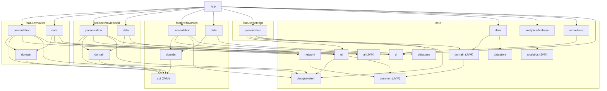
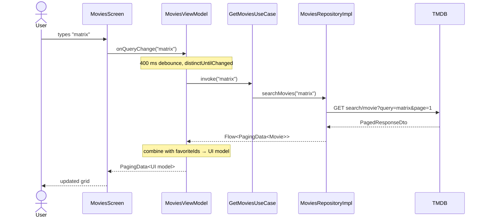
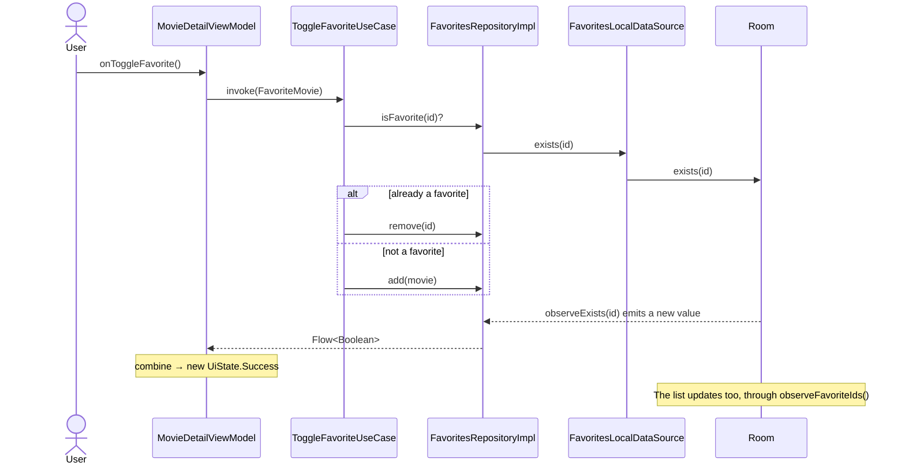

# MyFavoriteFilms — Architecture Document

> Version 1.12 · 2026-11-02 · project **MyFavoriteFilms** (`com.faas.myfavoritefilms`)
> Android movie app (TMDB API) in Jetpack Compose, multi-module monorepo, Clean Architecture on top of Google's official architecture guide, DI with **pure Dagger 2**.

This document describes **how the project is structured and why**. It holds the contracts, the rules and representative code excerpts.

**Documentation map:** [`README.md`](README.md) (overview) · [`AGENTS.md`](AGENTS.md) (rules on one page, read by AI agents) · [`docs/`](docs/README.md) (onboarding, how-to guides, reference, diagrams) · [`docs/decisions/`](docs/decisions/README.md) (one ADR per file) · [`.agents/skills/`](.agents/skills) (procedures for agents). This document remains the complete reference with code.

**Current state (v1.12):** all documentation in English and a project README. Before that: documentation for people and AI agents in open standards (nested `AGENTS.md`, skills in `.agents/skills/`, ADRs in `docs/decisions/` in MADR format, guides in `docs/` organized by Diátaxis, verification scripts and a secret-blocking hook in `scripts/`); repositories talking to local/remote data sources, never directly to a DAO or Retrofit (ADR-18); favorites as a feature with a public `api` module + `domain`/`data`/`presentation` (ADR-17); asynchronous tracking on a serialized queue (section 7.11); natural-language AI search (Gemini through Firebase AI Logic, section 7.13); and a working app with 4 features (`movies`, `moviedetail` with SDUI including cast and trailers, `favorites`, `settings`), bottom bar, **theme and language preferences with DataStore** (section 7.12), a complete testing strategy (section 13) and **tracking with Firebase Analytics + Crashlytics** (section 7.11). When code and document disagree, **the code is the source of truth** and this document must be updated.

---

## Contents

1. [App scope](#1-app-scope)
2. [Architecture decisions](#2-architecture-decisions)
3. [Stack](#3-stack)
4. [Monorepo structure](#4-monorepo-structure)
5. [Dependency graph and rules](#5-dependency-graph-and-rules)
6. [TMDB integration](#6-tmdb-integration)
7. [Core modules](#7-core-modules) (includes SDUI 7.10, tracking 7.11 and preferences 7.12)
8. [Feature: movies (list + search)](#8-feature-movies-list--search)
9. [Feature: moviedetail (detail + favorite)](#9-feature-moviedetail-detail--favorite)
10. [Navigation, DI and the app module](#10-navigation-di-and-the-app-module)
11. [Error handling](#11-error-handling)
12. [Build: Gradle, build-logic and convention plugins](#12-build-gradle-build-logic-and-convention-plugins)
13. [Tests](#13-tests)
14. [Code conventions](#14-code-conventions)
15. [Roadmap and project status](#15-roadmap-and-project-status)
16. [Future evolutions](#16-future-evolutions)

---

## 1. App scope

| Feature | Description | Where it lives |
|---|---|---|
| Movie list | Popular movies with infinite scrolling (pagination) | `feature:movies` |
| Title search | Search field on the list screen itself. With an empty query, shows popular movies. With text, shows the search results | `feature:movies` |
| AI search | "Search with AI" mode: the user describes the movie ("90s thriller with great reviews"), Gemini turns it into filters and the app queries `discover/movie`. Filters become removable chips; if the AI fails, it falls back to title search | `feature:movies` + `core:ai` + `core:ai-firebase` |
| Movie detail | Poster, backdrop, title, tagline, year, runtime, rating, genres and synopsis | `feature:moviedetail` |
| Favorite | Favorite button on the detail and indicator/shortcut on the list. Persisted locally | `feature:favorites:api` (contract) + `feature:favorites:domain`/`data` + `core:database` |
| Favorites screen | Grid with every favorite, same card as the main list; unfavoriting removes the item with an animation | `feature:favorites:presentation` |
| Server-driven information | Detail block built from an SDUI payload (facts, cast, trailers, production companies, countries, links) | `core:common/sdui` + `core:network/sdui` + `core:ui/sdui` |
| Settings | Theme (system/light/dark), dynamic color (Android 12+) and app language (system/pt-BR/en), persisted with DataStore | `feature:settings:presentation` + `core:domain` + `core:data` + `core:datastore` |

Out of scope for this version: TMDB login, offline cache for movies, a real SDUI backend (simulated today, section 7.10).

---

## 2. Architecture decisions

Summary of the decisions. When someone on the team asks "why is it like this?", the answer is here; the complete record of each one (context, options, consequences and how it is confirmed) is in [`docs/decisions/`](docs/decisions/README.md), in MADR format, with four-digit numbering (ADR-17 = `0017`).

| # | Decision | Reason | Discarded alternative |
|---|---|---|---|
| ADR-01 | Layers from Google's guide (UI, Domain, Data) named `presentation` / `domain` / `data` | Alignment with the official documentation: UDF, StateFlow, repositories and use cases | — |
| ADR-02 | **Mandatory pure Kotlin domain (JVM module)**, defining the repository interfaces. Data implements them (dependency inversion) | Clean Architecture: business rules don't know Android, Retrofit or Room. Domain tests run on the JVM, in milliseconds | Google's model where domain depends on data (optional domain) |
| ADR-03 | **Each feature has 3 Gradle modules** (`domain`, `data`, `presentation`) | The compiler enforces the boundaries. A feature can't import what it didn't declare | Now in Android model (features are UI only and layers live in `core`). Simpler, but isolates less |
| ADR-04 | **ViewModels only talk to use cases**, never to repositories | A single rule with no exceptions, easy to review in a PR | The Google guide allowing direct repository access |
| ADR-05 | **Features never depend on other features.** Shared code moves to `core` | Avoids lateral coupling and cycles | — |
| ADR-06 | ~~Favorites in `core:domain` + `core:data`~~ **Superseded by ADR-17** | It was the only way for two features to use the same rule without depending on each other | — |
| ADR-07 | **Paging 3** for list and search, with `paging-common` (JVM) in the domain | The TMDB API is paginated. Paging is Google's official solution for paged lists | Manual pagination in the ViewModel |
| ADR-08 | **Navigation Compose with type-safe routes** (`@Serializable`). Only the `app` module knows every route | Google's current recommendation. Features expose `NavGraphBuilder` extensions | Navigation 3 (valid, see section 16) |
| ADR-09 | **Pure Dagger 2** (no Hilt) for DI, with KSP | Explicit control of the graph: root `AppComponent` + `ViewModelComponent` (a subcomponent per ViewModel with `SavedStateHandle`). No aggregated code generation magic | Hilt (less code, but hides the graph); Koin |
| ADR-10 | **Online** movies (no cache). **Offline** favorites in Room | v1 scope. The movie cache can come later with `RemoteMediator` without breaking contracts | Full offline-first from the start |
| ADR-11 | TMDB token in `local.properties` → `BuildConfig` of `core:network` | Out of version control and simple for development | Hardcoded in the code |
| ADR-12 | **`core:di` module** with `ViewModelKey`, `DaggerViewModelFactory` and `daggerViewModel()` | The equivalent of what Hilt provides out of the box. It lives in the core so every `presentation` module can use it without knowing `:app` | A factory per feature (duplication) |
| ADR-14 | **Generic server-driven UI in the core**: model in `core:common`, parser in `core:network`, renderer in `core:ui`. Each feature only produces/consumes `List<SduiComponent>` | Any screen can have server-driven blocks without duplicating parser/renderer; unknown types are ignored (the backend can evolve ahead of the app) | SDUI inside the feature (not reusable) |
| ADR-15 | **Shared list components in `core:ui/movie`** (`MovieCardUi`, `MovieCard`, `MovieGrid`, skeletons) | The main list and favorites share the same card. Per ADR-05, what two features use moves to the core | Each feature with its own card (duplication) |
| ADR-16 | **Tracking through multibinding** (`@IntoSet`/`@ElementsIntoSet`): features only use `Analytics`/`ErrorReporter` (`core:analytics`, JVM); each destination (Firebase, Crashlytics, Logcat in debug) registers itself in a `Set` | Replace or add analytics tools without touching features; destinations per build type without `if (DEBUG)`; tests with `TestAnalytics` | Calling the Firebase SDK directly from features |
| ADR-17 | **`api` module for features consumed by other features** (today only `favorites`): `:feature:favorites:api` (JVM) publishes `FavoriteMovie` and thin use case interfaces (`ObserveFavoriteIdsUseCase`, `ObserveIsFavoriteUseCase`, `ToggleFavoriteUseCase`). The feature keeps the three layer modules of ADR-03 (`domain` implements the `api` interfaces, `data` holds Room and `FavoritesDataModule`, `presentation` holds the screen). Other features depend only on `:api`; only `:app` knows the favorites' `domain`/`data`/`presentation` | Dependency Inversion and Interface Segregation between modules; the core goes back to holding only cross-cutting rules; compile avoidance; Stable Abstractions/Stable Dependencies. The `api` module solves visibility between features and the layers solve internal organization: they are orthogonal | Favorites in the core (ADR-06); a single `:impl` with the layers in packages (broke the ADR-03 pattern and traded the compiler's guarantee for Konsist's); an `api` module in every feature (empty modules) |
| ADR-18 | **Repositories depend on data sources, never directly on a DAO or a Retrofit API**: `FavoritesLocalDataSource` (wraps `FavoriteMovieDao`), `MoviesRemoteDataSource` (`MoviesApi`), `MovieDetailRemoteDataSource` (`MovieDetailApi`); preferences already followed the pattern with `UserPreferencesDataSource`. Data sources live in `data/datasource`, are `internal`, talk to a single source and return data-layer models (entity, DTO); the repository maps to the domain and decides the policy (cache, timestamps, errors) | The shape recommended by the [data layer guide](https://developer.android.com/topic/architecture/data-layer) (`<Type>Local/RemoteDataSource` names); repositories focused on orchestration; an extension point for combining remote + local (offline cache); consistency across repositories | Injecting the DAO/API directly into the repository (the guide also accepts it when there is a single source and no extra logic; discarded for consistency and evolution) |
| ADR-13 | **Dagger modules as a public + internal pair**: a public `@Module(includes = [XxxBindsModule::class]) object XxxModule`, bindings `internal` | With pure Dagger the `AppComponent` must reference the module; the pair keeps implementations, DTOs and interceptors `internal` (rule 5.2.2) | Making everything public |

---

## 3. Stack

| Area | Technology |
|---|---|
| Language | Kotlin 2.4 (built-in Kotlin in AGP 9, no `kotlin-android` plugin) |
| Build | Gradle 9.6, AGP 9.4, version catalog, convention plugins in `build-logic`, type-safe project accessors |
| UI | Jetpack Compose (BOM 2026.09.00), Material 3, single Activity |
| State | ViewModel + `StateFlow`, UDF, `collectAsStateWithLifecycle` |
| Navigation | Navigation Compose 2.10 (type-safe) |
| DI | Pure Dagger 2.60 with KSP (no Hilt) |
| Network | Retrofit 3 + OkHttp 5 + kotlinx.serialization |
| Pagination | Paging 3 |
| Persistence | Room 2.8 (favorites), DataStore (preferences) |
| Images | Coil 3 |
| Async | Coroutines + Flow |
| Tests | JUnit4, coroutines-test, Turbine, paging-testing, MockWebServer, Robolectric 4.17, Compose UI Test, Roborazzi, Konsist, AndroidX Test + Orchestrator, Kover, module-graph-assert, fakes |
| SDK | minSdk 26 · targetSdk 37 · compileSdk 37 |

`minSdk 26` was chosen to use `java.time` (LocalDate) without desugaring.

---

## 4. Monorepo structure

```
my-favorite-film-android/
├── app/                                   # Shell: Application, MainActivity, NavHost, AppComponent/ViewModelComponent (Dagger)
├── build-logic/
│   ├── settings.gradle.kts
│   └── convention/
│       ├── build.gradle.kts
│       └── src/main/kotlin/               # Convention plugins (section 12)
├── core/
│   ├── common/          (JVM)             # AppResult, DomainError, DomainException, SDUI model
│   ├── domain/          (JVM)             # Cross-cutting rules: preferences (theme, language)
│   ├── data/            (Android)         # Implementation of the shared repositories
│   ├── network/         (Android)         # Retrofit, OkHttp, interceptors, safeApiCall, TmdbImages
│   ├── database/        (Android)         # Room: MoviesDatabase, entities, DAOs
│   ├── datastore/       (Android)         # DataStore Preferences: UserPreferencesDataSource
│   ├── designsystem/    (Android+Compose) # Theme, colors, typography, base components, MoviePoster
│   ├── ui/              (Android+Compose) # State components (loading/error/empty), error messages
│   ├── di/              (Android+Compose) # ViewModelKey, DaggerViewModelFactory, daggerViewModel()
│   ├── analytics/       (JVM)             # Analytics, ErrorReporter, events; composites over Set<Tracker>
│   ├── analytics-firebase/ (Android)      # Firebase SDK for Analytics + Crashlytics
│   ├── ai/              (JVM)             # AI contract: AiJsonGenerator, AiSchema, AiException
│   ├── ai-firebase/     (Android)         # Gemini through Firebase AI Logic + App Check (debug/release)
│   └── testing/         (JVM)             # MainDispatcherRule, fakes of the core contracts
├── feature/                               # README.md with the new feature checklist
│   ├── favorites/
│   │   ├── api/           (JVM)             # public contract: FavoriteMovie + use case interfaces (+ testFixtures: FakeFavorites)
│   │   ├── domain/        (JVM)             # FavoritesRepository, *UseCaseImpl (implement the api), ObserveFavoritesUseCase (+ testFixtures)
│   │   ├── data/          (Android)         # FavoritesLocalDataSource, FavoritesRepositoryImpl (Room) and FavoritesDataModule
│   │   └── presentation/  (Android+Compose) # FavoritesViewModel, screen and navigation
│   ├── movies/
│   │   ├── domain/        (JVM)
│   │   ├── data/          (Android)
│   │   └── presentation/  (Android+Compose)
│   ├── moviedetail/
│   │   ├── domain/        (JVM)
│   │   ├── data/          (Android)
│   │   └── presentation/  (Android+Compose)
│   └── settings/
│       └── presentation/  (Android+Compose) # UI only: preference rules live in the core
├── architecture-test/  (JVM)            # Konsist: architecture rules over the source code
├── .agents/skills/                        # Agent skills (Agent Skills standard): feature-builder, data-integrator, compose-ui, ...
├── .github/
│   ├── workflows/ci.yml                   # Android CI: docs, graph, Konsist, JVM tests, screenshots, lint, Kover, emulator
│   ├── pull_request_template.md           # Definition of done
│   └── ISSUE_TEMPLATE/feature-spec.md     # Feature specification for people and agents
├── docs/                                  # Tutorials, how-to, reference, explanation and ADRs (docs/README.md)
├── scripts/                               # verify.sh, verify-module.sh, record-screenshots.sh, check-docs.py, git-hooks/
├── README.md                              # Project overview
├── AGENTS.md                              # Instructions for agents (also in app/, core/, feature/, build-logic/, architecture-test/)
├── gradle/
│   ├── libs.versions.toml
│   └── wrapper/gradle-wrapper.properties
├── build.gradle.kts
├── settings.gradle.kts
├── gradle.properties
└── local.properties                       # NOT committed: TMDB_ACCESS_TOKEN
```

### 4.1 Packages per module

Base package: `com.faas.myfavoritefilms`.

| Module | Type | Namespace / package |
|---|---|---|
| `:app` | Android app | `com.faas.myfavoritefilms` |
| `:core:common` | JVM | `com.faas.myfavoritefilms.core.common` |
| `:core:domain` | JVM | `com.faas.myfavoritefilms.core.domain` |
| `:core:data` | Android lib | `com.faas.myfavoritefilms.core.data` |
| `:core:network` | Android lib | `com.faas.myfavoritefilms.core.network` |
| `:core:database` | Android lib | `com.faas.myfavoritefilms.core.database` |
| `:core:datastore` | Android lib | `com.faas.myfavoritefilms.core.datastore` |
| `:core:designsystem` | Android lib | `com.faas.myfavoritefilms.core.designsystem` |
| `:core:ui` | Android lib | `com.faas.myfavoritefilms.core.ui` |
| `:core:di` | Android lib | `com.faas.myfavoritefilms.core.di` |
| `:core:analytics` | JVM | `com.faas.myfavoritefilms.core.analytics` |
| `:core:analytics-firebase` | Android lib | `com.faas.myfavoritefilms.core.analytics.firebase` |
| `:core:ai` | JVM | `com.faas.myfavoritefilms.core.ai` |
| `:core:ai-firebase` | Android lib | `com.faas.myfavoritefilms.core.ai.firebase` |
| `:core:testing` | JVM | `com.faas.myfavoritefilms.core.testing` |
| `:feature:movies:domain` | JVM | `com.faas.myfavoritefilms.feature.movies.domain` |
| `:feature:movies:data` | Android lib | `com.faas.myfavoritefilms.feature.movies.data` |
| `:feature:movies:presentation` | Android lib | `com.faas.myfavoritefilms.feature.movies.presentation` |
| `:feature:moviedetail:domain` | JVM | `com.faas.myfavoritefilms.feature.moviedetail.domain` |
| `:feature:moviedetail:data` | Android lib | `com.faas.myfavoritefilms.feature.moviedetail.data` |
| `:feature:moviedetail:presentation` | Android lib | `com.faas.myfavoritefilms.feature.moviedetail.presentation` |
| `:feature:favorites:api` | JVM | `com.faas.myfavoritefilms.feature.favorites.api` |
| `:feature:favorites:domain` | JVM | `com.faas.myfavoritefilms.feature.favorites.domain` |
| `:feature:favorites:data` | Android lib | `com.faas.myfavoritefilms.feature.favorites.data` |
| `:feature:favorites:presentation` | Android lib | `com.faas.myfavoritefilms.feature.favorites.presentation` |
| `:feature:settings:presentation` | Android lib | `com.faas.myfavoritefilms.feature.settings.presentation` |
| `:architecture-test` | JVM | `com.faas.myfavoritefilms.architecture` |

### 4.2 Standard internal structure of a feature

```
feature/<name>/
├── domain/src/main/kotlin/.../domain/
│   ├── model/            # Business models (immutable data classes)
│   ├── repository/       # Interfaces (contracts)
│   └── usecase/          # One use case per action
├── data/src/main/kotlin/.../data/
│   ├── datasource/       # Local/remote data sources (internal, one source each)
│   ├── remote/
│   │   ├── api/          # Retrofit interface
│   │   └── dto/          # @Serializable DTOs (never leave the module)
│   ├── paging/           # PagingSource (when there is one)
│   ├── mapper/           # Dto -> Domain
│   ├── repository/       # Implementations (internal)
│   └── di/               # Dagger @Module: public + internal pair (ADR-13)
└── presentation/src/main/kotlin/.../presentation/
    ├── di/               # @Module with @Binds @IntoMap @ViewModelKey for the ViewModels
    ├── navigation/       # @Serializable route + NavGraphBuilder/NavController extensions
    ├── model/            # UI models + Domain -> UI mappers
    ├── <Screen>UiState.kt
    ├── <Screen>ViewModel.kt
    └── <Screen>Screen.kt   # Screen (stateful) + Content (stateless) + Previews
```

---

## 5. Dependency graph and rules



Simplified; other views (layers, DI, list, AI and error flows) are in [docs/explanation/architecture.md](docs/explanation/architecture.md).

### 5.1 Allowed dependency matrix

| Module | May depend on | Forbidden |
|---|---|---|
| `feature:x:domain` | `core:common`, `core:domain`, `paging-common`, `coroutines-core`, `javax.inject` | Android SDK, Retrofit, Room, Compose, any `data`/`presentation`, another feature |
| `feature:x:data` | `feature:x:domain`, `core:network`, `core:common` | `presentation`, another feature, `core:database`* |
| `feature:x:presentation` | `feature:x:domain`, `core:domain`, `core:ui`, `core:designsystem`, `core:common`, `core:di` | `data` of any module, `core:network`, `core:database`, `core:datastore`, another feature |
| `feature:x:api` | `core:common`, `coroutines-core` | Android, Dagger, any infrastructure `core` module, its own `domain`/`data`/`presentation` |
| consumer of another feature | `feature:y:api` | `feature:y:domain`, `feature:y:data`, `feature:y:presentation` |
| `core:domain` | `core:common` | any `feature`, Android |
| `core:data` | `core:domain`, `core:datastore`, `core:common` | any `feature` |
| `core:network` / `core:database` / `core:datastore` | `core:common` | any `feature`, `core:domain`, `core:data` |
| `core:ui` | `core:designsystem`, `core:common`, `core:analytics` | any `feature`, `domain`, `data` |
| `core:di` | Dagger, lifecycle-viewmodel | any other project module |
| `core:analytics` | `core:common` | Android, Firebase, any `feature` |
| `core:analytics-firebase` | `core:analytics`, Firebase SDK | any `feature` |
| `core:ai` | nothing (pure JVM) | Android, Firebase, any `feature` |
| `core:ai-firebase` | `core:ai`, Firebase SDK (AI Logic, App Check) | any `feature` |
| `feature:x:data` | + `core:ai` (the contract only) | `core:ai-firebase` (graph and Konsist enforce it) |
| `feature:x:data` / `feature:x:presentation` | + `core:analytics` (the interfaces only) | Firebase SDK (Konsist enforces it) |
| `:app` | every `presentation` and `data`, `core:data`, `core:network`, `core:database`, `core:datastore`, `core:ai-firebase`, `core:analytics-firebase`, `core:di`, `core:designsystem`, `core:ui` | — |

\* If a feature needs its own storage, create the entity and the DAO in `core:database`. The dependency is then allowed (as in `feature:favorites:data`) and must be recorded here.

### 5.2 Golden rules

1. **DTOs, entities and `Retrofit`/`Room` never cross the `data` module boundary.** What leaves it is a domain model.
2. **Implementations are `internal`.** In a `data` module, the only public type is the aggregating `@Module` (ADR-13), which only `includes` the internal module.
3. **`:app` depends on the `data` modules only so `AppComponent` can install their Dagger modules.** The `app` never calls them directly.
4. **Two features needing the same thing → it moves to `core`.** Never `implementation(projects.feature.other...)`.
5. **Use `api(...)` only when the type appears in the module's public API.** Example: the domain exposes `AppResult`, so it uses `api(projects.core.common)`.
6. **A repository never receives a DAO or a Retrofit API in its constructor** (ADR-18). It depends on a `<Type>LocalDataSource` or `<Type>RemoteDataSource` from the `data/datasource` package. Konsist enforces it.

---

## 6. TMDB integration

### 6.1 Authentication

Use the **API Read Access Token** (Bearer), not the API key in the query string. TMDB accepts both with the same access level, but the header keeps the token out of URLs and logs.

```
Authorization: Bearer <API_READ_ACCESS_TOKEN>
```

**Storing the token.** Only the *API Read Access Token* is used. The *API Key* (v3) doesn't enter the project: one less credential to leak.

| Environment | Where it lives | How it reaches the build |
|---|---|---|
| Developer machine | `local.properties` (in `.gitignore`, shared between developers through a secure channel, never through the repo) | `TMDB_ACCESS_TOKEN=...` |
| CI (GitHub Actions) | `TMDB_ACCESS_TOKEN` *repository secret* | `env: TMDB_ACCESS_TOKEN: ${{ secrets.TMDB_ACCESS_TOKEN }}` in the workflow |

`core/network/build.gradle.kts` reads `local.properties` first and, if it doesn't find the token, the environment variable, both through `providers` (configuration cache compatible). The value becomes `BuildConfig.TMDB_ACCESS_TOKEN`, used only by `TmdbAuthInterceptor`. If it is empty, the build warns and calls return 401 (`DomainError.Unauthorized`).

Protection layers already in place:
- the token is never in Git (not even in `gradle.properties`, which is committed);
- it goes in the `Authorization` header, not in the URL, and debug logging uses `redactHeader("Authorization")`;
- HTTP logging only exists in `debug`; `release` uses R8;
- the `pre-commit` hook in `scripts/git-hooks/` blocks `local.properties` and token patterns.

**Options evaluated**

| Option | Real security | When to use |
|---|---|---|
| `local.properties` + `BuildConfig` (**adopted**) | Out of Git, but **extractable from the APK** | Development, portfolio, free read-only APIs (TMDB's case) |
| Secrets Gradle Plugin (Google) | Same as above; it only automates reading | Equivalent; not adopted to avoid another plugin |
| Obfuscation (NDK/C++, XOR, encrypted strings) | Slows reverse engineering, doesn't prevent it | Not worth the complexity here |
| **Own backend/proxy** (e.g. Cloud Function) holding the token + Play Integrity/App Check | **The only one that removes the secret from the app** | Production with a paid or sensitive key |

> ⚠️ Any secret embedded in the APK can be extracted. For TMDB (free, read-only token) the risk is acceptable. If the token leaks, generate a new one under *Settings → API* on TMDB and update `local.properties` and the GitHub secret.

### 6.2 Endpoints used

Base URL: `https://api.themoviedb.org/3/`

| Use | Method | Endpoint | Parameters |
|---|---|---|---|
| Popular | GET | `movie/popular` | `page` |
| Title search | GET | `search/movie` | `query`, `page`, `include_adult=false` |
| AI search | GET | `discover/movie` | `page`, `sort_by`, `with_genres` (comma-separated = all of them), `primary_release_date.gte/lte`, `vote_average.gte`, `vote_count.gte`, `include_adult=false` |
| Genres | GET | `genre/movie/list` | — (in the device language; in-memory cache per language) |
| Detail | GET | `movie/{movie_id}` | `append_to_response=credits,videos` (cast and videos in the same call) |

The `language` parameter (e.g. `pt-BR`) is added automatically by an interceptor, from the device locale, so titles and synopses come translated when a translation exists.

Paged responses have the shape `{ page, results[], total_pages, total_results }` with 20 items per page. TMDB limits navigation to 500 pages, and the `PagingSource` respects that ceiling.

### 6.3 Images

The API returns only the path (`poster_path: "/abc.jpg"`). The final URL is built in the **data mapper**, so the domain already receives the complete URL:

```
https://image.tmdb.org/t/p/{size}{path}
```

| Use | Size |
|---|---|
| Poster in the grid | `w342` |
| Poster on the detail | `w500` |
| Backdrop on the detail | `w780` |

Sizes are centralized in `TmdbImages` (`core:network`). TMDB's `configuration` endpoint returns the official list of sizes, should you want to make it dynamic in the future.

### 6.4 API good practices

- **Rate limit:** TMDB applies a request limit. The search debounce (section 8.3) avoids firing one call per keystroke. HTTP 429 is mapped to `DomainError.RateLimited`.
- **Attribution:** TMDB's terms of use require visible credit in the app (logo and a notice that the app uses the API without TMDB's endorsement). Reserve an "About" screen or a footer for it and check the terms before publishing.

---

## 7. Core modules

### 7.1 `core:common` (JVM)

Types used by every layer. No Android dependency at all.

```kotlin
// AppResult.kt
sealed interface AppResult<out T> {
    data class Success<T>(val data: T) : AppResult<T>
    data class Failure(val error: DomainError) : AppResult<Nothing>
}

inline fun <T, R> AppResult<T>.map(transform: (T) -> R): AppResult<R> = when (this) {
    is AppResult.Success -> AppResult.Success(transform(data))
    is AppResult.Failure -> this
}

inline fun <T, R> AppResult<T>.fold(
    onSuccess: (T) -> R,
    onFailure: (DomainError) -> R,
): R = when (this) {
    is AppResult.Success -> onSuccess(data)
    is AppResult.Failure -> onFailure(error)
}
```

```kotlin
// DomainError.kt
sealed interface DomainError {
    data object Network : DomainError            // no internet / timeout
    data object Unauthorized : DomainError       // 401: invalid token
    data object NotFound : DomainError           // 404
    data object RateLimited : DomainError        // 429
    data class Server(val code: Int) : DomainError
    data object Unknown : DomainError
}

class DomainException(val error: DomainError) : Exception(error.toString())
```

`DomainException` carries a `DomainError` through APIs that only accept a `Throwable` (e.g. Paging's `LoadResult.Error`).

### 7.2 `core:domain` (JVM): cross-cutting rules

Today only the user preferences (section 7.12). A rule used by more than one feature does **not** automatically come here: if it has an owner (like favorites), it becomes a feature with an `api` module (ADR-17, section 7.14).

### 7.3 `core:network`

A single `Retrofit` and `OkHttpClient` instance for the whole app. Each feature only creates its API interface from it.

**`core/network/build.gradle.kts`** (simplified)

```kotlin
plugins {
    alias(libs.plugins.movies.android.library)
    alias(libs.plugins.movies.dagger)
    alias(libs.plugins.kotlin.serialization)
}

android {
    namespace = "com.faas.myfavoritefilms.core.network"
    buildFeatures { buildConfig = true }
    defaultConfig {
        buildConfigField("String", "TMDB_BASE_URL", "\"https://api.themoviedb.org/3/\"")
        buildConfigField("String", "TMDB_ACCESS_TOKEN", "\"$tmdbToken\"")
    }
}

dependencies {
    api(projects.core.common)
    api(libs.retrofit.core)
    api(libs.okhttp.core)
    api(libs.kotlinx.serialization.json)
    implementation(libs.retrofit.converter.kotlinx.serialization)
    implementation(libs.okhttp.logging)
}
```

`tmdbToken` comes from `local.properties` or the `TMDB_ACCESS_TOKEN` environment variable (section 6.1). Retrofit, OkHttp and the JSON library are `api` because they appear in the public API and `:app`'s Dagger component must see them (section 12.8).

**Interceptors**

```kotlin
internal class TmdbAuthInterceptor @Inject constructor() : Interceptor {
    override fun intercept(chain: Interceptor.Chain): Response =
        chain.proceed(
            chain.request().newBuilder()
                .header("Authorization", "Bearer ${BuildConfig.TMDB_ACCESS_TOKEN}")
                .header("Accept", "application/json")
                .build()
        )
}

internal class TmdbLanguageInterceptor @Inject constructor() : Interceptor {
    override fun intercept(chain: Interceptor.Chain): Response {
        val url = chain.request().url.newBuilder()
            .addQueryParameter("language", Locale.getDefault().toLanguageTag())
            .build()
        return chain.proceed(chain.request().newBuilder().url(url).build())
    }
}
```

**Dagger module** (public + internal pair, ADR-13)

```kotlin
@Module(includes = [NetworkProvidersModule::class])
object NetworkModule

@Module
internal object NetworkProvidersModule {

    @Provides @Singleton
    fun provideJson(): Json = Json {
        ignoreUnknownKeys = true
        explicitNulls = false
        coerceInputValues = true
    }

    @Provides @Singleton
    fun provideOkHttpClient(
        auth: TmdbAuthInterceptor,
        language: TmdbLanguageInterceptor,
    ): OkHttpClient = OkHttpClient.Builder()
        .addInterceptor(auth)
        .addInterceptor(language)
        .apply {
            if (BuildConfig.DEBUG) {
                addInterceptor(
                    HttpLoggingInterceptor().apply {
                        level = HttpLoggingInterceptor.Level.BODY
                        redactHeader("Authorization")
                    }
                )
            }
        }
        .connectTimeout(15, TimeUnit.SECONDS)
        .readTimeout(20, TimeUnit.SECONDS)
        .build()

    @Provides @Singleton
    fun provideRetrofit(client: OkHttpClient, json: Json): Retrofit = Retrofit.Builder()
        .baseUrl(BuildConfig.TMDB_BASE_URL)
        .client(client)
        .addConverterFactory(json.asConverterFactory("application/json".toMediaType()))
        .build()
}
```

`NetworkModule` is public because it is what `AppComponent` installs; the providers stay internal.

**Exception → `DomainError` conversion** (the only place in the app that knows `HttpException`):

```kotlin
suspend inline fun <T> safeApiCall(
    crossinline onFailure: (cause: Throwable, error: DomainError) -> Unit = { _, _ -> },
    crossinline block: suspend () -> T,
): AppResult<T> =
    try {
        AppResult.Success(block())
    } catch (e: CancellationException) {
        throw e
    } catch (e: Exception) {
        val error = e.toDomainError()
        onFailure(e, error)
        AppResult.Failure(error)
    }

fun Throwable.toDomainError(): DomainError = when (this) {
    is DomainException -> error
    is IOException -> DomainError.Network
    is HttpException -> when (code()) {
        401 -> DomainError.Unauthorized
        404 -> DomainError.NotFound
        429 -> DomainError.RateLimited
        in 500..599 -> DomainError.Server(code())
        else -> DomainError.Unknown
    }
    else -> DomainError.Unknown
}
```

Cancellation is never swallowed. `onFailure` lets the repository report unexpected errors while the original exception (with its stack trace) still exists (section 7.11).

**Images**

```kotlin
object TmdbImages {
    private const val BASE = "https://image.tmdb.org/t/p/"

    enum class Size(val path: String) { W185("w185"), W342("w342"), W500("w500"), W780("w780"), ORIGINAL("original") }

    fun url(path: String?, size: Size): String? =
        path?.takeIf { it.isNotBlank() }?.let { "$BASE${size.path}$it" }
}
```

### 7.4 `core:database`

```kotlin
@Entity(tableName = "favorite_movies")
data class FavoriteMovieEntity(
    @PrimaryKey val id: Int,
    val title: String,
    val posterUrl: String?,
    val rating: Double,
    val savedAt: Long,
)

@Dao
interface FavoriteMovieDao {
    @Query("SELECT * FROM favorite_movies ORDER BY savedAt DESC")
    fun observeAll(): Flow<List<FavoriteMovieEntity>>

    @Query("SELECT id FROM favorite_movies")
    fun observeIds(): Flow<List<Int>>

    @Query("SELECT EXISTS(SELECT 1 FROM favorite_movies WHERE id = :id)")
    fun observeExists(id: Int): Flow<Boolean>

    @Query("SELECT EXISTS(SELECT 1 FROM favorite_movies WHERE id = :id)")
    suspend fun exists(id: Int): Boolean

    @Upsert
    suspend fun upsert(entity: FavoriteMovieEntity)

    @Query("DELETE FROM favorite_movies WHERE id = :id")
    suspend fun deleteById(id: Int)
}

@Database(entities = [FavoriteMovieEntity::class], version = 1, exportSchema = true)
abstract class MoviesDatabase : RoomDatabase() {
    abstract fun favoriteMovieDao(): FavoriteMovieDao
}

@Module
object DatabaseModule {
    @Provides @Singleton
    fun provideDatabase(context: Context): MoviesDatabase =
        Room.databaseBuilder(context, MoviesDatabase::class.java, "movies.db").build()

    @Provides
    fun provideFavoriteMovieDao(db: MoviesDatabase): FavoriteMovieDao = db.favoriteMovieDao()
}
```

The `Context` is the Application's, provided by `AppComponent` (`@BindsInstance` + `@Binds`). The schema is exported to `core/database/schemas/` (configured in the Room convention plugin) and **must be committed**, because it is the basis for migrations. `room-runtime` is `api` so `AppComponent` can see `RoomDatabase`. The entity and the DAO live here because the central `@Database` must list every entity; features access them only through a `LocalDataSource` (ADR-18).

### 7.5 `core:data`

Implements the `core:domain` repositories. Today: `UserPreferencesRepositoryImpl`, which depends on `UserPreferencesDataSource` (`core:datastore`) and maps the stored values to the domain (an unknown value falls back to the default). It is bound as `@Singleton` in `DataModule`, with the usual public + internal pair.

`suspend` calls from Room, DataStore and Retrofit are already *main-safe*. There is no need for `withContext(Dispatchers.IO)` around them. Use an injected dispatcher only for truly blocking work.

### 7.6 `core:designsystem`

- `MoviesTheme` (Material 3, light/dark, *dynamic color* from Android 12).
- Visual components **with no domain knowledge**, only primitive parameters:

| Component | What it does |
|---|---|
| `SkeletonBox` | Shimmering block. The progress is only read in `drawBehind`: it animates without recomposition or relayout |
| `MoviePoster(url, contentDescription, aspectRatio, shape)` | Image with a skeleton while loading, a 300 ms crossfade on arrival and a fallback with the title's initial. Works for posters (2:3) and backdrops (`BACKDROP_ASPECT_RATIO`, 16:9) |
| `SearchField` | Search field: the magnifier turns into a spinner while loading; animated clear button |
| `FavoriteIconButton` | Heart with a spring animation when favoriting |
| `RatingBadge`, `LabelChips` | Rating with a star; wrapping labels (genres, companies) |

**Image loading strategy (v1.3 decision):** shimmering skeleton at the final size + crossfade + fallback.
- Uses `AsyncImage` with `onLoading/onSuccess/onError`, not `SubcomposeAsyncImage` (Coil discourages subcomposition in lists).
- The skeleton takes the final space (fixed aspect ratio): nothing "jumps" when the image arrives.
- The grids' initial load uses `MovieGridSkeleton` (skeleton cards) instead of a spinner.
- Alternatives evaluated: BlurHash/ThumbHash (needs a hash from the backend; TMDB doesn't provide one), dominant color (needs the image first), progressive loading w92→w342 (doubles requests), the Landscapist library (an extra dependency for something ~60 lines solve).

### 7.7 `core:ui`

Components reused by every screen:

- **State:** `LoadingContent`, `ErrorContent`, `EmptyContent` and the error → message mapping (below).
- **Movies (`movie/`, ADR-15):** `MovieCardUi` (the card's UI model, with `formatRating`), `MovieCard`, `MovieCardSkeleton`, `MovieGrid` (default columns/spacing through `MovieGridDefaults`) and `MovieGridSkeleton`. Used by the main list and by favorites.
- **SDUI (`sdui/`):** `LazyListScope.sduiItems(components)` and `SduiComponentView` (section 7.10).
- **Analytics:** `LocalAnalytics` and `TrackScreenView(screenName)` (section 7.11).

```kotlin
@Composable fun LoadingContent(modifier: Modifier = Modifier)
@Composable fun ErrorContent(error: DomainError, onRetry: () -> Unit, modifier: Modifier = Modifier)
@Composable fun EmptyContent(message: String, modifier: Modifier = Modifier)

@StringRes
fun DomainError.messageRes(): Int = when (this) {
    DomainError.Network -> R.string.error_network
    DomainError.Unauthorized -> R.string.error_unauthorized
    DomainError.NotFound -> R.string.error_not_found
    DomainError.RateLimited -> R.string.error_rate_limited
    is DomainError.Server -> R.string.error_server
    DomainError.Unknown -> R.string.error_unknown
}

fun Throwable.asDomainError(): DomainError = (this as? DomainException)?.error ?: DomainError.Unknown
```

`asDomainError()` converts Paging's `Throwable` (`LoadState.Error`) back into a `DomainError`.

### 7.8 `core:testing` (JVM)

- `MainDispatcherRule` (replaces `Dispatchers.Main` with `UnconfinedTestDispatcher`).
- `TestAnalytics` (records tracked events and reported errors), `FakeUserPreferencesRepository` and `FakeAppLanguageApplier`.
- Only fakes of **core contracts**. Fakes of a feature's contracts live in that feature (`src/test` or `testFixtures`, like `FakeFavorites` in `:feature:favorites:api`), because the core can't know features.

### 7.9 `core:di` (Android + Compose): Dagger for ViewModels

Replaces what Hilt would do (`@HiltViewModel` + `hiltViewModel()`):

| Piece | Role |
|---|---|
| `@ViewModelKey(X::class)` | `@MapKey` for the `Map<Class<out ViewModel>, Provider<ViewModel>>` multibinding |
| `ViewModelGraph` | Contract implemented by `:app`'s `ViewModelComponent`: exposes the providers map |
| `ViewModelGraphFactory` | Creates a new `ViewModelGraph` receiving the screen's `SavedStateHandle` |
| `ViewModelMultibindsModule` | `@Multibinds` for the map (an empty map is valid while no feature has contributed) |
| `DaggerViewModelFactory` | The app's only `ViewModelProvider.Factory`. Creates the `SavedStateHandle` from the `CreationExtras`, opens the subcomponent and instantiates the ViewModel |
| `LocalViewModelFactory` + `daggerViewModel()` | `MainActivity` provides the factory; screens call `viewModel: XViewModel = daggerViewModel()` |

```kotlin
@Module
interface MoviesPresentationModule {
    @Binds @IntoMap @ViewModelKey(MoviesViewModel::class)
    fun bindMoviesViewModel(vm: MoviesViewModel): ViewModel
}

class MovieDetailViewModel @Inject constructor(
    savedStateHandle: SavedStateHandle,
    private val getMovieDetail: GetMovieDetailUseCase,
) : ViewModel()
```

Each `feature:*:presentation/di/` has a module like `MoviesPresentationModule`. ViewModels use a regular `@Inject` constructor, and `SavedStateHandle` is available in the graph. Scope: the ViewModel lives in the current `ViewModelStoreOwner` (inside the `NavHost`, the screen's `NavBackStackEntry`), just like with Hilt.

---

### 7.10 Server-Driven UI (SDUI)

Part of a screen whose content and order are decided by the "server". The app knows a fixed vocabulary of blocks and only knows how to draw them.

```
[backend]  JSON { schemaVersion, components: [ {type, ...}, ... ] }
     │
core:network ─ SduiParser.parse(json)  →  List<SduiComponent>   (unknown/malformed type: dropped)
     │
domain ─ MovieDetail.infoSections: List<SduiComponent>         (the domain only carries it, never interprets it)
     │
core:ui ─ LazyListScope.sduiItems(...) / SduiComponentView      (type → composable)
```

| `type` | Model (`core:common/sdui`) | Fields |
|---|---|---|
| `section_title` | `SectionTitle` | `text` |
| `key_value_list` | `KeyValueList` | `title?`, `items[{label, value, icon?}]` |
| `chip_group` | `ChipGroup` | `title?`, `chips[]` |
| `text` | `TextBlock` | `title?`, `text` |
| `link` | `LinkButton` | `label`, `url` (opens in the browser) |
| `divider` | `Divider` | — |
| `person_carousel` | `PersonCarousel` | `title?`, `people[{name, subtitle?, imageUrl?}]` (circular photo) |
| `video_carousel` | `VideoCarousel` | `title?`, `videos[{title, url, thumbnailUrl?}]` (tapping opens `url`) |

In carousels, invalid items (no `name`, no `title`/`url`) are dropped; a carousel with no valid items is dropped entirely.

Icons are semantic keys (`calendar`, `money`, `star`, `info`, `person`, `place`, `thumb_up`, `build`); an unknown key means a row without an icon.

**Rules:**
- Texts arrive **ready to display** (labels and values formatted by the server).
- The app **ignores** types it doesn't know: the backend can ship a new block without breaking old versions.
- **New type:** add it to `SduiComponent`, `SduiParser` and `SduiComponentView`, with a test in `SduiParserTest` ([guide](docs/how-to/add-sdui-block.md)).

**Simulated backend:** labels come from `feature:moviedetail:data`'s `strings.xml` (through the injected `MovieDetailLayoutStrings`), and numbers and dates follow the device locale. `MovieDetailLayoutService` (`feature:moviedetail:data/sdui`) builds, from the TMDB response, the same JSON a real endpoint would return (including an unknown `ar_experience` block, to demonstrate the tolerance).

Block order: facts → cast → trailers → genres/companies/countries/languages → links. Simulated backend rules:
- **Cast:** `credits.cast` sorted by `order` (credits order), at most 15; `subtitle` = character; `w185` photo.
- **Trailers:** only `site = YouTube` and `type` `Trailer` or `Teaser`; trailers before teasers and official ones first; at most 10. `url` = `youtube.com/watch?v={key}` (opens in the YouTube app or the browser), thumbnail = `img.youtube.com/vi/{key}/hqdefault.jpg`. To use a real backend, replace this class with a Retrofit call; parser, domain and UI don't change.

### 7.11 Tracking and errors (Firebase Analytics + Crashlytics)

```
features ──► Analytics.track(event)             ErrorReporter.recordNonFatal(...)
                 │ CompositeAnalytics                 │ CompositeErrorReporter
                 ▼  Set<AnalyticsTracker>             ▼  Set<ErrorTracker>
     ┌───────────┴───────────┐              ┌─────────┴─────────┐
 FirebaseAnalyticsTracker  LogcatTracker  CrashlyticsErrorTracker  LogcatErrorTracker
 (core:analytics-firebase) (app/src/debug) (analytics-firebase) (app/src/debug)
```

- **`core:analytics` (JVM):** `Analytics` and `ErrorReporter` (what the app uses), `AnalyticsTracker` and `ErrorTracker` (destinations), events and parameters, `reportIfUnexpected`.
- **Destinations through multibinding:** Firebase contributes with `@ElementsIntoSet`, because it is conditional: without `google-services.json` the set is empty and the app works the same. Debug adds Logcat with `@IntoSet` (`BuildTypeAnalyticsModule` in `src/debug`; empty in `src/release`). The sets are declared with `@Multibinds` and may be empty.
- **A failing destination doesn't take down the others** (`runCatching` in the composite).
- **Asynchronous on a serialized queue:** `CompositeAnalytics` and `CompositeErrorReporter` dispatch on a `CoroutineDispatcher` injected with the `@AnalyticsDispatcher` qualifier, which in production is `Dispatchers.IO.limitedParallelism(1)` (`AnalyticsDispatcherModule`), inside their own scope with a `SupervisorJob`. Result: `track` returns immediately (a slow destination never blocks the caller's main thread) and, since parallelism is 1, events are processed in the order they were fired (Firebase stamps the timestamp in `logEvent`, so execution order matters). In tests, `UnconfinedTestDispatcher` keeps everything synchronous and `StandardTestDispatcher` proves nothing runs before `advanceUntilIdle()`.
- **Konsist enforces** that only `core:analytics-firebase` and `core:ai-firebase` import `com.google.firebase.*`.

**Events (v1)**

| Event | Parameters | Where |
|---|---|---|
| `screen_view` | `screen_name` (`movies`, `movie_detail`, `favorites`, `settings`) | `TrackScreenView(...)` at the top of each `*Screen` (through `LocalAnalytics`) |
| `search` | `search_term` | `MoviesViewModel`, one per effective search (after debounce, ≥ 2 characters) |
| `search_results` | `search_term`, `has_results` (`true`/`false`), `first_page_count` (items on the 1st page; 20 = "at least 20") | The screen notifies the ViewModel when the search finishes loading |
| `movie_opened` | `movie_id`, `source` (`popular`, `search`, `ai_search`, `favorites`) | List ViewModels, on tap |
| `favorite_added` / `favorite_removed` | `movie_id`, `source` (+ `detail`) | Every ViewModel that toggles favorites, with the state returned by the use case |
| `settings_changed` | `setting` (`theme_mode`, `dynamic_color`, `language`), `value` (e.g. `dark`, `true`, `en`, `system`) | `SettingsViewModel`, on each change |
| `ai_search` | `search_term`, `outcome` (`understood`, `not_understood`, `unavailable`), `filter_count` | `MoviesViewModel`, on each submitted AI search |

**Test crash:** the **debug** build has a floating button (⚠) on the tabs that forces a crash, to validate Crashlytics. The report reaches the console the next time the app opens. In release the button doesn't exist (empty `DebugOverlay` in `src/release`).

**Non-fatal errors:** only the unexpected becomes non-fatal (`DomainError.Server` and `Unknown`); no internet, 401, 404 and 429 are expected. They are reported in **data**, where the original exception (with its stack trace) still exists: `MoviesPagingSource` and `safeApiCall(onFailure = ...)`, with the `origin` attribute. Crashes are captured automatically by Crashlytics.

**Configuration:** `app/google-services.json` (outside Git). The `google-services` and `crashlytics` plugins are only applied when the file exists. In CI the file is created from the `GOOGLE_SERVICES_JSON` secret. To see events in real time: Logcat filtered by `Analytics` (debug) or **DebugView** in the console (`adb shell setprop debug.firebase.analytics.app com.faas.myfavoritefilms`).

**New event:** create the factory in `AnalyticsEvent.kt` (names up to 40 characters, `snake_case`), call it from the ViewModel and assert it in the ViewModel test with `TestAnalytics` (`core:testing`). Guide: [add-analytics-event.md](docs/how-to/add-analytics-event.md).

### 7.12 User preferences (theme and language)

```
SettingsScreen ─► SettingsViewModel ─► use cases (core:domain) ─► UserPreferencesRepository
                                                                        │ core:data (Impl, mapper)
                                                                        ▼
                                                     UserPreferencesDataSource (core:datastore)
                                                     DataStore<Preferences> "user_preferences"
MainActivity ◄─ MainActivityViewModel ◄─ observeUserPreferences()  → MoviesTheme(darkTheme, dynamicColor)
```

- **Model (`core:domain`):** `UserPreferences(themeMode, useDynamicColor, language)`, with `ThemeMode { SYSTEM, LIGHT, DARK }` and `AppLanguage { SYSTEM, PORTUGUESE_BRAZIL, ENGLISH }`. An unknown value on disk falls back to the default (in `core:data`'s mapper).
- **Storage:** **DataStore Preferences** (not `SharedPreferences`), a single `@Singleton` `DataStore` created in `DataStoreModule`. A corrupted file becomes empty preferences (`ReplaceFileCorruptionHandler`) and an `IOException` while reading emits empty.
- **Theme:** `MainActivity` draws nothing while the preferences load (avoids flashing the wrong theme), then applies `MoviesTheme` and reconfigures `enableEdgeToEdge` when dark mode changes. Dynamic color only shows on Android 12+.
- **Language: the system is the source of truth.** The app uses Android's per-app language (`AppCompatDelegate.setApplicationLocales`, `AppCompatActivity`, `locales_config.xml` and the `AppLocalesMetadataHolderService` service with `autoStoreLocales` for Android < 13). `SetAppLanguageUseCase` writes to DataStore and applies through `AppLanguageApplier` (interface in the domain, `AppCompatLanguageApplier` in `:app`). Since the user can change the language in the system settings, `SyncAppLanguageUseCase` runs when the app opens and copies the current system language to DataStore. Changing the language recreates the Activity (Android behavior).
- **Tests:** `UserPreferencesDataSourceTest` (real DataStore in a temporary folder), `UserPreferencesRepositoryImplTest`, use case tests with `FakeUserPreferencesRepository` and `FakeAppLanguageApplier` (`core:testing`), `SettingsViewModelTest`, `SettingsContentTest`, `SettingsContent` screenshots and `MainActivityViewModelTest`.

### 7.13 AI search (Gemini through Firebase AI Logic)

```
"90s thriller with great reviews"
   │ MoviesViewModel.onSubmitSearch()  (only in AI mode, when tapping search on the keyboard)
   ▼
InterpretMovieQueryUseCase ── repository.genres() ──► GET genre/movie/list (cached per language)
   │ MovieQueryInterpreter (domain)  ◄── AiMovieQueryInterpreter (feature:movies:data)
   │                                        │ AiJsonGenerator (core:ai)  ◄── GeminiJsonGenerator (core:ai-firebase)
   ▼                                        ▼
QueryInterpretation: Understood(MovieFilters) | NotUnderstood | Unavailable(DomainError)
   │ Understood → GetMoviesByFiltersUseCase → GET discover/movie (same Paging as the list)
   └ NotUnderstood / Unavailable → title search with the same text + a notice on screen
```

- **The AI doesn't invent movies.** It only returns filters in a JSON with a fixed schema (structured output): `genreIds`, `yearFrom`, `yearTo`, `minRating`, `sort`. TMDB brings the movies. This eliminates hallucinated titles.
- **Validation in data, never blind trust:** genre ids that don't exist in TMDB's list are dropped (at most 3), years outside 1874 to the current year + 2 are ignored, inverted years are swapped, the rating is clamped to 0–10 and an unknown `sort` becomes `POPULARITY`. Filters without any criterion = `NotUnderstood`.
- **Prompt:** the rules and the genre list go as the system instruction; the user's text goes separately, as data. The instruction says to ignore commands written inside the request (basic prompt-injection protection). `temperature = 0` for stable answers.
- **Isolated contract, like analytics:** `core:ai` (JVM) defines `AiJsonGenerator`, `AiSchema` (its own JSON Schema subset) and `AiException` (`Unavailable`, `QuotaExceeded`, `Failed`). `core:ai-firebase` is the only place with `firebase-ai`: it converts `AiSchema` into Firebase's `Schema` and translates the SDK exceptions. Replacing Gemini with another provider (or an own backend) means replacing only this module.
- **Without Firebase configured** (no `google-services.json`), `AiFirebaseModule` provides `UnavailableAiJsonGenerator` and the screen falls back to title search. The app still builds and works.
- **Errors:** no internet or timeout → `Network`; quota exceeded → `RateLimited`; AI unavailable → `Unknown` without reporting; invalid response or SDK failure → `Unknown` reported as non-fatal (`origin = movies_ai_interpreter`).
- **Model:** `gemini-3.5-flash-lite` (stable, no shutdown before 2027-07), a constant in `GeminiJsonGenerator`. Provider: **Gemini Developer API** (free quota on the Spark plan).
- **App Check (required by AI Logic since 2026-11-02):** `AppCheckInstaller` in `core:ai-firebase`, called from `MoviesApplication.onCreate`. `src/debug` installs `DebugAppCheckProviderFactory` (the token shows up in Logcat, filter `DebugAppCheckProvider`, and is registered under App Check → Apps → Manage debug tokens); `src/release` installs Play Integrity. Never commit the debug token.
- **UI:** `SingleChoiceSegmentedButtonRow` (Title | Search with AI). In AI mode, typing doesn't search; the search fires from the keyboard's search button. States: `Idle` (hint), `Interpreting` (the magnifier becomes a spinner, the previous list stays), `Applied` (`InputChip` chips; tapping removes the filter; without filters it goes back to popular movies), `Fallback` (a notice explaining it is showing the title search).
- **Tests:** use cases with `FakeMoviesRepository` and a fake interpreter; `AiMovieQueryInterpreterTest` with a fake `AiJsonGenerator` (validation, prompt, error mapping); `DiscoverQueryTest`; MockWebServer for `discover/movie` and `genre/movie/list`; ViewModel (apply, fallback, removing chips, analytics); Compose UI and screenshots of the AI states. No test calls the real Gemini.

### 7.14 Favorites: `api` module + layers (ADR-17)

```
feature:movies:*  ─────┐
feature:moviedetail:* ─┴─► :feature:favorites:api ◄── :feature:favorites:domain ◄── :feature:favorites:data
                          FavoriteMovie               *UseCaseImpl                  FavoritesLocalDataSource (Room)
                          ObserveFavoriteIdsUseCase   FavoritesRepository           FavoritesRepositoryImpl
                          ObserveIsFavoriteUseCase    ObserveFavoritesUseCase       FavoritesDataModule (@Binds)
                          ToggleFavoriteUseCase                   ▲
                                                      :feature:favorites:presentation (screen, ViewModel)
:app (composition root) depends on presentation + data, and installs FavoritesDataModule
```

- **`:api` (JVM):** contracts only, one file per interface. Thin interfaces per use case (Interface Segregation): the list only knows `ObserveFavoriteIds` and `ToggleFavorite`; the detail only `ObserveIsFavorite` and `ToggleFavorite`.
- **`:domain` (JVM):** `FavoritesRepository`, the implementations `ObserveFavoriteIdsUseCaseImpl`, `ObserveIsFavoriteUseCaseImpl` and `ToggleFavoriteUseCaseImpl`, and `ObserveFavoritesUseCase`, used only by the Favorites tab. Publishes `testFixtures` with `FakeFavoritesRepository`.
- **`:data`:** `FavoritesLocalDataSource` over `FavoriteMovieDao`, `FavoritesRepositoryImpl` over the data source, and `FavoritesDataModule`, which binds the repository (`@Singleton`) and each `:api` interface to its `:domain` implementation. The binding lives in `data` because the Konsist rule forbids Dagger in `domain` (pure JVM); that is why the `*UseCaseImpl` classes are public. Visibility is still protected by the graph: no other feature can depend on the favorites' `domain`.
- **`:presentation`:** `FavoritesViewModel`, screen, navigation and `FavoritesPresentationModule` (in `ViewModelComponent`).
- **Room:** `FavoriteMovieEntity` and `FavoriteMovieDao` stay in `core:database`, because the central `@Database` must list the entities and the core can't depend on features.
- **Tests:** `movies` and `moviedetail` use `testImplementation(testFixtures(projects.feature.favorites.api))` (`FakeFavorites`); the favorites `presentation` uses the `:domain` `testFixtures` (`FakeFavoritesRepository`).
- **Rules:** module-graph-assert forbids another feature from depending on `:feature:favorites:(domain|data|presentation)` and the `:api` module from depending on infrastructure or on the layers; Konsist only allows importing another feature through the `.api.` package and requires a `*UseCaseImplTest` for each `*UseCaseImpl` in `domain.usecase`.
- **Why not a single `:impl`:** it used to be like that, and it broke the ADR-03 pattern. The `api` module solves visibility between features; the layers solve internal organization. They are orthogonal decisions, and with layer modules the compiler guarantees the screen never touches Room.
- **When to use `api`:** only when the feature is consumed by others. `movies`, `moviedetail` and `settings` have no `api` module.

## 8. Feature: movies (list + search)

> **Implemented (v1.3):** popular movies + **title search** (400 ms debounce, minimum of 2 characters, the magnifier becomes a spinner while searching), favorite toggle on the grid, pull-to-refresh, skeleton while loading, pagination footer with retry. AI search was added later (section 7.13).
> **Difference from the design below:** the UI model is `core:ui`'s `MovieCardUi` (ADR-15), not a feature-specific `MovieItemUi`; the ViewModel also exposes `searchQuery` (the effective search, after debounce) so the screen can scroll back to the top and build the empty message.

### 8.1 Domain (`feature:movies:domain`, JVM)

```kotlin
data class Movie(
    val id: Int,
    val title: String,
    val overview: String,
    val posterUrl: String?,
    val releaseDate: LocalDate?,
    val rating: Double,
)

interface MoviesRepository {
    fun popularMovies(): Flow<PagingData<Movie>>
    fun searchMovies(query: String): Flow<PagingData<Movie>>
    fun discoverMovies(filters: MovieFilters): Flow<PagingData<Movie>>
    suspend fun genres(): AppResult<List<Genre>>
}

class GetMoviesUseCase @Inject constructor(
    private val repository: MoviesRepository,
) {
    operator fun invoke(query: String): Flow<PagingData<Movie>> {
        val normalized = query.trim()
        return if (normalized.length < MIN_QUERY_LENGTH) {
            repository.popularMovies()
        } else {
            repository.searchMovies(normalized)
        }
    }

    companion object {
        const val MIN_QUERY_LENGTH = 2
    }
}

fun Movie.toFavoriteMovie() = FavoriteMovie(id = id, title = title, posterUrl = posterUrl, rating = rating)
```

The screen's business rule lives in `GetMoviesUseCase`: an empty or too-short query shows popular movies; otherwise it searches by title. `toFavoriteMovie()` maps to the `:feature:favorites:api` model.

**`feature/movies/domain/build.gradle.kts`**

```kotlin
plugins {
    alias(libs.plugins.movies.jvm.library)
    alias(libs.plugins.movies.dagger)
}

dependencies {
    api(projects.core.common)
    api(projects.feature.favorites.api)
    testImplementation(projects.core.testing)
}
```

### 8.2 Data (`feature:movies:data`)

```kotlin
@Serializable
internal data class PagedResponseDto<T>(
    val page: Int,
    val results: List<T>,
    @SerialName("total_pages") val totalPages: Int,
    @SerialName("total_results") val totalResults: Int,
)

@Serializable
internal data class MovieDto(
    val id: Int,
    val title: String,
    val overview: String = "",
    @SerialName("poster_path") val posterPath: String? = null,
    @SerialName("release_date") val releaseDate: String? = null,
    @SerialName("vote_average") val voteAverage: Double = 0.0,
)

internal interface MoviesApi {
    @GET("movie/popular")
    suspend fun getPopular(@Query("page") page: Int): PagedResponseDto<MovieDto>

    @GET("search/movie")
    suspend fun search(
        @Query("query") query: String,
        @Query("page") page: Int,
        @Query("include_adult") includeAdult: Boolean = false,
    ): PagedResponseDto<MovieDto>
}

internal fun MovieDto.toDomain() = Movie(
    id = id,
    title = title,
    overview = overview,
    posterUrl = TmdbImages.url(posterPath, TmdbImages.Size.W342),
    releaseDate = releaseDate?.let { runCatching { LocalDate.parse(it) }.getOrNull() },
    rating = voteAverage,
)
```

```kotlin
internal class MoviesPagingSource(
    private val fetch: suspend (page: Int) -> PagedResponseDto<MovieDto>,
) : PagingSource<Int, Movie>() {

    override suspend fun load(params: LoadParams<Int>): LoadResult<Int, Movie> {
        val page = params.key ?: FIRST_PAGE
        return try {
            val response = fetch(page)
            val lastPage = minOf(response.totalPages, TMDB_MAX_PAGE)
            LoadResult.Page(
                data = response.results.map(MovieDto::toDomain),
                prevKey = if (page == FIRST_PAGE) null else page - 1,
                nextKey = if (page >= lastPage) null else page + 1,
            )
        } catch (e: CancellationException) {
            throw e
        } catch (e: Exception) {
            LoadResult.Error(DomainException(e.toDomainError()))
        }
    }

    override fun getRefreshKey(state: PagingState<Int, Movie>): Int? =
        state.anchorPosition?.let { anchor ->
            state.closestPageToPosition(anchor)?.prevKey?.plus(1)
                ?: state.closestPageToPosition(anchor)?.nextKey?.minus(1)
        }

    private companion object {
        const val FIRST_PAGE = 1
        const val TMDB_MAX_PAGE = 500
    }
}

internal class MoviesRemoteDataSource @Inject constructor(
    private val api: MoviesApi,
) {
    suspend fun popular(page: Int): PagedResponseDto<MovieDto> = api.getPopular(page)
    suspend fun search(query: String, page: Int): PagedResponseDto<MovieDto> = api.search(query = query, page = page)
}

internal class MoviesRepositoryImpl @Inject constructor(
    private val remoteDataSource: MoviesRemoteDataSource,
) : MoviesRepository {

    override fun popularMovies(): Flow<PagingData<Movie>> =
        pager { page -> remoteDataSource.popular(page) }

    override fun searchMovies(query: String): Flow<PagingData<Movie>> =
        pager { page -> remoteDataSource.search(query, page) }

    private fun pager(fetch: suspend (Int) -> PagedResponseDto<MovieDto>) = Pager(
        config = PagingConfig(pageSize = TMDB_PAGE_SIZE, enablePlaceholders = false),
        pagingSourceFactory = { MoviesPagingSource(fetch) },
    ).flow

    private companion object { const val TMDB_PAGE_SIZE = 20 }
}

@Module(includes = [MoviesDataBindsModule::class])
object MoviesDataModule

@Module
internal abstract class MoviesDataBindsModule {

    @Binds
    abstract fun bindMoviesRepository(impl: MoviesRepositoryImpl): MoviesRepository

    companion object {
        @Provides @Singleton
        fun provideMoviesApi(retrofit: Retrofit): MoviesApi = retrofit.create(MoviesApi::class.java)
    }
}
```

Simplified excerpt: the real repository also implements `discoverMovies` and `genres` (AI search, section 7.13) and reports unexpected errors. `MoviesDataModule` is installed in `AppComponent`.

**`feature/movies/data/build.gradle.kts`**

```kotlin
plugins {
    alias(libs.plugins.movies.android.feature.data)
}

android {
    namespace = "com.faas.myfavoritefilms.feature.movies.data"
}

dependencies {
    api(projects.feature.movies.domain)
    implementation(projects.core.ai)
}
```

### 8.3 Presentation (`feature:movies:presentation`)

**UI model**: formatting lives here, not in the domain.

```kotlin
data class MovieItemUi(
    val id: Int,
    val title: String,
    val posterUrl: String?,
    val year: String,
    val rating: Double,
    val ratingLabel: String,
    val isFavorite: Boolean,
)

internal fun Movie.toItemUi(isFavorite: Boolean) = MovieItemUi(
    id = id,
    title = title,
    posterUrl = posterUrl,
    year = releaseDate?.year?.toString() ?: "—",
    rating = rating,
    ratingLabel = String.format(Locale.US, "%.1f", rating),
    isFavorite = isFavorite,
)
```

`year` is `"2024"` or `"—"`, `rating` is the raw value (used for favoriting) and `ratingLabel` the formatted one (`"7.8"`).

**ViewModel**: reactive search with debounce, automatic switch between popular movies and search, and the favorite state combined in real time.

```kotlin
@OptIn(FlowPreview::class, ExperimentalCoroutinesApi::class)
class MoviesViewModel @Inject constructor(
    getMovies: GetMoviesUseCase,
    observeFavoriteIds: ObserveFavoriteIdsUseCase,
    private val toggleFavorite: ToggleFavoriteUseCase,
) : ViewModel() {

    private val _query = MutableStateFlow("")
    val query: StateFlow<String> = _query.asStateFlow()

    val movies: Flow<PagingData<MovieItemUi>> = _query
        .debounce { if (it.isBlank()) 0L else SEARCH_DEBOUNCE_MS }
        .map(String::trim)
        .distinctUntilChanged()
        .flatMapLatest { getMovies(it) }
        .cachedIn(viewModelScope)
        .combine(observeFavoriteIds()) { paging, favoriteIds ->
            paging.map { movie -> movie.toItemUi(isFavorite = movie.id in favoriteIds) }
        }

    fun onQueryChange(value: String) {
        _query.value = value
    }

    fun onToggleFavorite(item: MovieItemUi) {
        viewModelScope.launch { toggleFavorite(item.toFavoriteMovie()) }
    }

    private companion object {
        const val SEARCH_DEBOUNCE_MS = 400L
    }
}
```

Clearing the search is immediate (no debounce), `flatMapLatest` cancels the previous search and `cachedIn` survives rotation.

> With Paging, the loading, error and empty states come from `LazyPagingItems.loadState`, not from a custom `UiState`. `query` is the only extra screen state.

**Screen (stateful) + Content (stateless)**

```kotlin
@Composable
internal fun MoviesScreen(
    onMovieClick: (movieId: Int) -> Unit,
    viewModel: MoviesViewModel = daggerViewModel(),
) {
    val query by viewModel.query.collectAsStateWithLifecycle()
    val movies = viewModel.movies.collectAsLazyPagingItems()

    MoviesContent(
        query = query,
        movies = movies,
        onQueryChange = viewModel::onQueryChange,
        onMovieClick = onMovieClick,
        onToggleFavorite = viewModel::onToggleFavorite,
    )
}
```

`MoviesContent` receives the state and the lambdas. Its layout: a search field at the top; then, depending on `movies.loadState.refresh`, `LoadingContent` (skeleton grid), `ErrorContent(refresh.error.asDomainError(), onRetry = movies::retry)`, `EmptyContent` with a message from `strings.xml`, or the `MovieGrid` keyed by movie id, with a footer that shows a spinner or a retry button according to `loadState.append`.

### 8.4 Feature navigation

```kotlin
@Serializable
data object MoviesRoute

fun NavGraphBuilder.moviesScreen(onMovieClick: (movieId: Int) -> Unit) {
    composable<MoviesRoute> {
        MoviesScreen(onMovieClick = onMovieClick)
    }
}
```

**`feature/movies/presentation/build.gradle.kts`**

```kotlin
plugins {
    alias(libs.plugins.movies.android.feature.presentation)
}

android {
    namespace = "com.faas.myfavoritefilms.feature.movies.presentation"
}

dependencies {
    api(projects.feature.movies.domain)
    testImplementation(testFixtures(projects.feature.favorites.api))
}
```

Plus a Dagger module in `di/` with `@Binds @IntoMap @ViewModelKey`, registered in `:app`'s `ViewModelComponent`.

### 8.5 Search flow



---

## 9. Feature: moviedetail (detail + favorite)

> **Implemented (v1.3).** Differences from the design below:
> - `MovieDetail` has `infoSections: List<SduiComponent>` (section 7.10), built in data by `MovieDetailLayoutService` + `SduiParser`.
> - The ViewModel reads `movieId` with `savedStateHandle.get<Int>("movieId")` (Navigation stores the route fields under the field name), not with `toRoute()`. That way the test runs on the JVM, without Robolectric.
> - Screen: backdrop with a gradient, overlapping poster, metadata, genres (`LabelChips`), synopsis and the SDUI blocks, in a `LazyColumn`. Loading with a skeleton; transitions between states only when the state type changes.

### 9.1 Domain

```kotlin
data class MovieDetail(
    val id: Int,
    val title: String,
    val tagline: String?,
    val overview: String,
    val posterUrl: String?,
    val backdropUrl: String?,
    val releaseDate: LocalDate?,
    val runtimeMinutes: Int?,
    val rating: Double,
    val voteCount: Int,
    val genres: List<String>,
)

interface MovieDetailRepository {
    suspend fun getMovieDetail(movieId: Int): AppResult<MovieDetail>
}

class GetMovieDetailUseCase @Inject constructor(
    private val repository: MovieDetailRepository,
) {
    suspend operator fun invoke(movieId: Int): AppResult<MovieDetail> =
        repository.getMovieDetail(movieId)
}
```

The `MovieDetail` model is **intentionally separate** from the list's `Movie`. Each feature owns its models. The small duplication is the price of isolation (ADR-05).

### 9.2 Data

```kotlin
@Serializable
internal data class MovieDetailDto(
    val id: Int,
    val title: String,
    val tagline: String? = null,
    val overview: String = "",
    @SerialName("poster_path") val posterPath: String? = null,
    @SerialName("backdrop_path") val backdropPath: String? = null,
    @SerialName("release_date") val releaseDate: String? = null,
    val runtime: Int? = null,
    @SerialName("vote_average") val voteAverage: Double = 0.0,
    @SerialName("vote_count") val voteCount: Int = 0,
    val genres: List<GenreDto> = emptyList(),
)

internal interface MovieDetailApi {
    @GET("movie/{movie_id}")
    suspend fun getMovieDetail(@Path("movie_id") movieId: Int): MovieDetailDto
}

internal class MovieDetailRemoteDataSource @Inject constructor(
    private val api: MovieDetailApi,
) {
    suspend fun movieDetail(movieId: Int): MovieDetailDto = api.getMovieDetail(movieId)
}

internal class MovieDetailRepositoryImpl @Inject constructor(
    private val remoteDataSource: MovieDetailRemoteDataSource,
    private val layoutService: MovieDetailLayoutService,
    private val sduiParser: SduiParser,
    private val errorReporter: ErrorReporter,
) : MovieDetailRepository {
    override suspend fun getMovieDetail(movieId: Int): AppResult<MovieDetail> = safeApiCall(
        onFailure = { cause, error -> errorReporter.reportIfUnexpected(cause, error, origin = "movie_detail") },
    ) {
        val dto = remoteDataSource.movieDetail(movieId)
        val sections = sduiParser.parse(layoutService.layoutFor(dto))
        dto.toDomain(infoSections = sections)
    }
}
```

The mapper uses `TmdbImages.Size.W500` for the poster and `W780` for the backdrop. The Dagger module follows the same pattern as `MoviesDataModule`.

### 9.3 Presentation

```kotlin
@Serializable
data class MovieDetailRoute(val movieId: Int)

fun NavController.navigateToMovieDetail(movieId: Int, navOptions: NavOptions? = null) =
    navigate(MovieDetailRoute(movieId), navOptions)

fun NavGraphBuilder.movieDetailScreen(onBack: () -> Unit) {
    composable<MovieDetailRoute> {
        MovieDetailScreen(onBack = onBack)
    }
}
```

```kotlin
sealed interface MovieDetailUiState {
    data object Loading : MovieDetailUiState
    data class Success(val movie: MovieDetailUi, val isFavorite: Boolean) : MovieDetailUiState
    data class Error(val error: DomainError) : MovieDetailUiState
}

data class MovieDetailUi(
    val id: Int,
    val title: String,
    val tagline: String?,
    val overview: String,
    val posterUrl: String?,
    val backdropUrl: String?,
    val releaseDateLabel: String,
    val runtimeLabel: String?,
    val rating: Double,
    val ratingLabel: String,
    val genres: List<String>,
)
```

Labels are already formatted for display, from string resources and the device locale: `releaseDateLabel` like "Mar 12, 2024", `runtimeLabel` like "2h 16min", `ratingLabel` like "8.2 (25,431 votes)".

```kotlin
@OptIn(ExperimentalCoroutinesApi::class)
class MovieDetailViewModel @Inject constructor(
    savedStateHandle: SavedStateHandle,
    private val getMovieDetail: GetMovieDetailUseCase,
    observeIsFavorite: ObserveIsFavoriteUseCase,
    private val toggleFavorite: ToggleFavoriteUseCase,
) : ViewModel() {

    private val movieId: Int = checkNotNull(savedStateHandle.get<Int>(MOVIE_ID_ARG))
    private val reload = MutableStateFlow(0)

    private val detail: Flow<AppResult<MovieDetail>?> = reload.flatMapLatest {
        flow {
            emit(null)
            emit(getMovieDetail(movieId))
        }
    }

    val uiState: StateFlow<MovieDetailUiState> =
        combine(detail, observeIsFavorite(movieId)) { result, isFavorite ->
            when (result) {
                null -> MovieDetailUiState.Loading
                else -> result.fold(
                    onSuccess = { MovieDetailUiState.Success(it.toUi(), isFavorite) },
                    onFailure = { MovieDetailUiState.Error(it) },
                )
            }
        }.stateIn(
            scope = viewModelScope,
            started = SharingStarted.WhileSubscribed(5_000),
            initialValue = MovieDetailUiState.Loading,
        )

    fun retry() = reload.update { it + 1 }

    fun onToggleFavorite() {
        val state = uiState.value as? MovieDetailUiState.Success ?: return
        viewModelScope.launch {
            toggleFavorite(
                FavoriteMovie(state.movie.id, state.movie.title, state.movie.posterUrl, state.movie.rating)
            )
        }
    }
}
```

`null` in `detail` means loading. The favorite icon reacts on its own: the toggle writes to Room, Room emits on `observeIsFavorite` and `combine` produces a new `Success`. There is no manual state update (single source of truth).

```kotlin
@Composable
internal fun MovieDetailScreen(
    onBack: () -> Unit,
    viewModel: MovieDetailViewModel = daggerViewModel(),
) {
    val state by viewModel.uiState.collectAsStateWithLifecycle()
    MovieDetailContent(
        state = state,
        onBack = onBack,
        onRetry = viewModel::retry,
        onToggleFavorite = viewModel::onToggleFavorite,
    )
}
```

`MovieDetailContent` has a top app bar with back navigation and `FavoriteIconButton` (only in `Success`); `Loading` shows the skeleton, `Error` shows `ErrorContent(error, onRetry)`, and `Success` shows backdrop, poster, title, tagline, year · runtime · rating, genre chips, synopsis and the SDUI blocks.

**`feature/moviedetail/presentation/build.gradle.kts`**

```kotlin
plugins {
    alias(libs.plugins.movies.android.feature.presentation)
}

android {
    namespace = "com.faas.myfavoritefilms.feature.moviedetail.presentation"
}

dependencies {
    api(projects.feature.moviedetail.domain)
    testImplementation(testFixtures(projects.feature.favorites.api))
}
```

Plus a Dagger module in `di/` with `@Binds @IntoMap @ViewModelKey`, registered in `:app`'s `ViewModelComponent`.

### 9.4 Favorite flow



---

## 10. Navigation, DI and the app module

`:app` is the **only piece that knows every feature**. It stitches one screen's callbacks to the navigation to another and builds the Dagger graph.

### 10.1 Navigation

```kotlin
@Composable
fun MoviesNavHost(
    navController: NavHostController,
    modifier: Modifier = Modifier,
) {
    NavHost(
        navController = navController,
        startDestination = MoviesRoute,
        modifier = modifier,
    ) {
        moviesScreen(onMovieClick = navController::navigateToMovieDetail)
        favoritesScreen(onMovieClick = navController::navigateToMovieDetail)
        movieDetailScreen(onBack = navController::navigateUp)
        settingsScreen()
    }
}
```

Each feature exposes in `presentation/navigation/`: the `@Serializable` route, `NavGraphBuilder.<screen>Screen(callbacks)` and `NavController.navigateTo<Screen>(...)`.

**Bottom bar (`MoviesApp`).** `:app` has a `Scaffold` with a `NavigationBar` (Movies / Favorites / Settings), defined by the `TopLevelDestination` enum. The bar only shows on the tabs and hides with an animation on the detail. Switching tabs uses `popUpTo(start) { saveState = true }` + `restoreState = true`, which preserve each tab's scroll and search. **Insets:** the app's `Scaffold` uses `contentWindowInsets = WindowInsets(0)`; tab screens apply only the top and horizontal insets (the bar handles the bottom); the detail uses the default insets.

### 10.2 Dagger graph

```
AppComponent (@Singleton)                         ← MoviesApplication (lazy)
 ├─ AppModule                Application → Context, AppLanguageApplier
 ├─ NetworkModule            Json, OkHttpClient, Retrofit
 ├─ DatabaseModule           MoviesDatabase, DAOs
 ├─ DataStoreModule          DataStore<Preferences>
 ├─ DataModule               UserPreferencesRepository
 ├─ AnalyticsModule          Analytics, ErrorReporter, @AnalyticsDispatcher
 ├─ FirebaseModule           Firebase Set<AnalyticsTracker>/Set<ErrorTracker> (empty without google-services.json)
 ├─ BuildTypeAnalyticsModule Logcat in debug, empty in release
 ├─ AiFirebaseModule         AiJsonGenerator (Gemini or UnavailableAiJsonGenerator)
 ├─ <Feature>DataModule      MoviesDataModule, MovieDetailDataModule, FavoritesDataModule
 └─ ViewModelBindingModule   ViewModelProvider.Factory = DaggerViewModelFactory
      └─ ViewModelComponent (@Subcomponent, one per ViewModel, receives SavedStateHandle)
           ├─ ViewModelMultibindsModule
           ├─ <Feature>PresentationModule  (@Binds @IntoMap @ViewModelKey)
           └─ AppViewModelModule           (MainActivityViewModel)
```

```kotlin
@Singleton
@Component(
    modules = [
        AppModule::class, NetworkModule::class, DatabaseModule::class, DataStoreModule::class, DataModule::class,
        AnalyticsModule::class, FirebaseModule::class, AiFirebaseModule::class, BuildTypeAnalyticsModule::class,
        ViewModelBindingModule::class,
        MoviesDataModule::class, MovieDetailDataModule::class, FavoritesDataModule::class,
    ],
)
interface AppComponent {
    val viewModelFactory: ViewModelProvider.Factory
    val analytics: Analytics
    val viewModelComponentFactory: ViewModelComponent.Factory

    @Component.Factory
    interface Factory { fun create(@BindsInstance application: Application): AppComponent }
}

@Subcomponent(
    modules = [
        ViewModelMultibindsModule::class,
        MoviesPresentationModule::class, MovieDetailPresentationModule::class,
        FavoritesPresentationModule::class, SettingsPresentationModule::class, AppViewModelModule::class,
    ],
)
interface ViewModelComponent : ViewModelGraph {
    @Subcomponent.Factory
    interface Factory { fun create(@BindsInstance savedStateHandle: SavedStateHandle): ViewModelComponent }
}
```

`MoviesApplication` creates the `AppComponent` on demand and installs App Check (`AppCheckInstaller.install(this)`). `MainActivity` (an `AppCompatActivity`, because of the per-app language) hands the `viewModelFactory` to the screens through `LocalViewModelFactory` and `Analytics` through `LocalAnalytics`; each screen gets its ViewModel with `daggerViewModel()`.

### 10.3 `app/build.gradle.kts`

Plugins: `movies.android.application`, `movies.android.compose`, `movies.dagger`, `kotlin.serialization`, `movies.android.robolectric`. It depends on `core:di`, `core:network`, `core:database`, `core:datastore`, `core:data`, `core:analytics-firebase`, `core:ai-firebase`, `core:designsystem`, `core:ui` and, per feature, on `presentation` + `data`. The manifest registers `android:name=".MoviesApplication"` and the `INTERNET` permission.

---

## 11. Error handling

```
Retrofit/OkHttp throws an exception
        │
        ▼
core:network ─ safeApiCall / toDomainError()       →  AppResult.Failure(DomainError)
        │                                              (or DomainException in Paging)
        ▼
domain ─ works only with AppResult / DomainError   (never sees HttpException)
        │
        ▼
presentation ─ UiState.Error(DomainError)          /  LoadState.Error → asDomainError()
        │
        ▼
core:ui ─ DomainError.messageRes()                 →  localized string + "Try again" button
```

Rules:
- `CancellationException` **is always rethrown**.
- No screen shows a raw `e.message` to the user.
- 401 (`Unauthorized`) means a missing or invalid token. The debug message should point to checking `local.properties`.

---

## 12. Build: Gradle, build-logic and convention plugins

The build files are the source of truth. Summary of what each one does:

| File | Contents |
|---|---|
| `settings.gradle.kts` | `includeBuild("build-logic")`, repositories, `TYPESAFE_PROJECT_ACCESSORS`, foojay (toolchains), `include` of `:app`, the 14 `core` modules, the 11 feature modules and `:architecture-test` |
| `build.gradle.kts` (root) | Third-party plugins with `apply false` (AGP app/library, kotlin-jvm, compose, serialization, KSP, Room, Roborazzi, Google Services, Crashlytics), Kover aggregation and the `moduleGraphAssert` rules |
| `gradle.properties` | `-Xmx4g`, parallel, caching, configuration cache, AndroidX |
| `gradle/wrapper/gradle-wrapper.properties` | Gradle 9.6.0 |
| `gradle/libs.versions.toml` | The single catalog (versions, libraries, `compose-ui`/`lifecycle-compose`/`unit-test` bundles, third-party and convention plugins) |
| `build-logic/settings.gradle.kts` | Reuses `../gradle/libs.versions.toml` as `libs` |
| `build-logic/convention/build.gradle.kts` | `kotlin-dsl`, AGP/KGP/compose/KSP/Room as `compileOnly`, plugin registration |

### 12.7 Convention plugins

| Plugin | Applies | Used in |
|---|---|---|
| `movies.android.application` | AGP application, compile/min/targetSdk from the catalog, Java 17 | `:app` |
| `movies.android.library` | AGP library, SDKs, Java 17, `coroutines-android`, test dependencies | every Android module |
| `movies.android.compose` | Compose compiler, `buildFeatures.compose`, BOM, `compose-ui` bundle, tooling | `app`, `designsystem`, `ui`, `di`, `presentation` |
| `movies.jvm.library` | Kotlin JVM, `java-library`, `javax.inject`, `coroutines-core` (**api**), `unit-test` bundle | `common`, `domain`, `analytics`, `ai`, `testing`, `feature:*:domain`, `feature:*:api` |
| `movies.dagger` | KSP + `dagger` + `dagger-compiler` | every module with `@Inject`/`@Module`/`@Component` |
| `movies.android.room` | KSP + Room + `schemas/`, `room-runtime` as **api** | `core:database` |
| `movies.android.feature.data` | library + dagger + serialization + `core:common`/`core:network` | `feature:*:data` |
| `movies.android.feature.presentation` | library + compose + dagger + serialization + **robolectric** + `core:ui`/`designsystem`/`di` + lifecycle/navigation | `feature:*:presentation` |
| `movies.android.robolectric` | Roborazzi + Robolectric + AndroidX Test + Compose UI Test in `src/test`, plus the JDK 24+ `--add-opens` flags | `presentation`, `core:ui`, `core:designsystem`, `core:data`, `:app` |

Every base convention (`application`, `library`, `jvm.library`) also applies **Kover** and registers the **`unitTest`** task (`test` on the JVM, `testDebugUnitTest` on Android). `application` configures the **Android Test Orchestrator** with `clearPackageData`. The root build aggregates coverage (`koverHtmlReport`) and applies **module-graph-assert** (`assertModuleGraph`).

With AGP 9's built-in Kotlin, `jvmTarget` is configured on the `KotlinJvmCompile` tasks (`KotlinConfig.kt`), since `android.kotlinOptions` was removed.

### 12.8 Why some `api(...)` with pure Dagger

`DaggerAppComponent` is generated in `:app` and references the types of every installed module. Therefore:
- `core:network` exposes Retrofit/OkHttp/Json as `api`, and `core:database` exposes `room-runtime` as `api`;
- **`feature:x:data` and `feature:x:presentation` declare `api(projects.feature.x.domain)`**: `AppComponent` must see the repository interface, and `ViewModelComponent` must see the use cases in the ViewModel's constructor.

Without it, `:app`'s KSP fails with `ComponentProcessingStep was unable to process 'AppComponent' because '...MoviesRepository' could not be resolved` (or "cannot access OkHttpClient"). It is the cost of pure Dagger; Hilt works around it with its own aggregation task.

### 12.9 Enforcing the rules in the build (implemented)

The rules in section 5 are largely enforced by the module graph itself. To lock down the rest (e.g. someone adding `implementation(projects.feature.moviedetail.domain)` inside `feature:movies`), the root `build.gradle.kts` applies **module-graph-assert** with rules like:

```
":feature:movies:.*" -X> ":feature:moviedetail:.*"
":feature:moviedetail:.*" -X> ":feature:movies:.*"
".*:presentation" -X> ".*:data"
".*:domain" -X> ":core:(network|database|datastore|data|ui|designsystem)"
":core:(network|database|datastore)" -X> ":core:(domain|data)"
```

The complete list is in `moduleGraphAssert { restricted = ... }` and in [docs/reference/architecture-rules.md](docs/reference/architecture-rules.md). It is complemented by the Konsist tests in `architecture-test/` (section 13), which catch what Gradle can't see: imports, packages, names and visibility.

---

## 13. Tests

A layered strategy, from the fastest and most numerous to the slowest and most expensive. **Fakes instead of mocks** everywhere (as Google recommends): real, simple implementations of the contracts, no mocking framework.

### 13.1 Pyramid

| Level | Where it runs | Tools | What it covers | Examples |
|---|---|---|---|---|
| **Architecture** | JVM | Konsist, module-graph-assert | The document's rules become tests: layers, packages, names, visibility, "every use case/ViewModel has a test" | `architecture-test/`, `assertModuleGraph` |
| **Unit** | JVM | JUnit4, coroutines-test, Turbine, fakes | Use cases, mappers, `AppResult`, SDUI parser, formatting | `GetMoviesUseCaseTest`, `SduiParserTest` |
| **ViewModel** | JVM | Turbine, `MainDispatcherRule`, paging-testing (`asSnapshot`) | State sequences, debounce, retry, reactive favorites | `MoviesViewModelTest`, `MovieDetailViewModelTest` |
| **Network integration** | JVM | MockWebServer + real Retrofit/`TmdbJson` + **real TMDB JSON** in `src/test/resources` | Retrofit paths/query params, `@SerialName`, end-to-end pagination, HTTP → `DomainError`, interceptors | `MoviesRepositoryImplTest`, `MovieDetailRepositoryImplTest`, `TmdbInterceptorsTest` |
| **Database integration** | JVM (Robolectric) | Real in-memory Room | Repository + data source + DAO + mapping + Flows | `FavoritesRepositoryImplTest` |
| **UI (Compose)** | JVM (Robolectric) | `createComposeRule` | Each stateless `*Content` in every state (data, loading, error, empty) and callbacks | `MoviesContentTest`, `MovieDetailContentTest`, `SduiRendererTest` |
| **Screenshot** | JVM (Robolectric, `GraphicsMode.NATIVE`) | Roborazzi | Pixel-by-pixel visual regression, light and dark themes, `pt-BR` | `*ScreenshotTest` → `src/test/screenshots/*.png` |
| **DI graph** | JVM (Robolectric) | Real Dagger | Every ViewModel registered in the multibinding and instantiable; `@Singleton` scopes | `DependencyGraphTest` |
| **Instrumented** | Emulator/device | AndroidX Test, Compose UI Test, Orchestrator | DAO on real SQLite; app E2E (real Dagger + Room + Navigation) | `FavoriteMovieDaoTest`, `MoviesAppNavigationTest` |
| **Coverage** | — | Kover | Aggregated report across every module, excluding generated code and previews | `build/reports/kover/` |

**Why so much on the JVM?** Robolectric runs Compose, Room and Android resources without an emulator, in seconds, and runs in CI on every PR. Instrumented tests are kept for what only a device truly validates: real SQLite and the whole app running.

### 13.2 Conventions

- **Name:** `<Class>Test` in the same package. Konsist requires a test for every `UseCase`, `UseCaseImpl` and `ViewModel`.
- **Robolectric:** `@RunWith(AndroidJUnit4::class)` + `@Config(sdk = [36])`. Strings always through `context.getString(R.string.x)`, never hardcoded resource text (Robolectric's locale is `en`).
- **Screenshot:** `@GraphicsMode(NATIVE)`, `qualifiers = "pt-rBR-w411dp-h891dp-xxhdpi"`, `MoviesTheme(darkTheme = ..., dynamicColor = false)` to be deterministic; files in `src/test/screenshots/` (**committed**).
- **Paging in UI tests:** `flowOf(PagingData.from(list)).collectAsLazyPagingItems()`; loading/error states with `PagingData.empty(sourceLoadStates = ...)` (see `MoviesTestData`).
- **Paging in ViewModel tests:** fakes return a `Pager` with a simple `PagingSource`; a static `PagingData.from` makes `asSnapshot` hang.
- **HTTP:** real (trimmed) TMDB JSON fixtures; Retrofit built with the same `TmdbJson` as production.
- **Test tags** only where there is no natural text/semantics (skeletons: `MovieGridDefaults.SKELETON_TEST_TAG`, `MOVIE_DETAIL_SKELETON_TEST_TAG`).
- **ViewModel:** instantiated by hand with fakes; `SavedStateHandle(mapOf("movieId" to 603))` instead of `toRoute()` (runs without Robolectric).

### 13.3 Commands

```bash
./gradlew unitTest                       # EVERY JVM test (unit, integration, Compose, DI, Konsist)
./gradlew :feature:movies:presentation:unitTest
./gradlew assertModuleGraph              # module graph rules
./gradlew recordRoborazziDebug           # (re)record the screenshot references -> commit the PNGs
./gradlew verifyRoborazziDebug           # fails if a screenshot changes
./gradlew compareRoborazziDebug          # generates diff images for review
./gradlew koverHtmlReport                # aggregated coverage in build/reports/kover/html
./scripts/verify.sh                      # shortcut: docs + graph + Konsist + unitTest + screenshots + lint (--quick: graph and Konsist only)
./scripts/verify-module.sh :feature:movies:presentation
./gradlew connectedDebugAndroidTest      # instrumented (emulator/connected device)
```

### 13.4 CI (`.github/workflows/ci.yml`, "Android CI")

1. **checks** (JVM): `scripts/check-docs.py` (links and skills) → `assertModuleGraph` → Konsist → `unitTest` → `verifyRoborazziDebug` (when there are committed references) → `lintDebug` → Kover. Uploads the reports as artifacts.
2. **instrumented**: API 35 emulator with KVM (`reactivecircus/android-emulator-runner`) → `connectedDebugAndroidTest`.

It runs on pushes to `master` and on every pull request. The token comes from the repository's `TMDB_ACCESS_TOKEN` secret. No test depends on the real network: network tests use MockWebServer, and the E2E test doesn't check content coming from TMDB.

### 13.5 Possible next steps

- **Gradle Managed Devices** (emulator declared in Gradle) instead of the emulator action.
- **Macrobenchmark + Baseline Profiles** (grid scrolling, startup).
- **Hermetic E2E:** a `TestAppComponent` with fake repositories to test complete flows without the network.

---

## 14. Code conventions

### Naming

| Element | Pattern | Example |
|---|---|---|
| Navigation route | `<Screen>Route` (`@Serializable`) | `MovieDetailRoute(movieId)` |
| Stateful composable (with a ViewModel) | `<Screen>Screen` | `MovieDetailScreen` |
| Stateless composable | `<Screen>Content` | `MovieDetailContent` |
| Screen state | `<Screen>UiState` (sealed interface) | `MovieDetailUiState` |
| UI model | `<Name>Ui` | `MovieCardUi` |
| Use case | Verb + noun + `UseCase` | `GetMovieDetailUseCase` |
| Repository (contract) | `<Name>Repository` | `MoviesRepository` |
| Repository (implementation) | `<Name>RepositoryImpl`, `internal` | `MoviesRepositoryImpl` |
| Data source | `<Type>LocalDataSource` / `<Type>RemoteDataSource`, `internal` | `MoviesRemoteDataSource` |
| DTO | `<Name>Dto`, `internal` | `MovieDto` |
| Room entity | `<Name>Entity` | `FavoriteMovieEntity` |
| Navigation extension | `NavGraphBuilder.<screen>Screen()` / `NavController.navigateTo<Screen>()` | `movieDetailScreen()` |

### Rules

- **Visibility:** `internal` is the default. Only a module's contract is `public`: domain models and use cases, presentation routes and navigation extensions.
- **Immutability:** `UiState` and models are `data class` with `val` and `List` (not `MutableList`).
- **Use cases:** one responsibility, `operator fun invoke`, stateless.
- **ViewModel:** exposes `StateFlow` (or `Flow<PagingData>`), receives events through `onXxx()` functions, never exposes `MutableStateFlow`.
- **Compose:** `*Content` receives state + lambdas, no ViewModel, and has a `@Preview` for Loading, Success and Error.
- **Strings:** every user-visible text comes from `strings.xml` (`values/` pt-BR, `values-en/` English), including `contentDescription`, units (`2h 16min`) and the simulated SDUI backend's content (`MovieDetailLayoutStrings`). Konsist (`UiStringRulesTest`) fails if a `@Composable` uses literal text. Exceptions: `@Preview` and test data (sample titles, synopses).
- **Language:** English for everything that isn't product text: identifiers, test names, exception and build messages, CI job names and documentation. JVM tests use English names in backticks (`` `blank query returns popular movies` ``); instrumented tests use camelCase (`navigatesToFavoritesShowsEmptyStateAndBack`), because DEX with minSdk < 30 doesn't accept spaces in method names.
- **Coroutines:** never catch `CancellationException` without rethrowing it.
- **Comments:** the code has no explanatory comments. Class, function and test names must be enough; the *why* of decisions lives in `docs/decisions/`, in this document and in `feature/README.md`.

---

## 15. Roadmap and project status

- [x] **1. Base project** (Android Studio, `com.faas.myfavoritefilms`, minSdk 26).
- [x] **2. Gradle.** Wrapper 9.6.0, unified catalog, `gradle.properties`.
- [x] **3. Token** (local `local.properties`; `TMDB_ACCESS_TOKEN` secret on GitHub for CI). Add `TMDB_ACCESS_TOKEN=...` to `local.properties`. Test it first with:
  ```bash
  curl -H "Authorization: Bearer $TOKEN" "https://api.themoviedb.org/3/movie/popular?language=pt-BR"
  ```
- [x] **4. build-logic** with the convention plugins.
- [x] **5. `:app` converted** to the convention plugins.
- [x] **6. Core modules:** `common`, `domain`, `network`, `database`, `data`, `designsystem`, `ui`, `di`, `testing`.
- [x] **7. App shell:** `MoviesApplication` + `AppComponent`, `ViewModelComponent`, `MainActivity`, `MoviesNavHost`.
- [x] **8a. `movies` feature: paged popular list** + favorite toggle.
- [x] **8b. Title search** on the same screen (debounce, magnifier with loading).
- [x] **9. `moviedetail` feature** with a server-driven section (7.10).
- [x] **10. Favorites end to end** + favorites screen (`feature:favorites`) and bottom bar.
- [x] **11. Quality:** module graph assertion, Konsist, tests in every layer, screenshots, Kover and CI on GitHub Actions (section 13).
- [x] **12a. Tracking:** Firebase Analytics + Crashlytics through multibinding (section 7.11).
- [x] **12b. Preferences** for theme and language with DataStore + Settings tab (section 7.12).
- [x] **12c. Cast and trailers** on the detail through SDUI (`person_carousel`, `video_carousel`; section 7.10).
- [x] **12d. Natural-language AI search** (Gemini + `discover/movie`; section 7.13).
- [x] **13. Documentation for AI agents** in open standards: `AGENTS.md`, `.agents/skills/`, `docs/` (Diátaxis + MADR), `scripts/` and secret-blocking hook ([docs/explanation/ai-agents.md](docs/explanation/ai-agents.md)).
- [x] **14. English documentation** and project README.
- [ ] **15. TMDB attribution** on an "About" screen (6.4).

**To add a feature:** follow the checklist in `feature/README.md` (modules, `include`, data Dagger module in `AppComponent`, ViewModel module in `ViewModelComponent`, route in `MoviesNavHost`).

---

## 16. Future evolutions

| Evolution | How it fits without breaking the architecture |
|---|---|
| Offline cache for the list | `RemoteMediator` in `feature:movies:data` + entity and DAO in `core:database` behind a `MoviesLocalDataSource`. The `MoviesRepository` contract doesn't change |
| TMDB login and account favorites | A new `auth` feature, session in `core:datastore` (which already exists). `FavoritesRepository` gets another implementation, without changing the domain |
| Navigation 3 | Changes only section 10 and the features' `navigation/` files. Domain and data are not affected |
| Dynamic image configuration | Fetch the `configuration` endpoint at startup and feed `TmdbImages` |
| Real SDUI backend | An own endpoint returning the payload from section 7.10; replaces `MovieDetailLayoutService` |
| Shared element (grid poster → detail) | `SharedTransitionLayout` in `:app` + `Modifier.sharedElement` on `MovieCard` and on the detail header, passing the scopes through a CompositionLocal |
| Baseline Profiles | A `:baselineprofile` module with a list-scrolling benchmark |

---

### References

- Guide to Android app architecture: https://developer.android.com/topic/architecture
- Guide to Android app modularization: https://developer.android.com/topic/modularization
- Now in Android (reference app): https://github.com/android/nowinandroid
- Type-safe navigation: https://developer.android.com/guide/navigation/design/type-safety
- Paging 3: https://developer.android.com/topic/libraries/architecture/paging/v3-overview
- Migrating to built-in Kotlin in AGP 9: https://developer.android.com/build/migrate-to-built-in-kotlin
- TMDB, getting started: https://developer.themoviedb.org/docs/getting-started
- TMDB, authentication: https://developer.themoviedb.org/docs/authentication-application
- TMDB, images: https://developer.themoviedb.org/docs/image-basics
