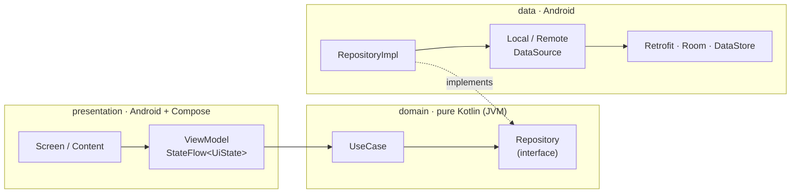
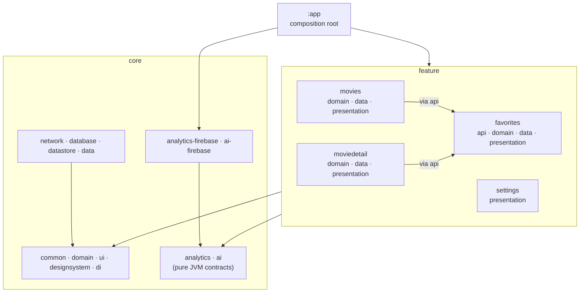

# MyFavoriteFilms

[](https://github.com/FilipeSilva18/my-favorite-film-android/actions/workflows/ci.yml)

An Android movie app built on [The Movie Database (TMDB)](https://www.themoviedb.org) API, used as a reference implementation of modern Android architecture: Jetpack Compose, a multi-module Clean Architecture monorepo, pure Dagger 2, tests at every layer, architecture rules enforced by the build, and documentation ready for both people and AI coding agents.

## Features

| Feature | What it does |
|---|---|
| **Popular movies** | Infinite scrolling grid with Paging 3, skeleton loading, pull-to-refresh and per-page retry |
| **Title search** | Debounced search on the same screen; blank query falls back to popular movies |
| **AI search** | "Search with AI" mode: a free-text description ("90s thriller with great reviews") is turned by Gemini into structured filters for TMDB `discover/movie`. Filters show up as removable chips; on failure it falls back to title search |
| **Movie detail** | Poster, backdrop, metadata and synopsis, plus **server-driven UI** sections: facts, cast carousel, trailers, production companies and links |
| **Favorites** | Toggle from the grid or the detail screen, stored offline with Room, dedicated tab with animated removal |
| **Settings** | Theme (system/light/dark), dynamic color (Android 12+) and per-app language (pt-BR/en) with DataStore |

## Architecture at a glance

Clean Architecture on top of the [official Android architecture guide](https://developer.android.com/topic/architecture), with each layer in its own Gradle module so the compiler enforces the boundaries.



- **Dependency inversion:** the domain is a pure JVM module that owns the repository interfaces; the data layer implements them. Business rules never see Android, Retrofit or Room.
- **Unidirectional data flow:** ViewModels expose `StateFlow` (or `Flow<PagingData>`) and receive events through `onXxx()` functions.
- **One rule per boundary:** ViewModels only talk to use cases; repositories only talk to data sources; data sources talk to exactly one source.

### Module graph

27 Gradle modules: `:app`, 14 `core` modules, 11 feature modules and `:architecture-test`.



- **Features never depend on each other.** The only exception is a feature consumed by others, which publishes a thin `:api` module (`:feature:favorites:api`) with the model and use case interfaces. Consumers depend on that module only.
- **Third-party SDKs live behind JVM contracts.** Features see `Analytics`, `ErrorReporter` and `AiJsonGenerator`; Firebase Analytics, Crashlytics and Gemini are confined to the `-firebase` modules and can be swapped without touching features.
- **`:app` is the composition root.** It is the only module that knows every feature's `data` and `presentation` modules, and it builds the Dagger graph and the navigation host.

## Key decisions

Every decision is recorded as an ADR in [`docs/decisions/`](docs/decisions/README.md). The most important ones:

| Decision | Why |
|---|---|
| [Pure Kotlin domain](docs/decisions/0002-pure-kotlin-domain.md) | Business rules testable on the JVM in milliseconds, independent of frameworks |
| [Three modules per feature](docs/decisions/0003-three-modules-per-feature.md) | Layer boundaries enforced by the compiler instead of code review |
| [Pure Dagger 2, no Hilt](docs/decisions/0009-pure-dagger.md) | Explicit, compile-time verified graph: `AppComponent` plus a `ViewModelComponent` per ViewModel with `SavedStateHandle` |
| [Generic server-driven UI](docs/decisions/0014-generic-server-driven-ui.md) | Model, parser and renderer in `core`; unknown block types are ignored so the backend can evolve ahead of the app |
| [Tracking by multibinding](docs/decisions/0016-tracking-by-multibinding.md) | Analytics destinations plug in through `Set<Tracker>`, dispatched asynchronously on a serialized queue |
| [Feature `api` modules](docs/decisions/0017-feature-api-module.md) | Cross-feature reuse through interfaces without breaking feature isolation |
| [Repositories depend on data sources](docs/decisions/0018-repositories-depend-on-data-sources.md) | Repositories own policy (mapping, errors, caching); data sources own access to a single source |

## AI search without hallucinated movies

The model never returns movies. It returns a JSON object constrained by a fixed schema (structured output, temperature 0) with genre ids, year range, minimum rating and sort order. The data layer validates every field against TMDB's genre list and sane ranges before calling `discover/movie`, so every result is a real TMDB movie. The user's text is sent as data, separate from the system instruction, as a basic prompt-injection defense. Without Firebase configured, a null-object generator makes the app fall back to title search.

## Quality

| Level | Tools |
|---|---|
| Architecture | [module-graph-assert](https://github.com/jraska/modules-graph-assert) for module dependencies and [Konsist](https://docs.konsist.lemonappdev.com) for imports, packages, naming, visibility and mandatory tests ([rules](docs/reference/architecture-rules.md)) |
| Unit and ViewModel | JUnit 4, coroutines-test, Turbine, `paging-testing`, fakes instead of mocks |
| Integration | MockWebServer with real TMDB JSON fixtures; in-memory Room with Robolectric |
| UI | Compose UI tests on the JVM with Robolectric |
| Screenshots | Roborazzi, light and dark themes |
| Dependency graph | Real Dagger graph instantiating every ViewModel |
| End to end | Instrumented navigation tests with AndroidX Test Orchestrator |
| Coverage | Kover, aggregated across modules |

GitHub Actions runs the documentation check, module graph rules, Konsist, every JVM test, screenshot verification, lint and coverage on each push and pull request, and the instrumented suite on an emulator.

## Tech stack

Kotlin 2.4 · Jetpack Compose (BOM 2026.09) · Material 3 · Navigation Compose (type-safe) · Dagger 2.60 with KSP · Retrofit 3 · OkHttp 5 · kotlinx.serialization · Paging 3 · Room 2.8 · DataStore · Coil 3 · Coroutines and Flow · Firebase (Analytics, Crashlytics, AI Logic, App Check) · Gradle 9.6 with AGP 9.4 and convention plugins · minSdk 26, targetSdk 37

## Getting started

Requirements: Android Studio (latest stable) and JDK 21.

1. Create a TMDB account and generate an **API Read Access Token**.
2. Add it to `local.properties` (ignored by Git):
   ```properties
   TMDB_ACCESS_TOKEN=your_token
   ```
3. Optional: add `app/google-services.json` from your own Firebase project to enable analytics and AI search. Without it the app still runs, and AI search falls back to title search.
4. Install the git hook that blocks secrets from being committed:
   ```bash
   ./scripts/install-git-hooks.sh
   ```
5. Build and verify:
   ```bash
   ./gradlew :app:assembleDebug
   ./scripts/verify.sh
   ```

## Repository layout

```
app/                  Composition root: Dagger components, navigation host, bottom bar
core/                 Shared infrastructure and cross-cutting rules (14 modules)
feature/              movies, moviedetail, favorites (with api), settings
build-logic/          Gradle convention plugins (movies.*)
architecture-test/    Konsist architecture rules
docs/                 Tutorials, how-to guides, reference, explanation and ADRs
.agents/skills/       AI agent skills (open Agent Skills format)
scripts/              Verification scripts and git hooks
ARCHITECTURE.md       Full architecture document with contracts and code
AGENTS.md             Instructions for AI coding agents
```

## Documentation

| Start here | |
|---|---|
| [Onboarding](docs/tutorials/onboarding.md) | From clone to first pull request |
| [Architecture diagrams](docs/explanation/architecture.md) | Layers, modules, DI graph and main flows |
| [ARCHITECTURE.md](ARCHITECTURE.md) | The complete document, with contracts and code |
| [How-to guides](docs/README.md) | New feature, new TMDB endpoint, new server-driven block, new analytics event, tests, ADRs |
| [Module reference](docs/reference/modules.md) | Every module and what it owns |

## Working with AI agents

The repository follows open, vendor-neutral standards so any coding assistant can work in it:

- [`AGENTS.md`](AGENTS.md) at the root and per area: project map, commands, non-negotiable rules and definition of done.
- [`.agents/skills/`](.agents/skills): seven skills in the open [Agent Skills](https://agentskills.io) format covering a feature's lifecycle, from the data layer to UI, tests, architecture review and documentation.
- Architecture rules are executable, so an agent gets immediate feedback when it drifts from the patterns.

More in [AI agents in this repository](docs/explanation/ai-agents.md).

## Attribution

This product uses the TMDB API but is not endorsed or certified by TMDB.
