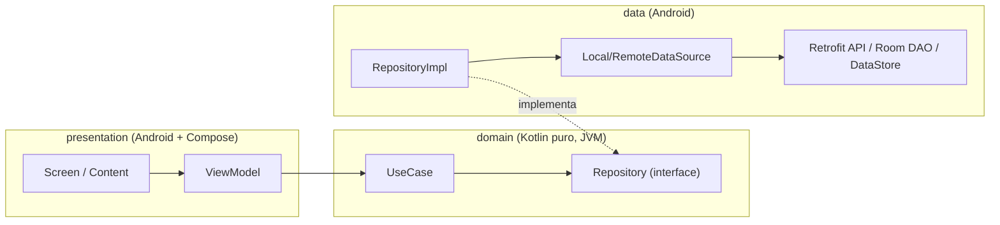
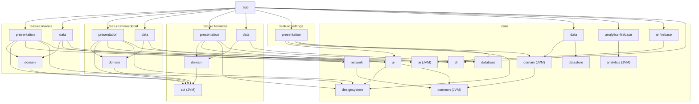
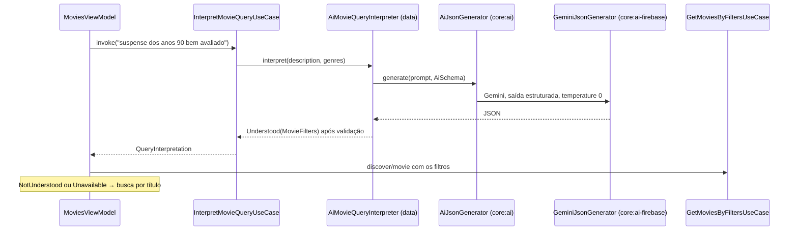

# Arquitetura em diagramas

Visão de alto nível. Os contratos e o código estão no [ARCHITECTURE.md](../../ARCHITECTURE.md); as decisões, em [decisions/](../decisions/README.md).

## Camadas

- **Dependency Inversion (ADR-0002):** o `domain` define `Repository`; o `data` implementa. A seta de dependência aponta para o domínio.
- **ViewModel só com use cases (ADR-0004).** Repositório só com data sources (ADR-0018).
- **UDF:** o ViewModel expõe `StateFlow<UiState>` (ou `Flow<PagingData>`); a tela envia eventos por funções `onXxx()`.

## Grafo de módulos

Simplificado: as dependências de `core:common`, `core:analytics` e `core:testing` não estão todas desenhadas. A fonte da verdade são os `build.gradle.kts` e as regras do `moduleGraphAssert` no build raiz ([referência](../reference/architecture-rules.md)).

**Leitura do grafo:**
- Nenhuma seta entre features, exceto para `favorites:api` (ADR-0005 e ADR-0017).
- Nenhuma seta de `core` para `feature`.
- Firebase só nos módulos `-firebase`; as features veem `analytics` e `ai` (contratos JVM).
- O `:app` é o único que conhece `data` e `presentation` de todas as features (composition root).

## Grafo de DI (Dagger puro)

## Fluxo: lista paginada

## Fluxo: busca com IA

## Fluxo: erros

`CancellationException` sempre é relançada. Só `DomainError.Server` e `Unknown` viram não fatais no Crashlytics.

## Por que este desenho

| Escolha | Ganho | Custo aceito |
|---|---|---|
| Módulo por camada e por feature | O compilador e o grafo garantem as fronteiras | Mais módulos (convention plugins reduzem o boilerplate) |
| Dagger puro | Grafo explícito, erros em compilação | `api(...)` extras para o KSP do `:app` |
| Contratos JVM para SDKs | Trocar fornecedor sem tocar features; testes sem SDK | Uma camada de indireção |
| Regras como testes (Konsist + module-graph-assert) | Documentação executável; agentes e pessoas recebem feedback imediato | Testes a manter quando uma ADR muda |
