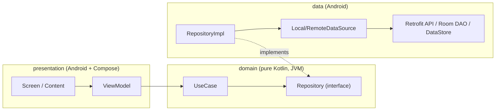
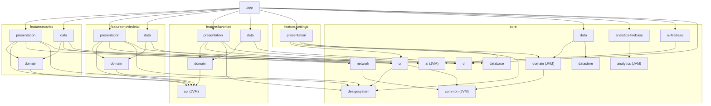
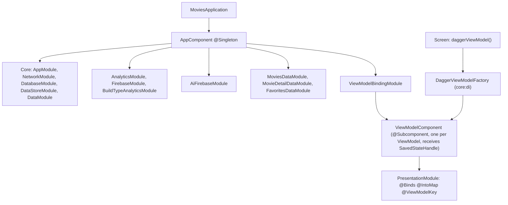
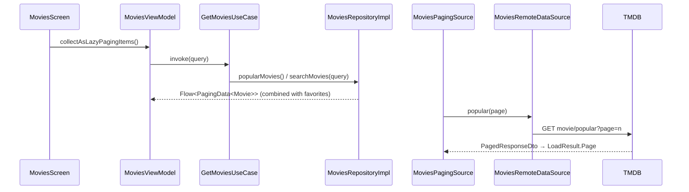
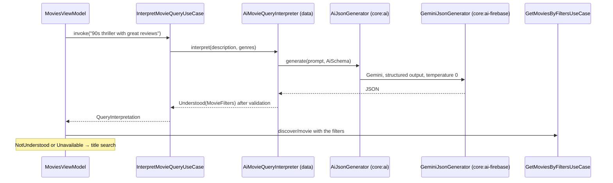
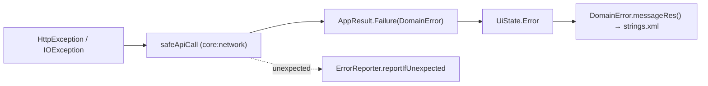

# Architecture in diagrams

High-level view. Contracts and code are in [ARCHITECTURE.md](../../ARCHITECTURE.md); decisions are in [decisions/](../decisions/README.md).

## Layers

- **Dependency inversion (ADR-0002):** `domain` defines `Repository`; `data` implements it. The dependency arrow points to the domain.
- **ViewModels only use use cases (ADR-0004).** Repositories only use data sources (ADR-0018).
- **UDF:** the ViewModel exposes `StateFlow<UiState>` (or `Flow<PagingData>`); the screen sends events through `onXxx()` functions.

## Module graph

Simplified: not every dependency on `core:common`, `core:analytics` and `core:testing` is drawn. The source of truth is the `build.gradle.kts` files and the `moduleGraphAssert` rules in the root build ([reference](../reference/architecture-rules.md)).

**Reading the graph:**
- No arrow between features, except to `favorites:api` (ADR-0005 and ADR-0017).
- No arrow from `core` to `feature`.
- Firebase only in the `-firebase` modules; features see `analytics` and `ai` (JVM contracts).
- `:app` is the only module that knows every feature's `data` and `presentation` (composition root).

## DI graph (pure Dagger)

## Flow: paged list

## Flow: AI search

## Flow: errors

`CancellationException` is always rethrown. Only `DomainError.Server` and `Unknown` become non-fatal reports in Crashlytics.

## Why this design

| Choice | Gain | Accepted cost |
|---|---|---|
| Module per layer and per feature | The compiler and the graph enforce the boundaries | More modules (convention plugins reduce the boilerplate) |
| Pure Dagger | Explicit graph, compile-time errors | Extra `api(...)` dependencies for `:app`'s KSP |
| JVM contracts for SDKs | Swap vendors without touching features; tests without the SDK | One layer of indirection |
| Rules as tests (Konsist + module-graph-assert) | Executable documentation; agents and people get immediate feedback | Tests to maintain when an ADR changes |
